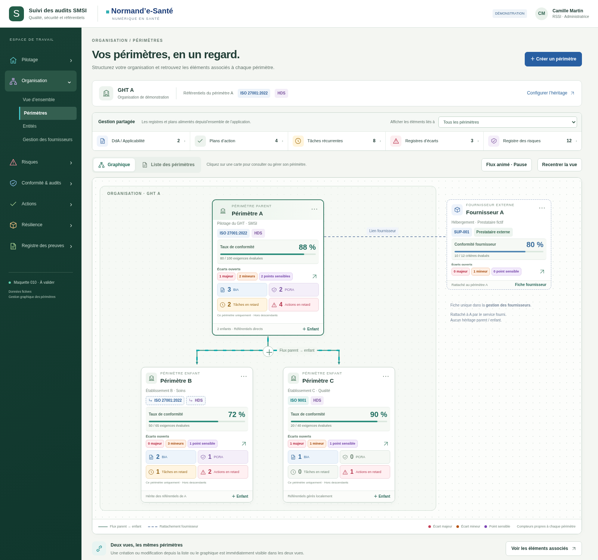
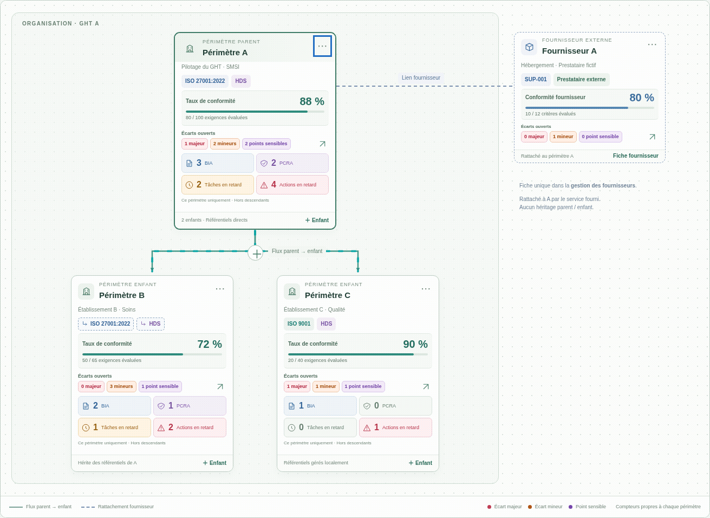

# 010 · v006 — Écarts colorés et dashboard compact

**À valider · 19 octobre 2026 · Données fictives.** Deux PNG et un GIF. Aucun ZIP/BAT ni raccordement backend.

- Majeurs : rouge `#B4233C` sur fond `#FFEDEF`.
- Mineurs : orange foncé `#A34608` sur fond `#FFF0E5`.
- Points sensibles : violet `#7040A6` sur fond `#F3EBFC`.

La section **« Écarts ouverts »** est placée immédiatement sous le taux de conformité et avant les tuiles BIA/PCRA/retards. Les trois catégories portent un libellé et un nombre ; la couleur n’est pas le seul repère. Elles sont reprises sur les cartes, dans la fenêtre de détail et dans la légende. Les tuiles BIA/PCRA/retards passent à 36 px de hauteur minimale, avec icône, nombre et libellé alignés.

**Dimensions contrôlées au même viewport :** cartes de périmètre toujours larges de 300 px, mais **12 px moins hautes** ; carte fournisseur également réduite à 280 × 241 px. Aucun débordement des badges. Les flux animés, les fenêtres centrales et la réciprocité liste/graphique sont conservés.

## Cartes compactes et trois catégories d’écarts

[Ouvrir](visuels/01-cartes-compactes-ecarts.png)

## Détail des écarts du périmètre

[Ouvrir](visuels/02-detail-ecarts.png)

## Flux animé avec les cartes compactes

[Ouvrir](visuels/03-flux-cartes-compactes.gif)

[Rapport des contrôles](technique/verification.json) · [Source du contrôle](technique/verifier.cjs) · [Spécification préparatoire](../../implementation/PERIMETRES-GRAPHIQUES.md).

Pour reproduire le contrôle de dimensions, servir le dossier parent `maquettes/` sur le port local 18778 : le test ouvre v005 puis v006 à viewport identique. Les données sont simulées et réinitialisées au rechargement. La recette backend et la validation visuelle utilisateur restent à effectuer. Aucun marqueur local « implémentation ok » trouvé ; aucun changement d’étape.
