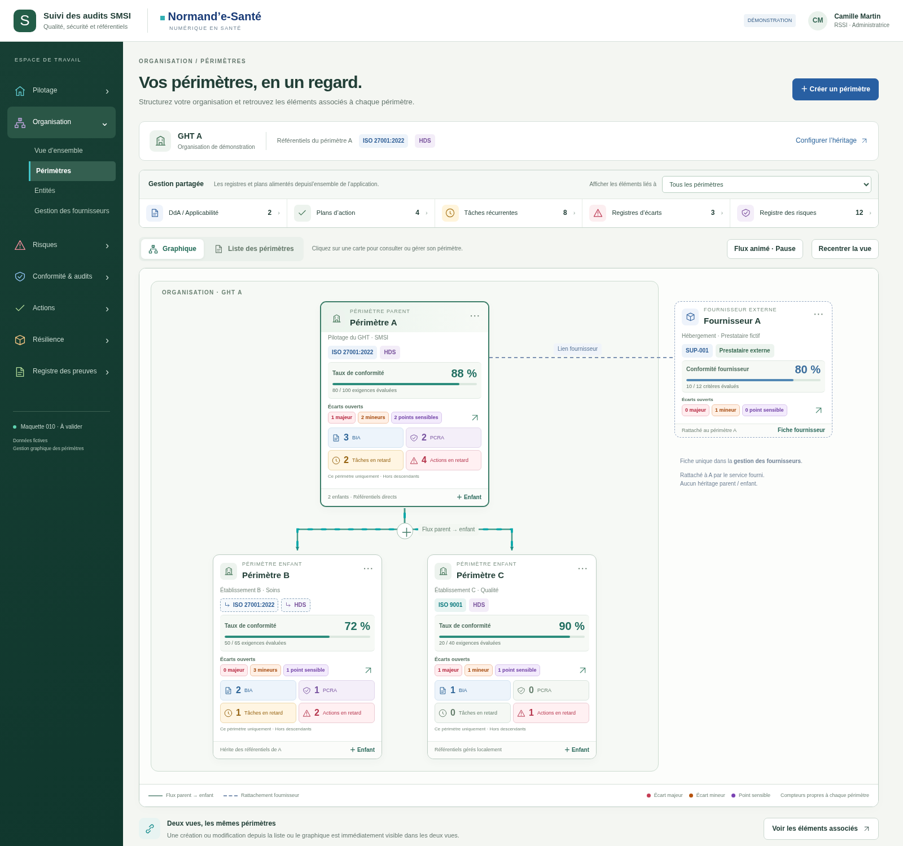
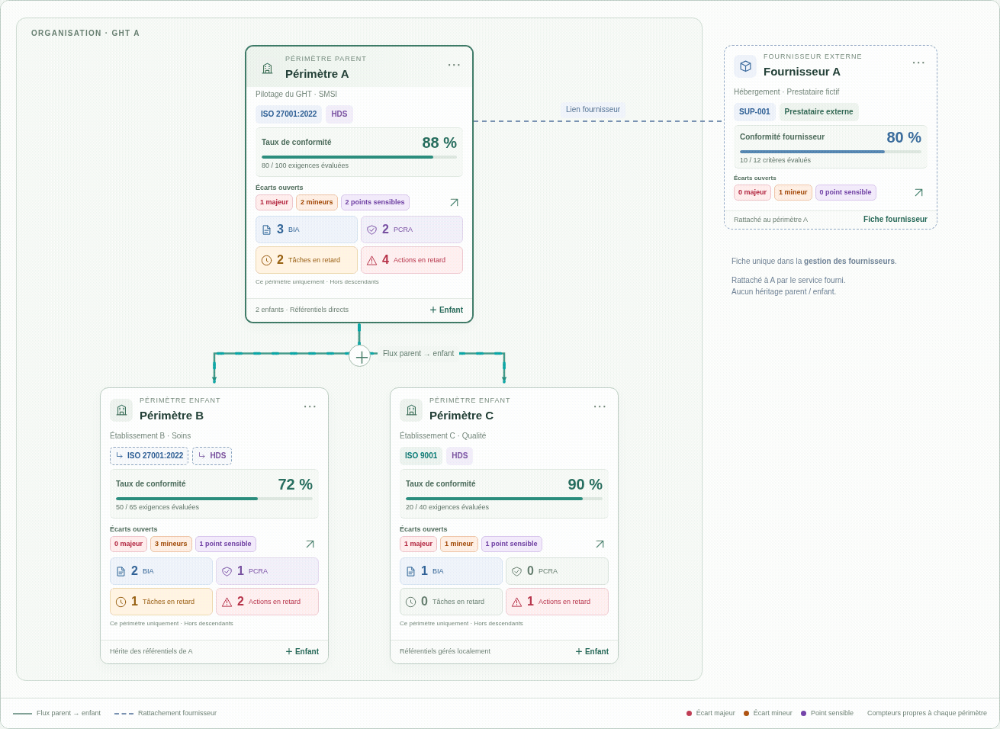

> Édition du 21 octobre 2026 : lire le [dossier courant](../../implementation/DOSSIER-IMPLEMENTATION.md). Les contrôles de capture ci-dessous restent historiques.

# 010 · v007 — Fond uni

**Référence de transmission approuvée · Données fictives.** Le fond à petits points est remplacé par une surface unie `#FCFDFB`. La disposition, les écarts sous la conformité, les tuiles compactes et le flux parent/enfant sont conservés.

## Aperçu

## Animation

Contrôle de rendu : `background-image: none`, fond `rgb(252, 253, 251)`, aucune erreur JavaScript pendant la capture. Aucun nouveau test fonctionnel ni intégration backend pour cette modification CSS. [Résultat du contrôle](verification.json).

Un PNG et un GIF, sans ZIP/BAT. Le dossier est classé à implémenter ; aucun marqueur local « implémentation ok » trouvé.
