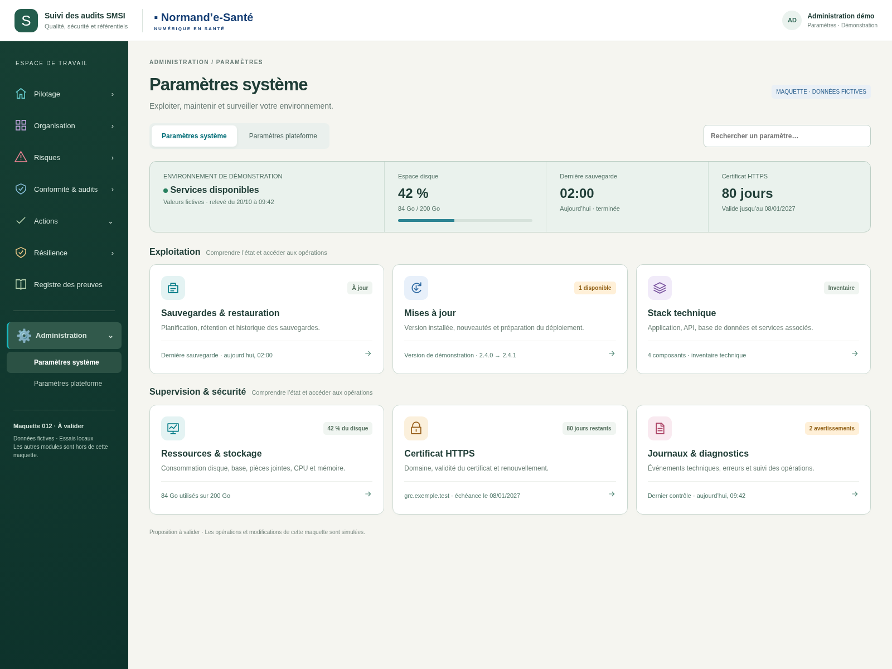
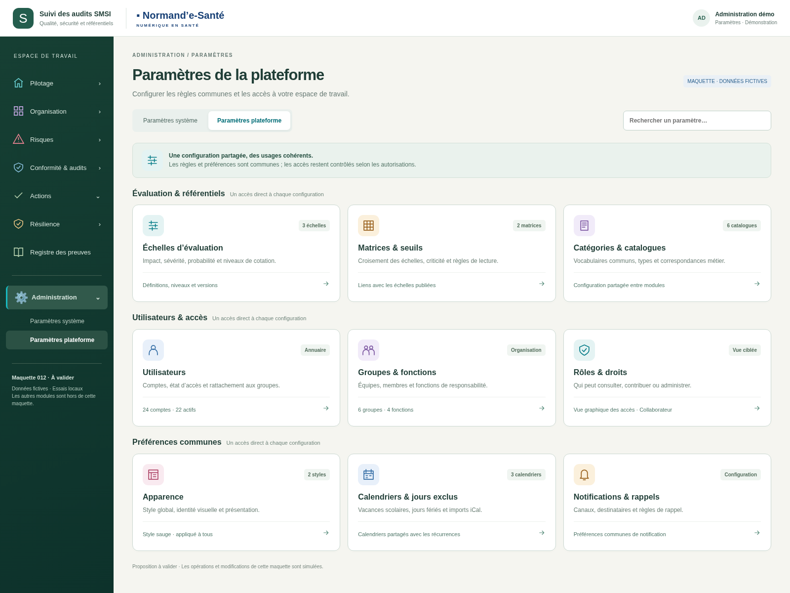
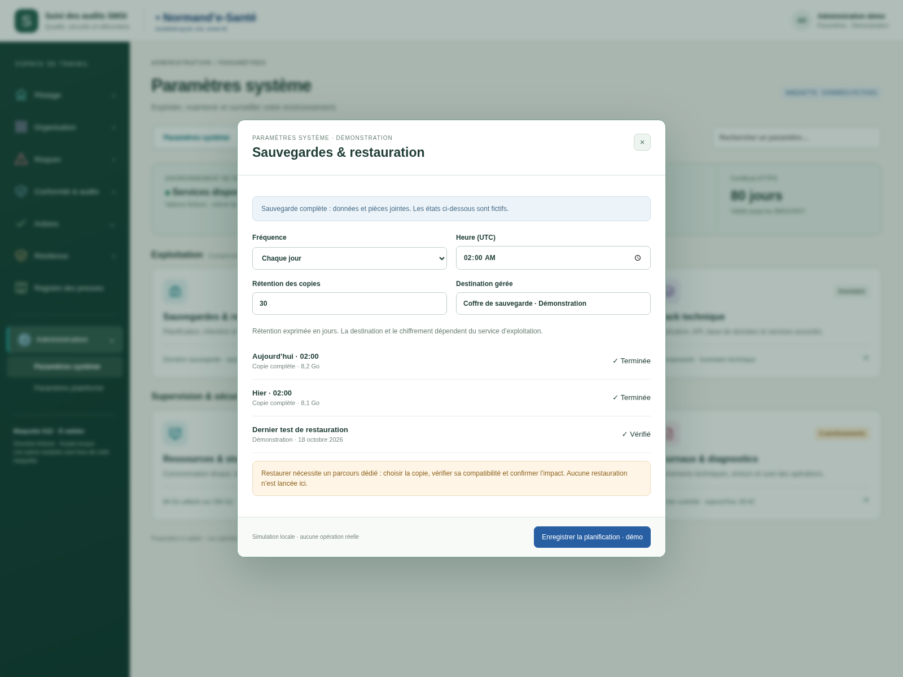
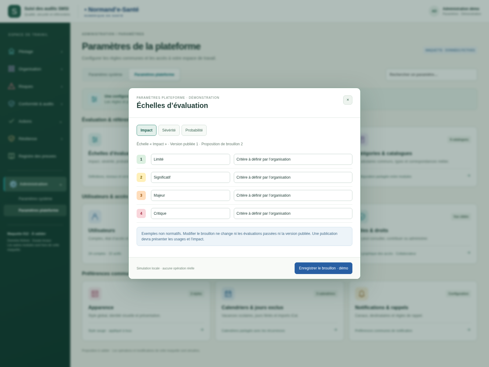
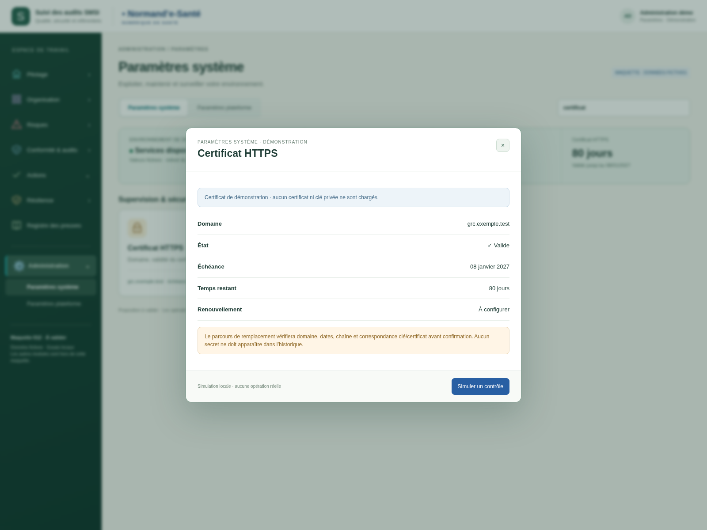
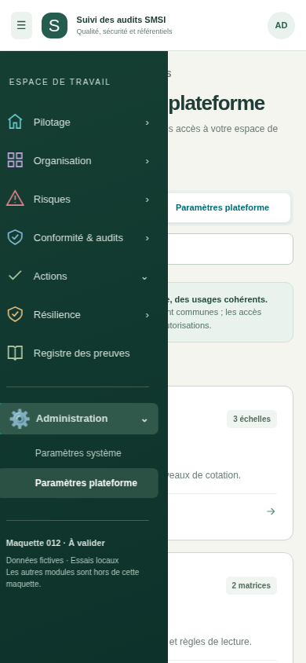

# Deux espaces de paramètres — v002

Proposition du 20 octobre 2026, **à valider**. Deux entrées du menu Administration et deux pages à cartes, dans le style 08. Les valeurs, comptes, versions et états sont fictifs.

- **Système** : sauvegardes/restauration, mises à jour, stack technique, ressources/stockage, certificat HTTPS, journaux/diagnostics.
- **Plateforme** : échelles, matrices/seuils, catalogues, utilisateurs, groupes/fonctions, rôles/droits, apparence, calendriers et notifications.

Les cartes sont regroupées par thème ; la recherche réduit la liste. Elles ouvrent un panneau central. La carte des droits rejoint la maquette 022 existante. Les autres modules du menu sont hors périmètre.

Ouvrir `index.html` avec ses fichiers voisins pour tester les deux pages. Les brouillons d’échelle, la planification et le choix de style sont conservés uniquement en mémoire, puis réinitialisés au rechargement. Les autres panneaux illustrent leurs informations et parcours ; ils ne fournissent pas encore une gestion complète. Aucune sauvegarde, restauration, mise à jour, opération TLS, import iCal ou notification réelle n’est exécutée.

[Spécifications et correspondances avec l’existant](../../implementation/PARAMETRES-SYSTEME-PLATEFORME.md) · [19 contrôles locaux](technique/verification.json).

## Paramètres système

## Paramètres de la plateforme

## Sauvegardes et restauration

## Échelles d’évaluation

## Certificat HTTPS

## Vue mobile

