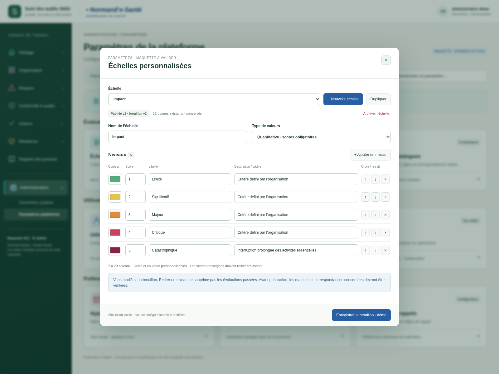
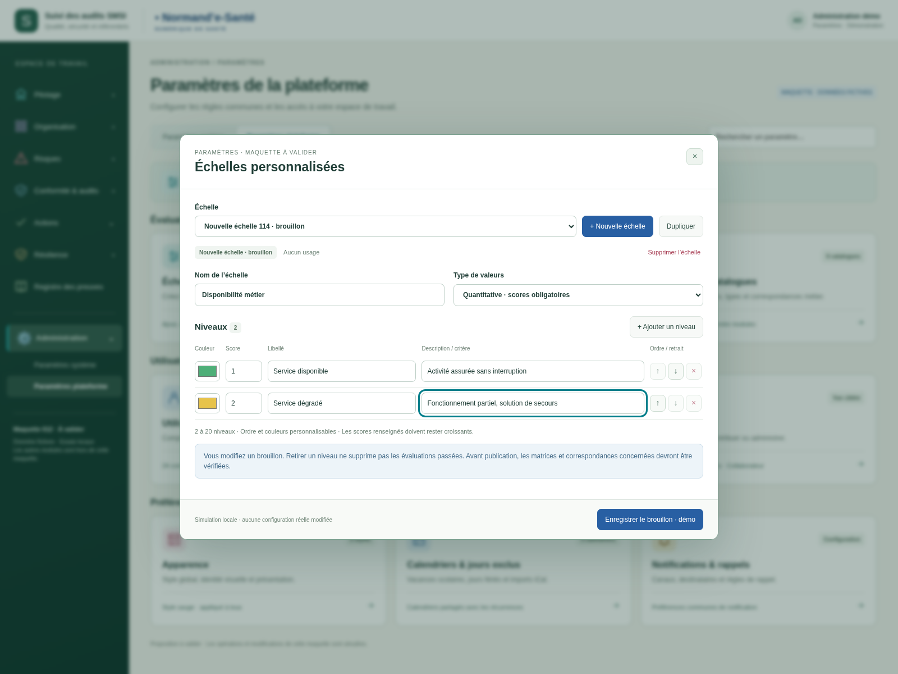
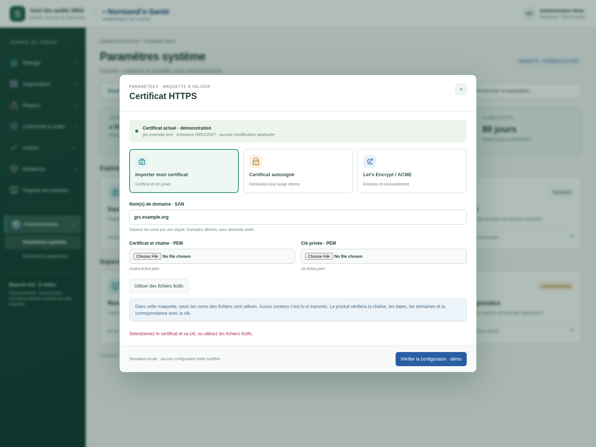
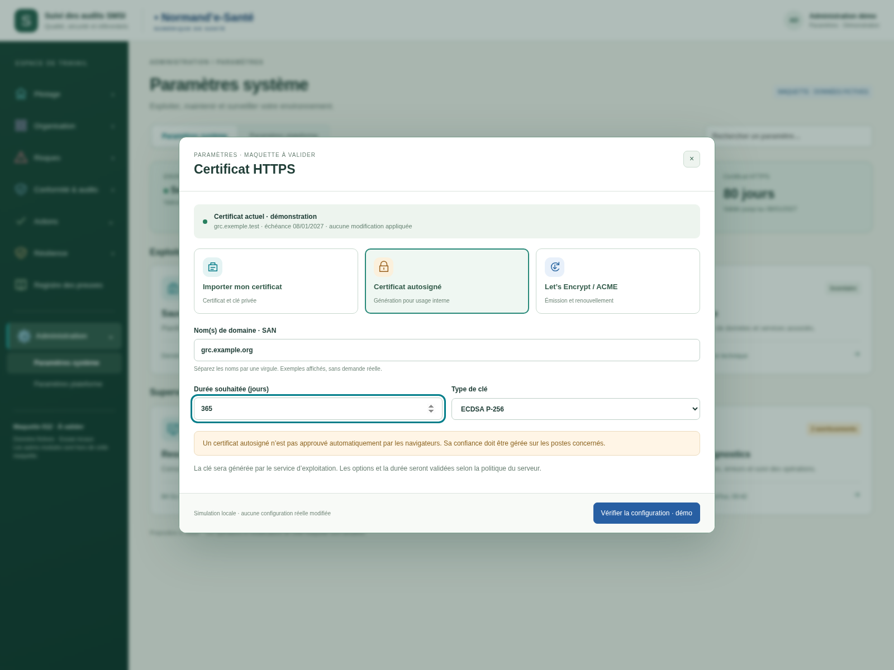
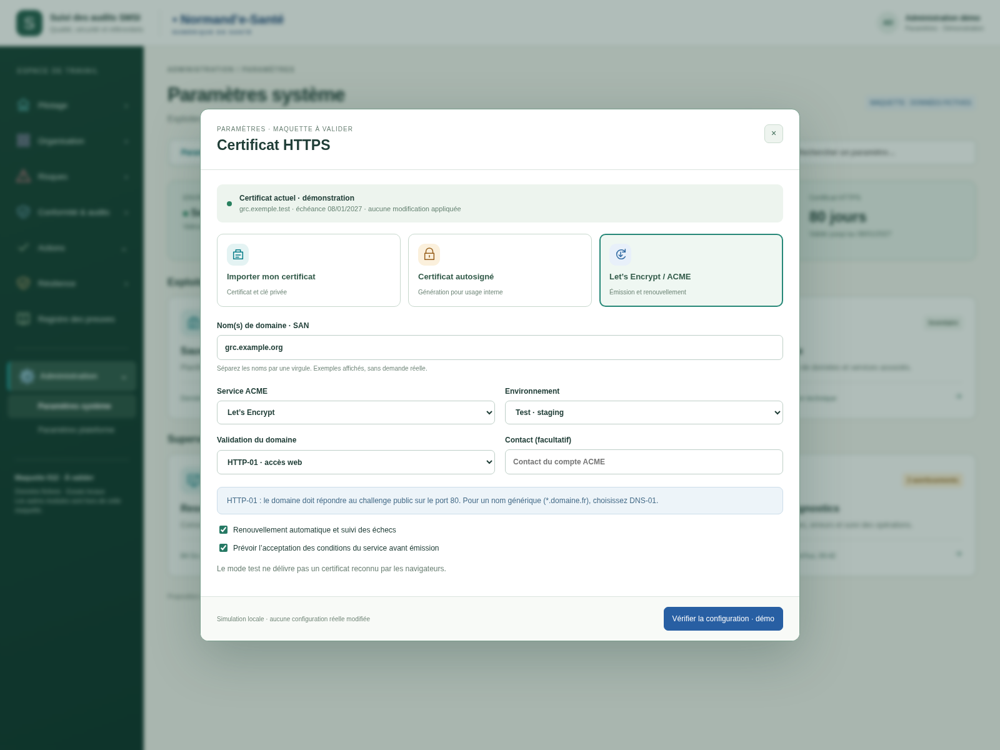
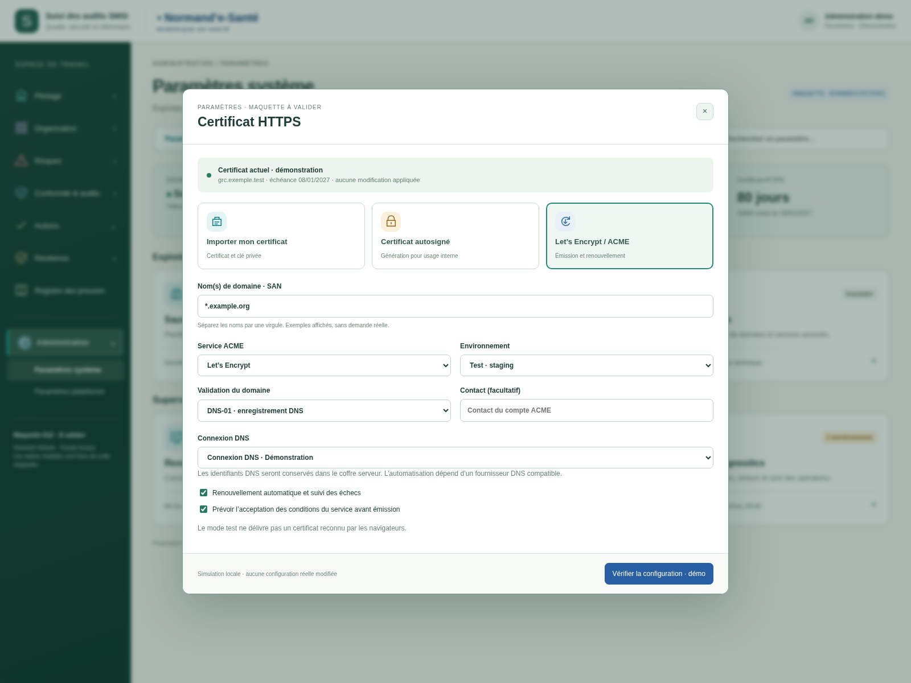

# Échelles personnalisées et certificats — v003

Proposition du 20 octobre 2026, **à valider**. Cette version reprend les deux pages à cartes de v002 et complète les échelles et les certificats.

## Échelles

Créer ou dupliquer une échelle ; modifier son nom et sa nature quantitative, qualitative ou hybride ; ajouter, retirer et déplacer les niveaux ; personnaliser leurs scores, couleurs, libellés et descriptions/critères. La plage de 2 à 20 niveaux reprend le contrat métier consulté, sans limite arbitraire à quatre niveaux.

Un brouillon jamais publié peut être supprimé après confirmation. Une échelle publiée est archivée pour conserver ses usages. Les changements des niveaux restent dans le brouillon : les versions publiées et évaluations passées ne sont pas réécrites. La publication et l’étude d’impact ne sont pas exécutées par cette maquette.

## Certificats : trois choix

- **Importer mon certificat** : certificat/chaîne PEM et clé privée, avec un jeu fictif pour essayer.
- **Certificat autosigné** : noms DNS, durée souhaitée et type de clé.
- **Let’s Encrypt / ACME** : service, staging/production, HTTP-01 ou DNS-01, contact et renouvellement automatique ; autre annuaire ACME possible.

Les fichiers sélectionnés ne sont ni lus ni envoyés : seuls leurs noms sont utilisés. Aucun certificat n’est réellement contrôlé, émis, généré ou installé ; aucun compte ACME ni secret DNS n’est créé. Le panneau donne un aperçu du futur parcours. Les noms DNS de démonstration ne prouvent pas leur propriété.

Ouvrir `index.html` avec ses fichiers voisins. Toutes les modifications restent en mémoire et disparaissent au rechargement. La saisie d’une échelle est conservée pendant les manipulations du brouillon ; « Enregistrer » valide sa cohérence locale, sans appel serveur.

[Spécifications courantes](../../implementation/PARAMETRES-SYSTEME-PLATEFORME.md) · [39 contrôles exécutés](technique/verification.json). Les règles ACME illustrées s’appuient sur les [types de challenge](https://letsencrypt.org/docs/challenge-types/) et l’[environnement de test](https://letsencrypt.org/docs/staging-environment/) officiels.

## Échelle personnalisée : ajout et retrait de niveaux

## Création d’une échelle métier

## Importer son propre certificat

## Générer un certificat autosigné

## Let’s Encrypt / ACME : validation HTTP

## ACME : validation DNS et domaine générique

