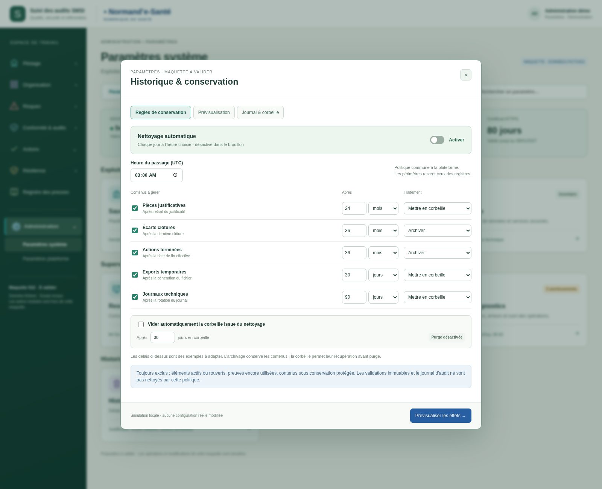
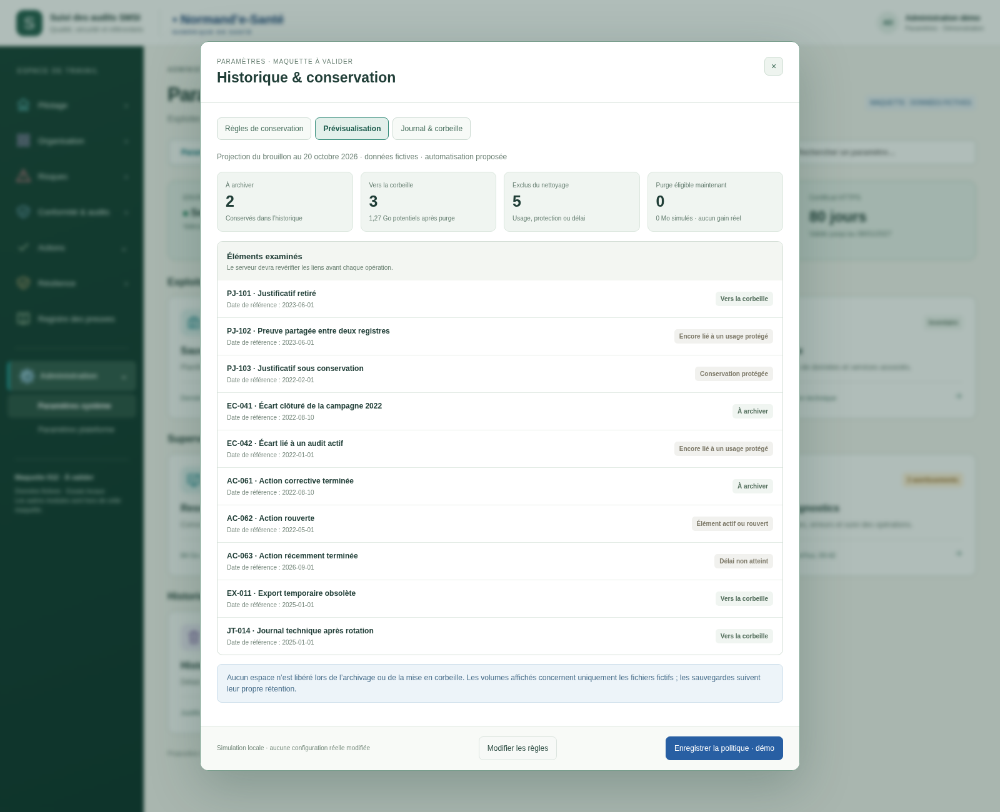
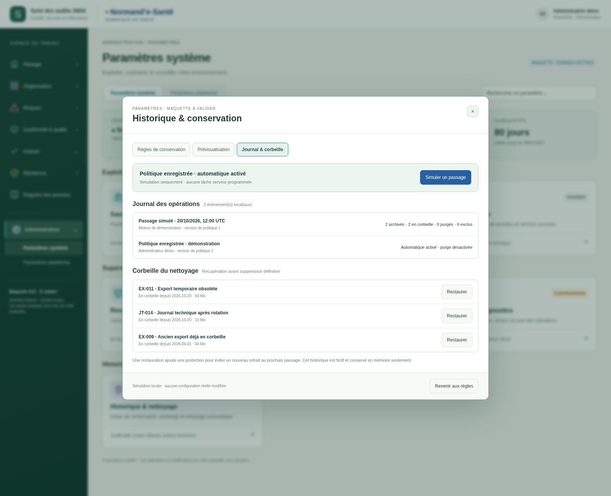
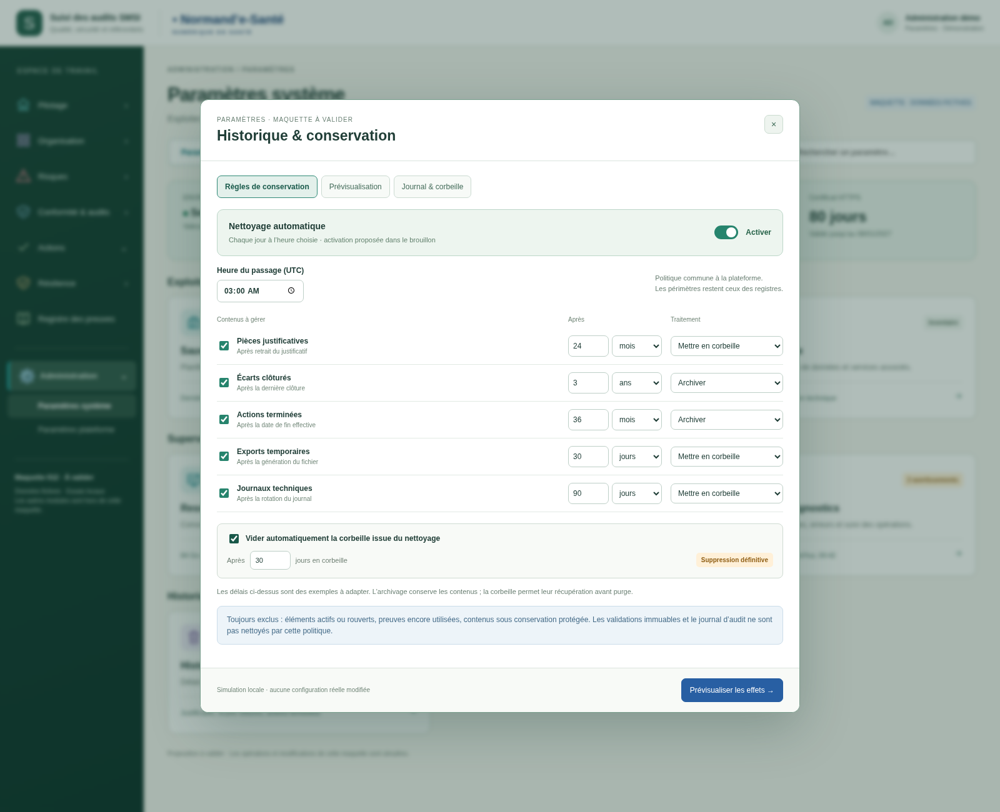

# Historique et conservation — v004

Proposition à valider du 20 octobre 2026. Nouvelle carte **Historique & nettoyage** dans les paramètres système. Les deux pages, échelles personnalisées et trois modes de certificat de v003 sont conservés.

- Activation globale du nettoyage automatique et activation indépendante par catégorie.
- Délais en jours, mois ou années pour les justificatifs retirés, écarts clôturés, actions terminées, exports temporaires et journaux techniques après rotation.
- Choix entre archivage et corbeille ; purge définitive optionnelle après un délai de récupération.
- Prévisualisation calculée sur des données fictives, avec motifs d’exclusion et volumes potentiels.
- Confirmation de la politique, simulation de passages, journal local et restauration depuis la corbeille.

**Aucune automatisation réelle.** Nettoyage et purge sont désactivés au départ. Les durées proposées sont des exemples, pas des obligations de conservation. Les éléments protégés, utilisés ou rouverts sont exclus ; le journal d’audit et les validations immuables sont hors de cette politique.

Ouvrir `index.html` avec ses fichiers voisins. Choisir Historique & nettoyage, régler les catégories et prévisualiser. Confirmer la politique locale puis utiliser « Simuler un passage » dans Journal & corbeille. Le bouton de simulation est indisponible si la politique enregistrée est désactivée. Fermer le panneau conserve son brouillon local ; recharger la page réinitialise toute la démonstration.

Archiver ou mettre en corbeille ne libère pas les fichiers. Les volumes sont fictifs et les gains de performance ne sont pas mesurés. Aucun objet métier, fichier, journal ou sauvegarde réel n’est modifié.

[Spécifications courantes](../../implementation/PARAMETRES-SYSTEME-PLATEFORME.md) · [39 contrôles exécutés](technique/verification.json).

## Règles et délais de conservation

## Prévisualisation des éléments et exclusions

## Journal des passages et récupération depuis la corbeille

## Purge automatique optionnelle après délai de récupération

