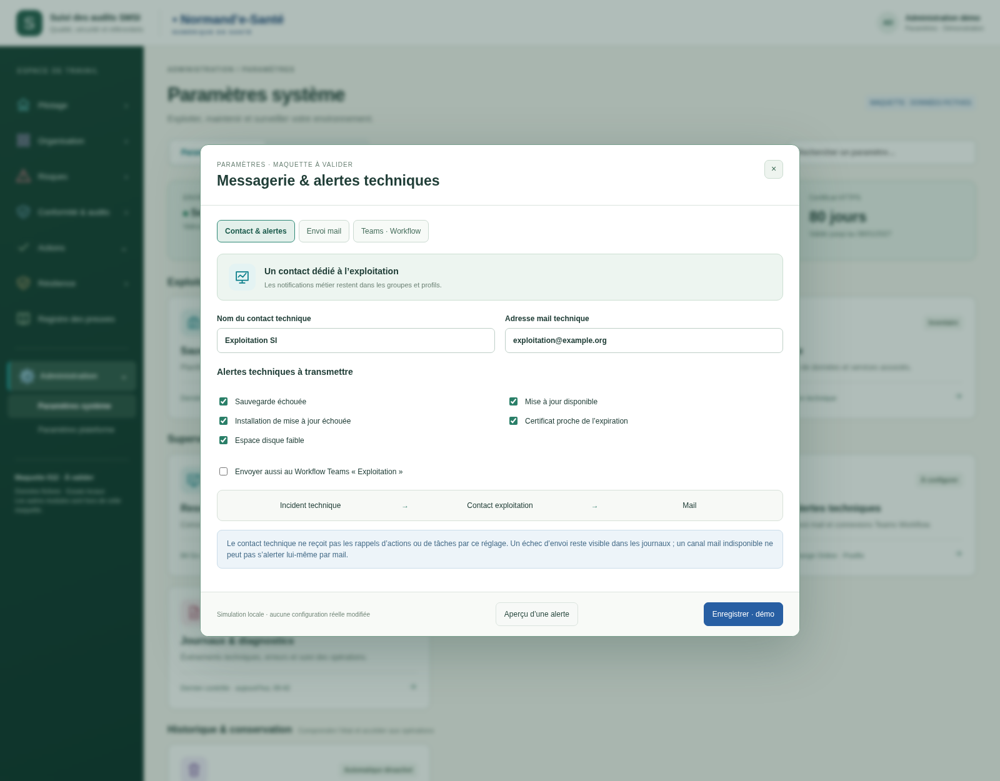
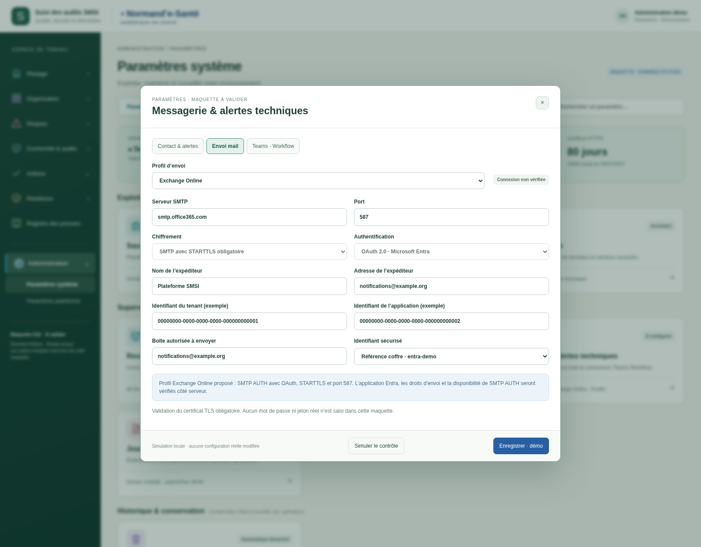
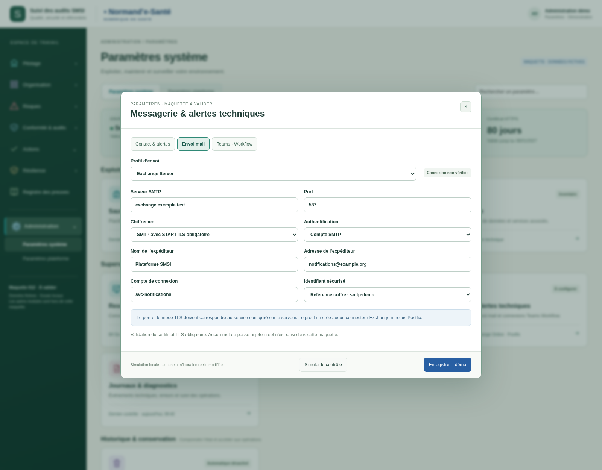
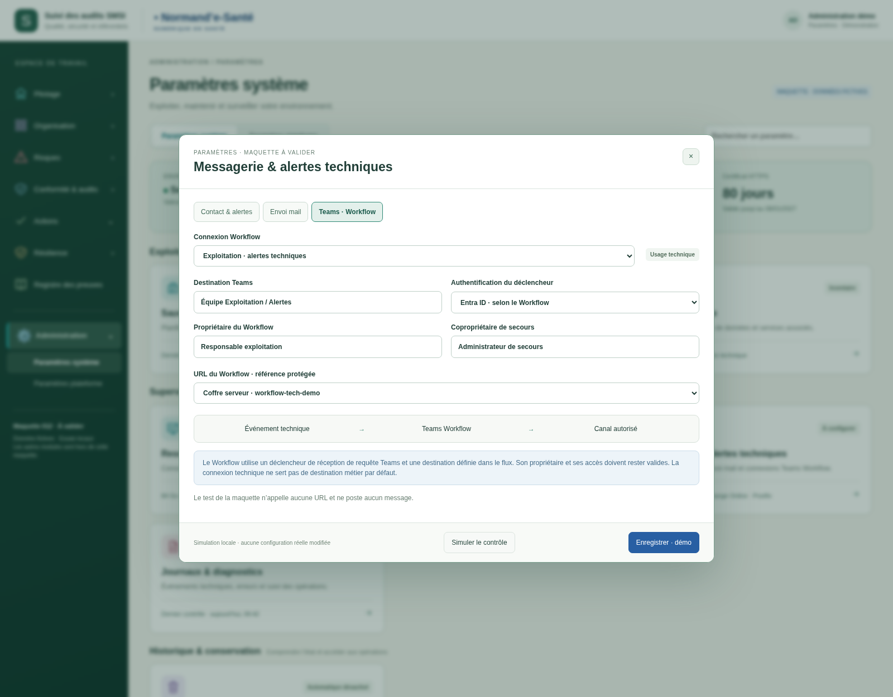
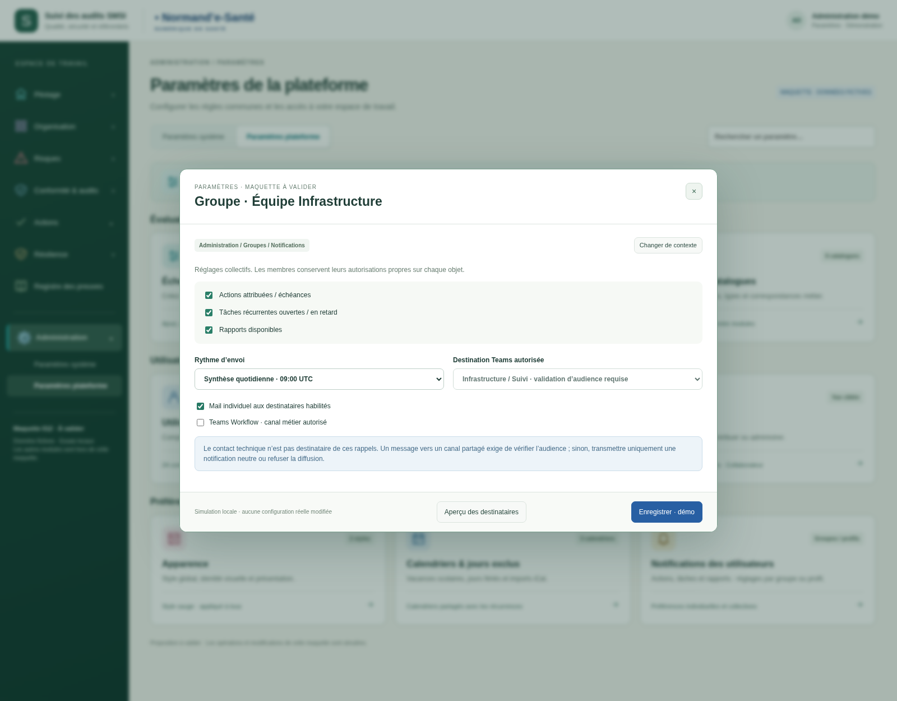
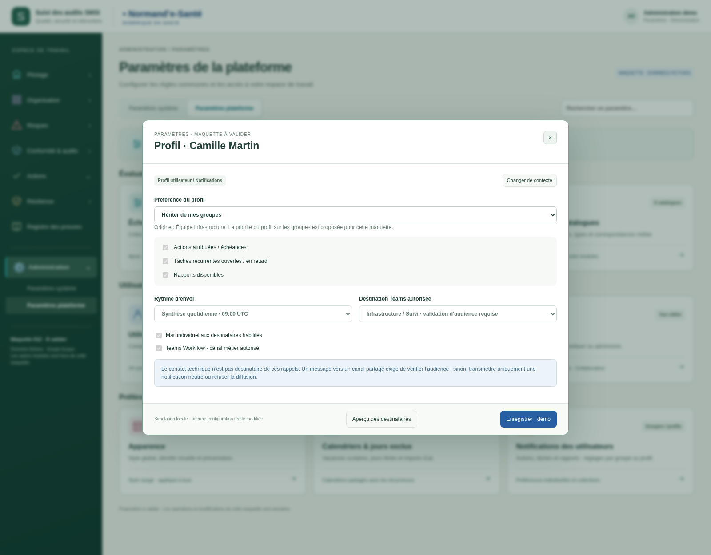
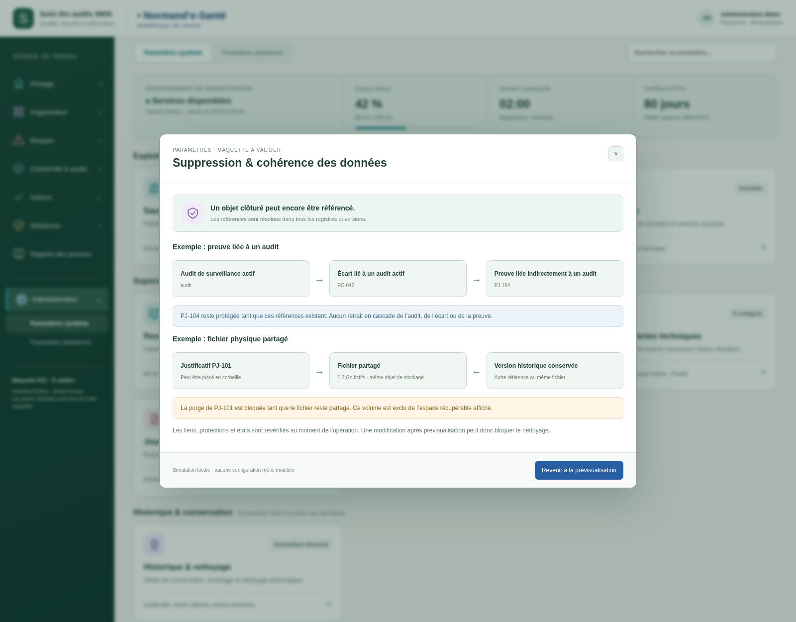

# Notifications et cohérence des suppressions — v005

Proposition du 20 octobre 2026, **à valider**. Cette version conserve les pages de paramètres, les échelles, les trois modes de certificat et la gestion de conservation.

## Notifications

**Paramètres système → Messagerie & alertes techniques** : contact technique pour les sauvegardes échouées, mises à jour et autres alertes d’exploitation ; profils d’envoi Exchange Online, Exchange Server sur site, Postfix ou autre SMTP ; connexions Teams via Workflow.

**Groupes et profils → Notifications** : événements métier (actions, tâches, rapports), canaux et fréquence. La carte plateforme oriente vers ces deux contextes et les fiches Utilisateurs/Groupes comportent un accès direct. Le contact technique n’est pas ajouté aux rappels métier. Une personne peut naturellement être destinataire à un autre titre, via ses préférences et autorisations métier.

La priorité du profil personnalisé sur les réglages de groupe est une proposition à valider. Le mode hérité suit le groupe ; le mode désactivé coupe les notifications métier de ce profil. La maquette illustre un groupe et deux profils fictifs. Les préférences ne donnent aucun droit supplémentaire et l’aperçu exclut un membre sans accès à l’objet d’exemple.

## Cohérence du nettoyage

La prévisualisation comporte un accès aux dépendances : audit → écart → preuve, ainsi qu’un fichier partagé avec une version historique. Les références directes/indirectes et les cycles sont examinés dans le jeu fictif. Un parent avec des éléments rattachés ne passe pas automatiquement en corbeille ; une preuve encore référencée et un fichier partagé restent protégés. Les octets partagés sont exclus de l’estimation récupérable.

## Essayer

Ouvrir `index.html` avec ses fichiers voisins. Choisir la carte de messagerie, puis les onglets Contact, Envoi mail et Teams. Les boutons de contrôle simulent une validation de formulaire : aucun serveur contacté et aucun message envoyé. Les champs protégés utilisent uniquement des références de coffre fictives.

Les préférences et brouillons restent en mémoire et disparaissent au rechargement. Les boutons Enregistrer ne publient aucune configuration réelle. Dans Historique & nettoyage, ouvrir Prévisualisation puis « Voir les dépendances et fichiers partagés ».

[Spécifications et sources techniques](../../implementation/PARAMETRES-SYSTEME-PLATEFORME.md) · [44 contrôles exécutés](technique/verification.json). Aucune connexion SMTP, session OAuth, invocation de Workflow, modification Claude ou suppression réelle.

## Contact et alertes techniques

## Envoi mail : Exchange Online

## Envoi mail : Exchange Server sur site

## Envoi mail : Postfix / SMTPS

## Teams via Workflow

## Notifications du groupe

## Notifications du profil utilisateur

## Cohérence des suppressions et fichiers partagés

