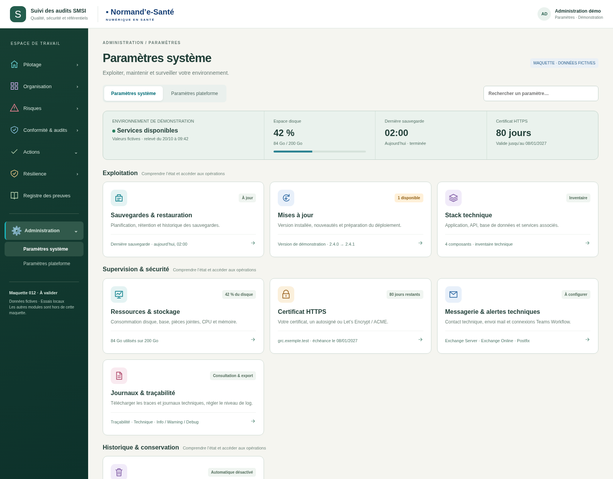
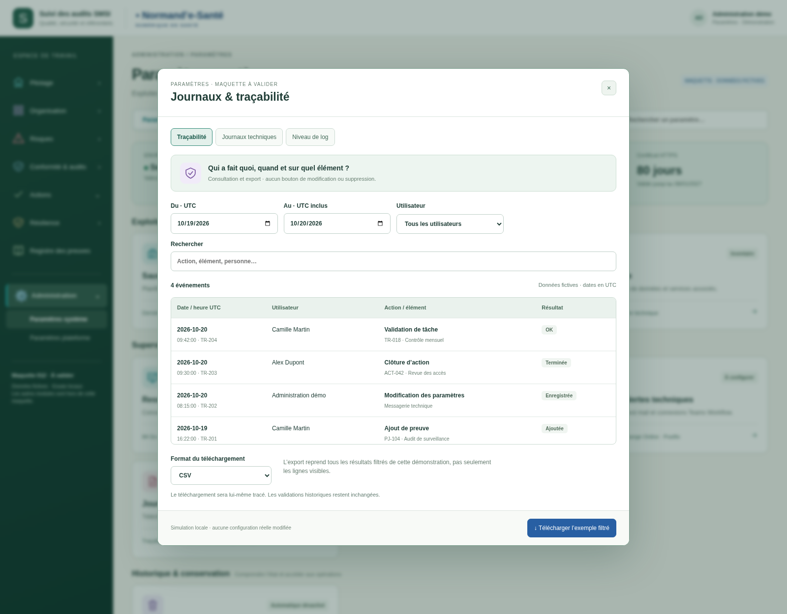
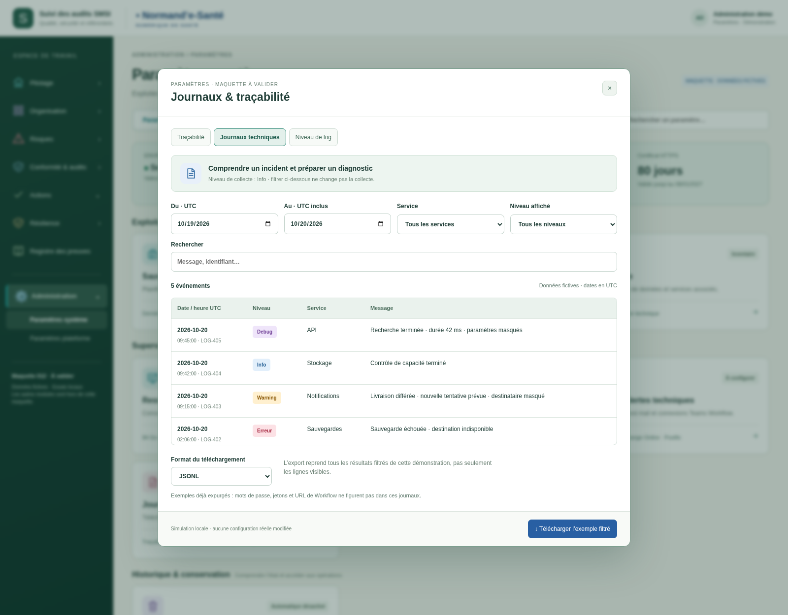
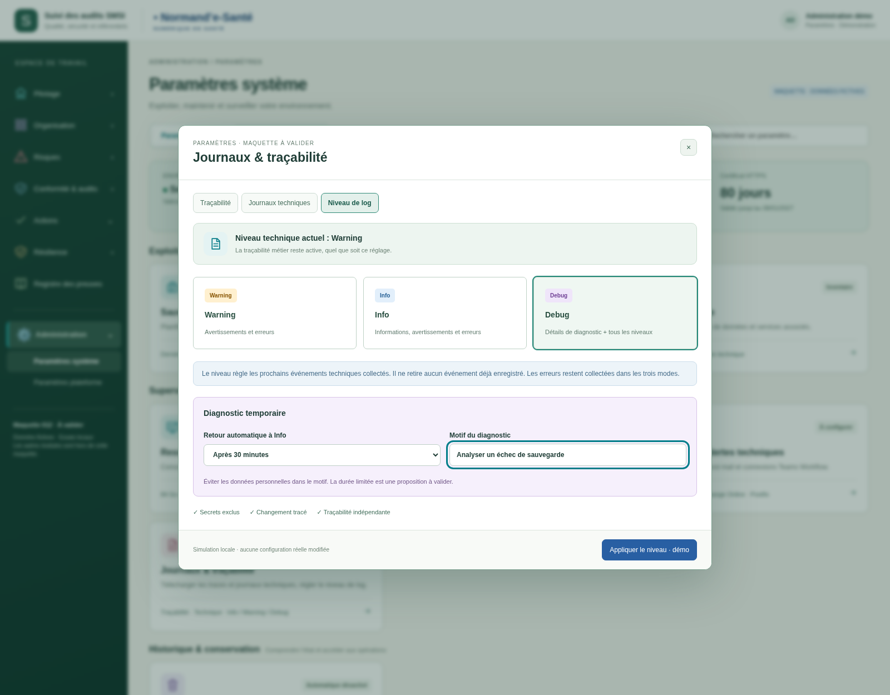

# Journaux, téléchargement et niveau de log — v006

Proposition du 20 octobre 2026, **à valider**. Direction graphique 08 conservée : fond sauge clair, menu fixe et fenêtre centrale.

Dans **Paramètres système → Journaux & traçabilité** :

- **Traçabilité** : filtres dates, utilisateur et recherche ; téléchargement CSV ou JSON.
- **Journaux techniques** : filtres dates, service, niveau et recherche ; téléchargement JSONL ou LOG.
- **Niveau de log** : Info, Warning ou Debug pour les nouveaux événements techniques. Les erreurs sont toujours collectées et la traçabilité reste indépendante. Debug temporaire avec motif et retour à Info proposé après 15, 30, 60 ou 120 minutes.

Les téléchargements de la maquette fonctionnent, avec des données **strictement fictives**. Les événements de téléchargement et de changement de niveau sont ajoutés à la trace locale. Les réglages sont réinitialisés au rechargement. Aucun journal de production n'est lu, aucun logger serveur n'est modifié.

Ouvrir `index.html` avec ses fichiers voisins pour essayer. Les pages antérieures de paramètres, notifications et conservation restent accessibles. Aucun ZIP ni BAT généré.

[Spécifications et raccordement au journal existant](../../implementation/PARAMETRES-SYSTEME-PLATEFORME.md) · [27 contrôles locaux](technique/verification.json) · [Version précédente : notifications](../v005-notifications-dependances/README.md).

## Paramètres système — accès aux journaux

## Traçabilité — consultation et téléchargement

## Journaux techniques — filtres et téléchargement

## Niveau de log — diagnostic Debug temporaire

