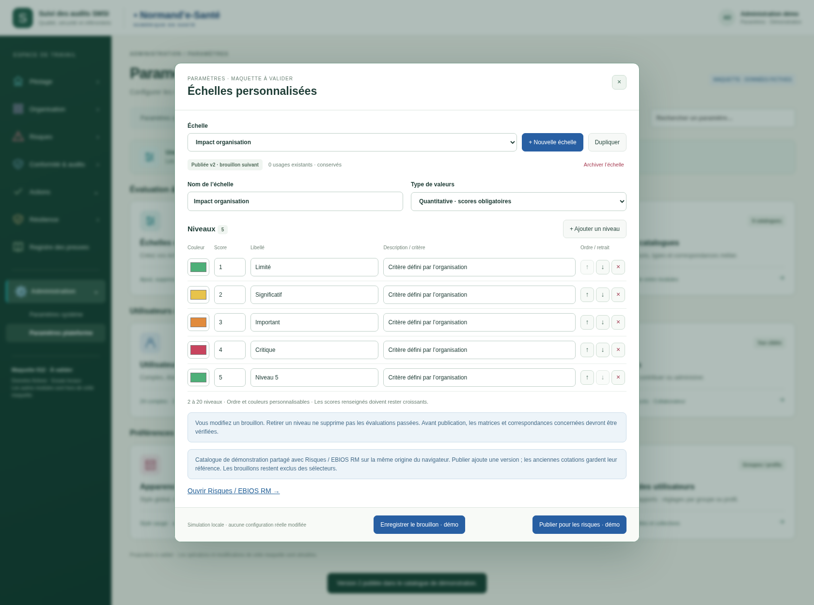

> Transmission du 20 octobre 2026 : [dossier courant](../../implementation/DOSSIER-IMPLEMENTATION.md). Cette version est une référence de conception ; les statuts et limites historiques ci-dessous restent attachés à sa production initiale. Vérifier l’existant avant tout codage.

# Échelles partagées — Risques / EBIOS RM

Proposition du 20 octobre 2026, **à valider**.

Les échelles publiées dans Paramètres plateforme sont sélectionnables dans la cotation des risques et EBIOS RM. Leurs niveaux, libellés, critères, scores et couleurs sont repris. Une nouvelle publication ajoute une version ; les cotations historiques gardent leurs références.

Dans les échelles, le bouton « Publier pour les risques · démo » rend la nouvelle version disponible dans la maquette Risques/EBIOS. Le brouillon ne remplace pas la version publiée. Les autres paramètres et journaux restent disponibles.

[Voir la cotation et son historique](../../../003-ebios-rm/maquettes/v002-echelles-plateforme/README.md) · [Contrats techniques](../../../003-ebios-rm/implementation/ECHELLES-PLATEFORME.md).

## Essayer

Servir la racine du dépôt sur une même origine HTTP locale, puis ouvrir `index.html`. Les deux maquettes partagent un catalogue fictif via le stockage du navigateur. Un lancement séparé en `file://` ne garantit pas ce partage. Aucun ZIP ni BAT produit. Les publications et cotations locales sont conservées au rechargement ; ce stockage ne constitue pas une intégration au serveur.

[21 contrôles locaux réussis](technique/verification.json) : publication depuis la configuration, exclusion des brouillons, nouveaux niveaux, matrice dynamique, conservation des versions et archivage. Aucun backend ni permission serveur testé.

## Publication d’une échelle partagée

