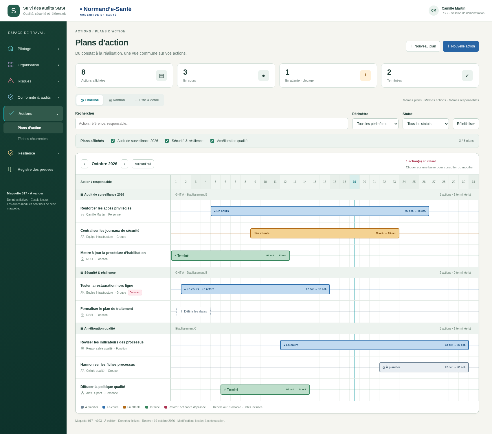

# 017 · Plans d’action — v003

**Proposition à valider.** Style repris des tâches récurrentes v008 : menu fixe, fond clair uni, couleurs lisibles, fenêtre centrale et défilements indépendants.

## Aperçus

- [Timeline des plans et des actions](visuels/01-timeline-plans.png)
- [Fiche centrale et motif du blocage](visuels/02-action-en-attente.png)
- [Kanban des quatre statuts](visuels/03-kanban-statuts.png)
- [Liste et détail de l’action](visuels/04-liste-detail.png)
- [Création et responsable de type fonction](visuels/05-creation-responsable-fonction.png)
- [Timeline sur mobile](visuels/06-timeline-mobile.png)

## Comportements de la maquette

- Plusieurs plans contiennent leurs actions ; sélection d’un, de plusieurs ou de tous les plans.
- Timeline : une barre entre début et fin, intitulés et responsables fixes, repère daté, navigation mensuelle ; action sans dates à planifier dans sa ligne.
- Quatre statuts : À planifier, En cours, En attente (blocage motivé), Terminé. Le retard est un indicateur distinct.
- Un responsable typé : personne, groupe ou fonction. Une affectation unique, trois types possibles.
- Liste & détail, Kanban et timeline utilisent les mêmes objets locaux. Les filtres sont partagés.
- Création d’un plan, création/modification d’une action ; un ou plusieurs périmètres. Origine illustrée : écart, risque, revue ou création directe.
- Date de fin >= début ; dates complètes hors « À planifier », motif en attente, compte rendu de clôture.

[Ouvrir la source du prototype](index.html) · [Notes d’intégration](../../implementation/PLANS-ACTION-V003.md) · [27 contrôles exécutés](technique/verification.json).

Ouvrir `index.html` localement permet de tester les interactions sans installation. GitHub affiche les sources, il n’héberge pas cette maquette comme une application. Aucune archive ZIP ou BAT créée.

Toutes les données sont fictives et uniquement en mémoire : un rechargement les réinitialise. Les liens métiers sont illustrés, sans connexion API. Les preuves et la validation de conformité ne sont pas simulées comme acquises. Aucun écart n’est clôturé par la réalisation d’une action.

Les dates vides en « À planifier » et le motif de blocage obligatoire sont des propositions UX à valider. Les transitions métier finales restent définies par le serveur. L’affectation groupe/fonction est un besoin utilisateur à raccorder au socle, pas une API déjà vérifiée.
