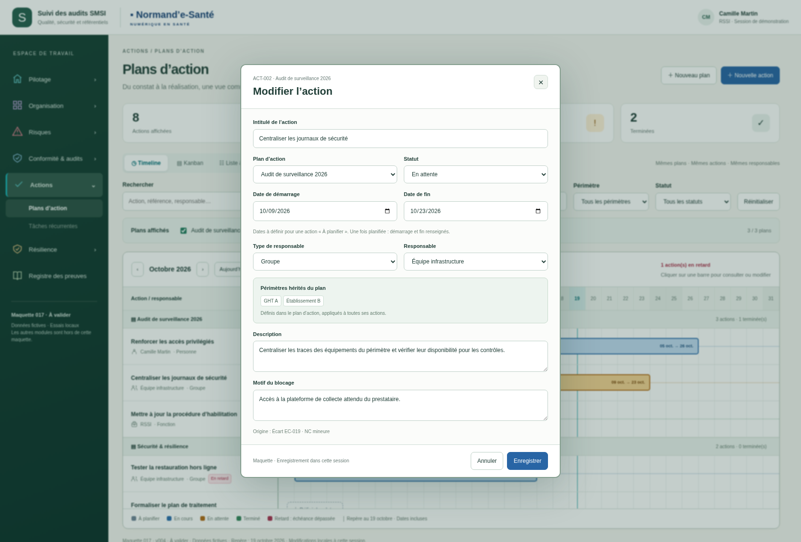

> Transmission du 20 octobre 2026 : [dossier courant](../../implementation/DOSSIER-IMPLEMENTATION.md). Cette version est une référence de conception ; les statuts et limites historiques ci-dessous restent attachés à sa production initiale. Vérifier l’existant avant tout codage.

# 017 — v004 · Périmètres hérités du plan

**Proposition visuelle à valider. Règle d’héritage confirmée par l’utilisateur.**

Le plan porte un ou plusieurs périmètres ; ses actions les héritent. Aucun champ de périmètre n’est enregistré sur l’action. Les fiches affichent les périmètres hérités en lecture seule. Changer le plan de rattachement actualise cet affichage. Modifier un plan (crayon près de son nom) actualise ses actions dans les trois vues et le filtrage global.

- [Timeline par plan](visuels/01-timeline-plans.png)
- [Action avec périmètres hérités en lecture seule](visuels/02-action-perimetres-herites.png)
- [Choix des périmètres au niveau du plan](visuels/03-perimetres-du-plan.png)
- [Liste et détail avec héritage](visuels/04-liste-heritage.png)

[Sources autonomes](index.html) · [35 contrôles navigateur réussis](technique/verification.json) · [Dossier technique transversal courant](../../../_dossiers-transversaux/implementation-ui-2026-10/README.md).

Ouvrir `index.html` localement pour tester. Données fictives en mémoire, réinitialisées au rechargement ; aucune connexion au backend. Le choix des périmètres reste dans le formulaire du plan. Le filtre global conserve le rôle de recherche des plans et de leurs actions. Les versions antérieures restent historiques. Aucun ZIP/BAT généré.
