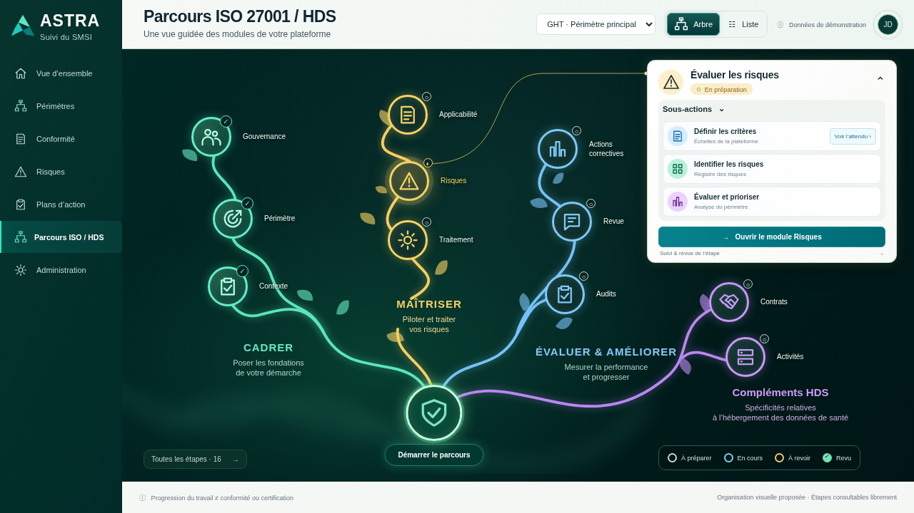
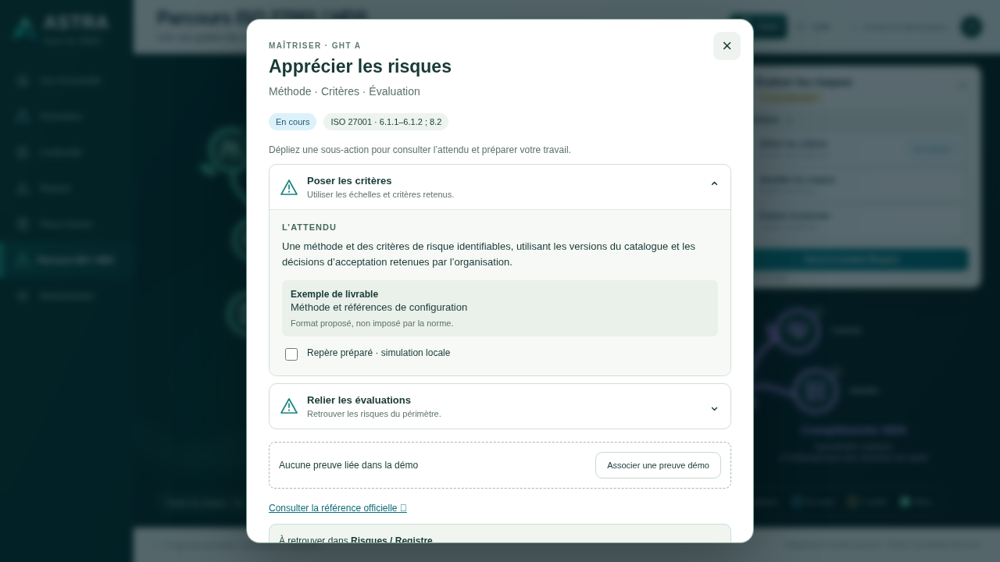
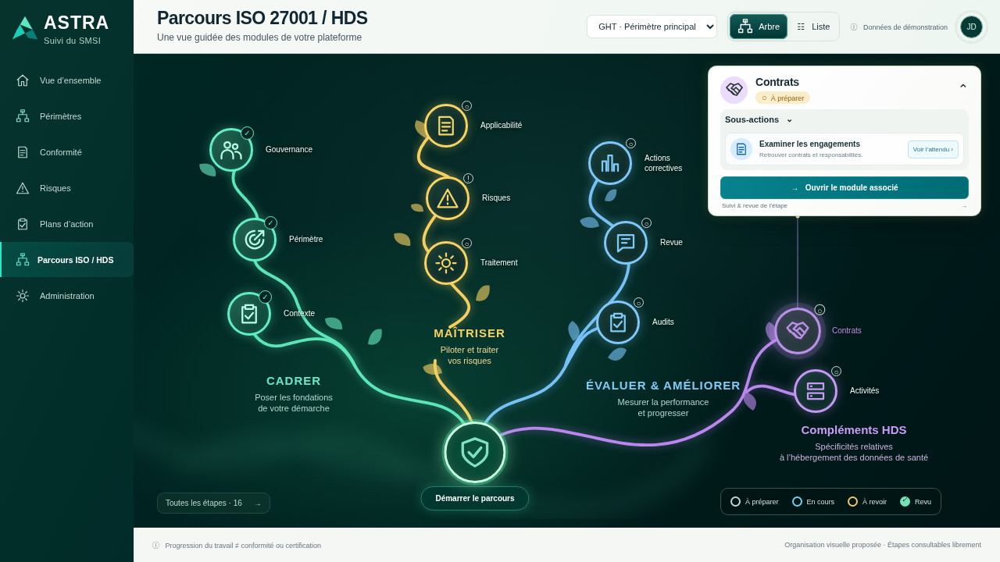

# 024 · Maquette fonctionnelle — style de référence v004

**À valider, non intégrée au backend.** Reprise de la composition demandée : menu vert profond, en-tête compact, branches végétales lumineuses, feuilles SVG, libellés latéraux, racine centrale et fiche blanche en haut à droite. Vue de référence à 1280 × 720.

## Télécharger et tester

[Télécharger le HTML autonome](https://github.com/yousername-ha/suivi-audits/raw/refs/heads/legacy/fonctionnalites-a-implementer/024-parcours-iso-hds/maquettes/v004-style-reference/index.html). Enregistrer `index.html`, puis l’ouvrir dans le navigateur. Si GitHub affiche le code, utiliser « Download raw file » sur la [page du fichier](https://github.com/yousername-ha/suivi-audits/blob/legacy/fonctionnalites-a-implementer/024-parcours-iso-hds/maquettes/v004-style-reference/index.html).

Aucun ZIP, BAT, installation ou ressource externe pour le contenu. Les liens officiels nécessitent Internet. Les essais sont sauvegardés dans ce navigateur ; un stockage refusé est signalé et l’essai reste en mémoire. Tests réalisés via HTTP local avec Chromium ; aucune vérification Windows ou ouverture `file://` revendiquée.

## Interactions

- Cliquer sur un cercle sélectionne sa branche et actualise la fiche compacte sans masquer l’arbre.
- Déplier/replier la fiche ou ses sous-actions. Cliquer sur une sous-action ouvre l’attendu central avec source et exemple de livrable.
- « Suivi & revue de l’étape » conserve la préparation, la preuve fictive, la revue simulée et la remise à revoir après modification.
- Le module de démonstration partage les mêmes repères et notes que le parcours. Aucun appel au backend de l’application.
- « Liste » ou « Toutes les étapes » donne accès aux 16 étapes / 26 sous-actions de v002, dont les ressources, objectifs, opérations, indicateurs et compléments HDS non dessinés sur la vue synthétique.
- Administration ou l’avatar donne accès au filtre HDS, aux sources et à la réinitialisation confirmée. Le sélecteur de périmètre isole les deux jeux fictifs.
- Menu fixe, canevas défilant et fiches centrales accessibles sur mobile. Adaptation proportionnelle du dessin sur grand écran ; la liste est disponible pour une lecture compacte.

## Aperçus réels

[Liste complète](images/03-liste-complete.png) · [Liste mobile](images/05-liste-mobile.png) · [Attendu mobile](images/06-attendu-mobile.png).

## Correspondances conservées

Les 11 points dessinés sont des raccourcis, pas 11 nouvelles étapes. Contexte et Périmètre ciblent les sous-actions du même objet `context`. Applicabilité et Traitement ciblent `treatment`. « Identifier les risques » et « Évaluer et prioriser » pointent sur la même sous-action existante `risk-2` et son repère : aucun nouveau critère ni double comptage. La liste conserve les 16 étapes et les 26 sous-actions sourcées. Les branches sont un choix graphique, pas un ordre normatif obligatoire.

[Sources documentaires](../../../../fonctionnalites-en-developpement/_prototype-transversal/demarrage-parcours-v1/SOURCES.md) · [Règles techniques](../../implementation/README.md) · [Résultats de vérification](verification.json) · [Script de recette](verifier.cjs) · [Version précédente conservée](../v003-arbre-organique/README.md).

Les fichiers `app.js` et `style.css` sont les sources de cette variante. `python construire.py` génère l’HTML autonome en y incorporant également `contenu.js` de v002. Le code de démonstration ne crée aucun contrat serveur concurrent. Statuts, preuves et notes restent fictifs, sans conformité automatique ni traçabilité immuable.
