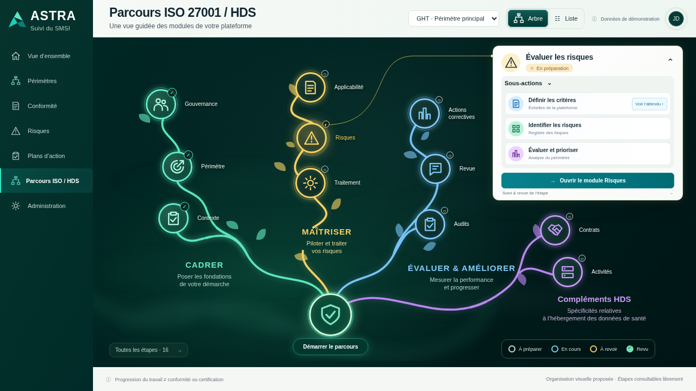

# 024 · Brume et lueurs — v005

**Maquette fonctionnelle à valider.** Géométrie, palette, typographie, cartes et interactions de v004 conservées. Seules des couches d’animation sont ajoutées.

## Ouvrir sur téléphone

[Ouvrir l’aperçu animé en ligne](https://astra-parcours-apercu.earlycedar65.chatgpt.site). Connexion avec le même compte ChatGPT si demandée. Aucun téléchargement nécessaire. Site privé de validation, publié avec Sites ; les données restent fictives et locales au navigateur. Mode paysage conseillé pour voir davantage de l’arbre, vue Liste disponible en portrait. Aucun délai d’expiration automatique n’est configuré.

[État de publication](hebergement.json) · **65 contrôles réussis**.

## Effets

- Brume discrète en arrière-plan : deux dégradés floutés se déplacent lentement, sur 32 et 41 secondes.
- Lueur des branches : halo respirant et filet lumineux parcourant les courbes en 18 secondes.
- Cercles : pulsation du halo en 6 secondes (8 pour la racine), sans déplacement ni redimensionnement des nœuds.
- Administration → « Animer la brume et les lueurs » permet de les arrêter. La préférence est sauvegardée. Le réglage système de mouvement réduit désactive les effets ; les animations se mettent en pause quand l’onglet est masqué.

Le contenu et les données de démonstration restent identiques. La clé locale v004 est conservée pour ne pas réinitialiser les essais de la même origine. L’hébergement utilise une origine distincte : les données saisies dans un fichier local ne sont pas transférées au site.

## Aperçus et recette

Une capture fixe ne montre pas les animations. Consulter le lien hébergé publié dans le dossier de fonctionnalité pour les voir.

[Rapport de tests](verification.json) · [Script reproductible](verifier.cjs) · [Version graphique v004 conservée](../v004-style-reference/README.md) · [Dossier technique](../../implementation/README.md).

Les tests Chromium sont exécutés via HTTP local. Le script compare la géométrie avec v004 et vérifie les animations, leur désactivation, la persistance, les préférences système, les interactions existantes et le mobile. Ce n’est pas une vérification sur un téléphone physique ni une intégration au backend.

## Sources

`app.js`, `style.css` et `construire.py` produisent le fichier autonome `index.html`, avec les données sourcées de v002. Aucun ZIP/BAT généré pour l’utilisateur. L’hébergement utilise une copie isolée de ce seul fichier, sans données réelles ni connexion à la plateforme.
