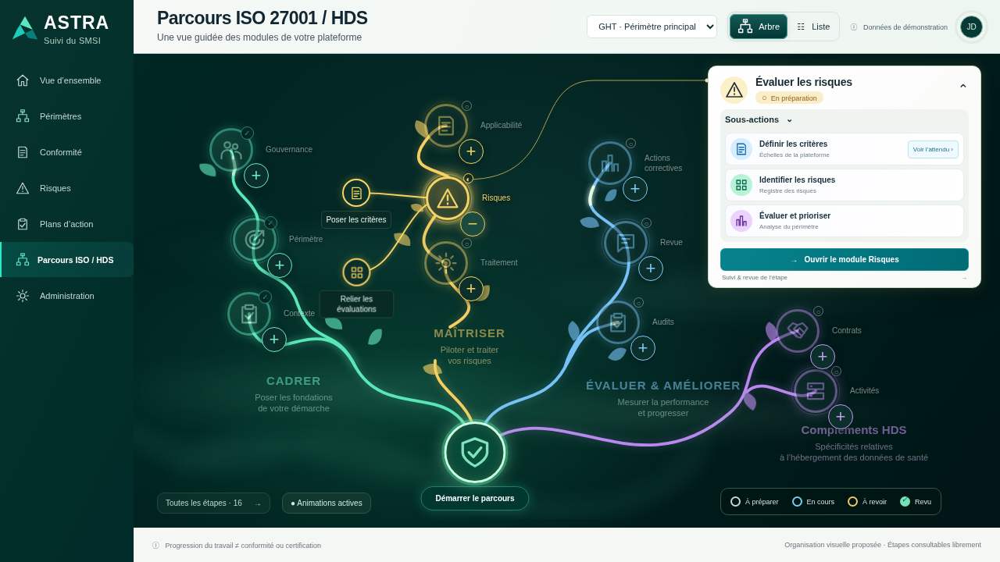
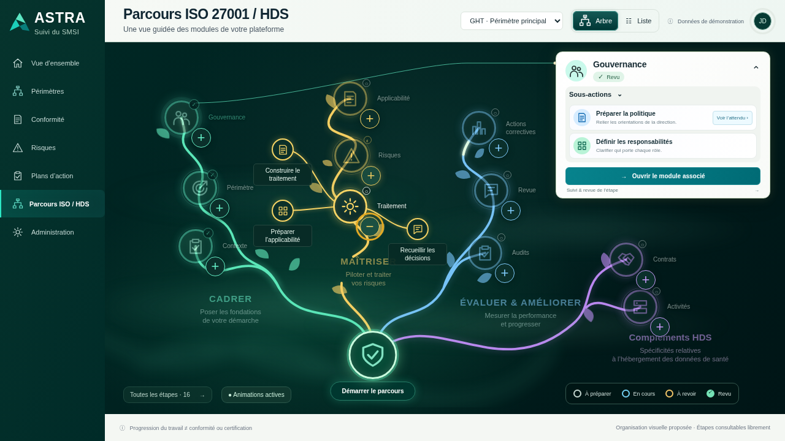

# 024 · Sous-branches et animations visibles — v006

**Maquette fonctionnelle à valider.** Même composition graphique que v004/v005, complétée par des commandes « + » séparées des cercles, des enfants reliés au parent et des animations plus perceptibles.

## Tester en ligne

[Ouvrir l’aperçu privé sur téléphone](https://astra-parcours-apercu.earlycedar65.chatgpt.site). Utiliser le même compte ChatGPT si une connexion est demandée. Aucun téléchargement nécessaire. Les informations de publication de cette version sont dans [l’état d’hébergement](hebergement.json).

- **Cercle parent** : ouvre sa carte compacte, comme précédemment.
- **Petit +** : dessine progressivement les sous-branches et fait apparaître les cercles enfants. Il ne change ni la carte ni la progression métier.
- **Petit −** : replie les enfants avec animation. Une seule branche est dépliée à la fois ; les autres nœuds s’atténuent pour conserver la lisibilité.
- **Cercle enfant** : ouvre l’attendu de la sous-action existante. La préparation reste commune au parcours et au module simulé.
- **Animations**, en bas de l’arbre ou dans Administration : modes Automatiques, Animées et Arrêtées. Le mode automatique respecte les préférences du téléphone. « Animées » est un choix explicite permettant de voir les mouvements même si le système demande de les réduire. « Arrêtées » les désactive.

Le statut indique « Animations actives », « réduites » ou « arrêtées ». Le réglage est conservé dans ce navigateur. Les effets s’interrompent quand l’onglet est masqué. Sur téléphone, les boutons disposent d’une cible tactile agrandie et le canevas reste défilant. La vue Liste conserve les 16 étapes et 26 sous-actions.

**109 contrôles réussis** sur Chromium. Sur téléphone, toucher un cercle principal amène sa carte dans la zone visible.

## Aperçus

[Mobile](images/09-sous-branches-mobile.png) · [Rapport de tests](verification.json) · [Script reproductible](verifier.cjs).

## Diagnostic et limites

La version précédemment hébergée a été récupérée avec l’accès privé autorisé : son HTML correspondait exactement à v005 et contenait les animations. Les effets étaient peu contrastés et le mode automatique les arrête lorsque le navigateur demande de réduire le mouvement. La cause exacte sur le téléphone de l’utilisateur n’est pas établie. v006 rend l’état explicite, renforce les contrastes et propose un choix manuel.

Les enfants réutilisent les identifiants et repères des sous-actions v002 ; aucun nouvel attendu normatif, aucune copie métier, aucun nouveau calcul de conformité. Les raccourcis Contexte/Périmètre et Traitement/Applicabilité continuent de viser leurs objets communs. Le dépliage est un état d’affichage temporaire, pas une progression sauvegardée.

Les tests sont exécutés sur Chromium, via HTTP local, y compris une taille mobile. Aucun essai sur le téléphone physique de l’utilisateur ni intégration backend revendiqué. L’hébergement est privé et séparé de la plateforme réelle. Aucune expiration automatique configurée, aucun ZIP/BAT livré.

[Sources officielles et limites documentaires](../../../../fonctionnalites-en-developpement/_prototype-transversal/demarrage-parcours-v1/SOURCES.md) · [Dossier technique](../../implementation/README.md) · [Version précédente conservée](../v005-brume-lueurs/README.md).

`python construire.py` produit `index.html` autonome à partir de `style.css`, `app.js` et du contenu v002 conservé dans le dépôt.
