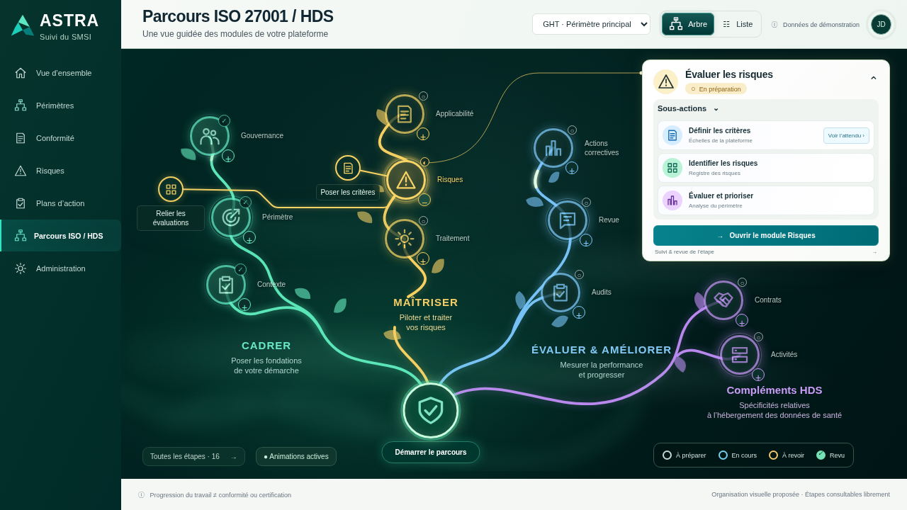
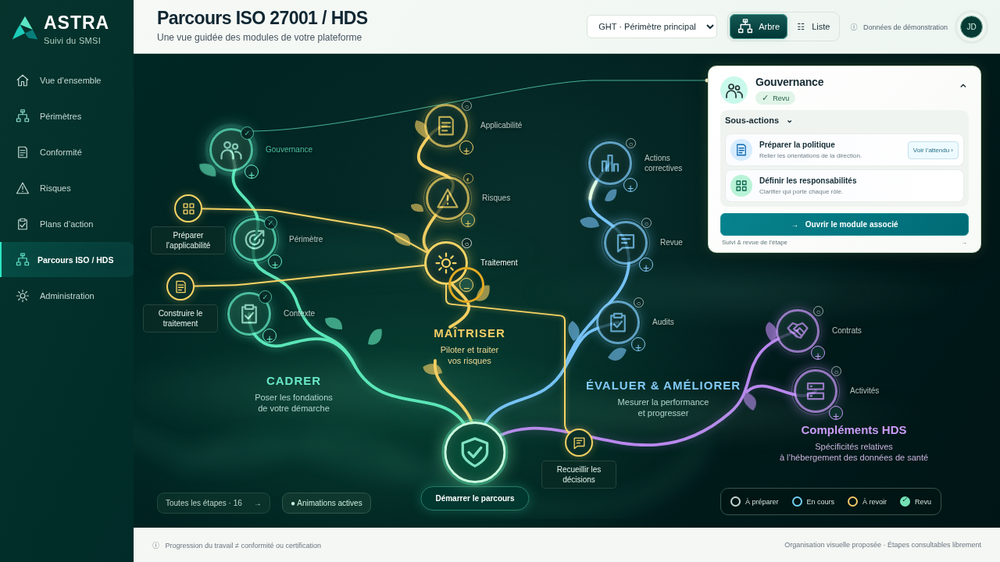

# 024 · Dépliage lisible — v007

**Maquette fonctionnelle à valider**, sans intégration backend.

[Ouvrir le même aperçu privé sur téléphone](https://astra-parcours-apercu.earlycedar65.chatgpt.site). Actualiser la page après publication ; utiliser le même compte ChatGPT si demandé.

- Boutons « + / − » réduits à un disque de 18 px, avec cible invisible de 40 px sur écran tactile avant mise à l’échelle du canevas.
- Placement des cercles enfants tenant compte des libellés complets, cartes, commandes et autres enfants. Les liaisons contournent les textes, y compris le libellé de leur propre destination.
- Apparition progressive sur place, sans déplacement par-dessus les mots. Recalcul lors du changement de carte et du redimensionnement.
- Graphisme, brume, lueurs, contenu sourcé et comportements conservés : plus pour déplier, parent pour sa carte, enfant pour l’attendu. Une branche ouverte à la fois.

## Aperçus

[Vue mobile](images/09-sous-branches-mobile.png).

## Vérification

109 contrôles fonctionnels et 69 contrôles de placement réussis avec Chromium via HTTP local. Le placement couvre les 11 branches avec 3 cartes sélectionnées, en bureau et tactile (66 combinaisons), ainsi que le diamètre et la cible tactile. Les liaisons SVG sont échantillonnées tous les 2 px pour détecter les croisements de textes.

[Recette fonctionnelle](verification.json) · [Placement](verification-placement.json) · [Script fonctionnel](verifier.cjs) · [Script placement](verifier-placement.cjs) · [Publication](hebergement.json).

Aucun essai sur le téléphone physique de l’utilisateur. Le canevas demeure défilant sur petit écran. Données de démonstration locales uniquement, sans API métier. Aucun ZIP/BAT ; aucune expiration automatique de l’aperçu configurée.

`python construire.py` régénère le HTML autonome depuis les sources locales et le contenu sourcé v002. Les versions précédentes restent conservées. [Règles techniques](../../implementation/README.md).
