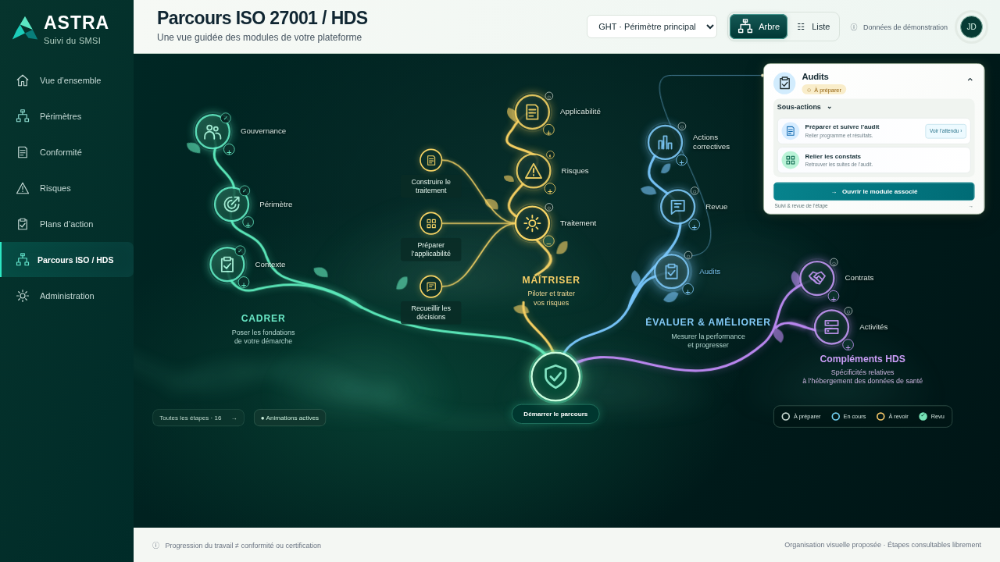

# 024 · Branches vivantes — v008

**Maquette à valider, sans intégration backend.** Cette version remplace le routage de v007, rejeté visuellement par l’utilisateur.

[Ouvrir l’aperçu privé](https://astra-parcours-apercu.earlycedar65.chatgpt.site) — même adresse, aucun téléchargement. Actualiser la page.

- Le « + » écarte les grandes branches pour ouvrir un espace dédié aux enfants. Les cercles, libellés, feuilles et courbes se déplacent ensemble ; le repli les ramène à leur place.
- Les enfants forment un petit éventail près du parent, relié par des courbes directes. Ils apparaissent après l’écartement. Plus de trajets anguleux autour des mots.
- Cadrage automatique sur bureau ; canevas défilant sur téléphone, menu fixe. Les boutons « + / − » restent petits, avec cible tactile étendue.
- La brume naît au bas du canevas, monte puis se dissipe. Deux nappes décalées entretiennent un mouvement continu, sans retour descendant.
- Cliquer sur un cercle déclenche un halo de sa couleur. Le parent ouvre sa carte, l’enfant son attendu ; la racine conserve son action.
- Les filets lumineux utilisent exactement la couleur de chaque branche : vert, or, bleu, violet. Aucune surcouche blanche commune.

Les modes Automatiques / Animées / Arrêtées et la préférence système de mouvement réduit sont conservés. Les contenus, données de démonstration, sources et règles métier ne changent pas.

[Mobile](images/09-sous-branches-mobile.png) · [Tests fonctionnels](verification.json) · [Placement](verification-placement.json) · [Animations mesurées](verification-animations.json) · [Publication](hebergement.json).

Recette : 109 contrôles fonctionnels, 69 de placement et 14 d’animation sur Chromium local. Les tests d’animation mesurent les positions et les courbes pendant l’ouverture, la restitution au repli, le sens de déplacement de la brume, les couleurs calculées et les halos des trois types de cercles.

Aucun essai sur le téléphone physique de l’utilisateur, aucune API métier, aucun ZIP/BAT. L’aperçu reste privé ; aucune expiration automatique configurée. La capture est fixe : les mouvements sont à consulter via le lien.

`python construire.py` produit le HTML autonome depuis les sources locales et le contenu sourcé v002. Les scripts `verifier*.cjs` utilisent Node, Playwright et Chromium via un serveur HTTP local sur le port 19120.
