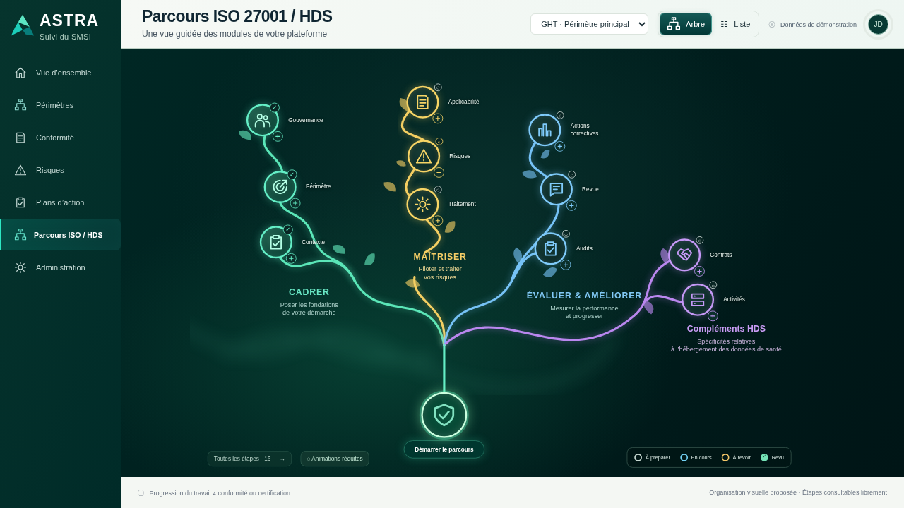

# 024 · Tronc dégagé et cartes refermables — v009

**Maquette à valider, sans intégration backend.**

[Ouvrir le même aperçu privé](https://astra-parcours-apercu.earlycedar65.chatgpt.site).

- « + / − » vectoriels centrés dans leurs disques, indépendamment de la police ; petites commandes et cibles tactiles conservées.
- Bouclier descendu de 120 px dans le repère du canevas, avec un tronc reliant la jonction des branches au bouclier. Le canevas plus haut conserve un cadrage global sur bureau et le défilement indépendant sur téléphone.
- Croix de fermeture de la carte compacte. Un clic sur le fond ou Échap ferme également la carte et sa liaison ; un clic sur un cercle la rouvre.
- Fenêtres détaillées : croix conservée, fermeture au clic sur le fond extérieur. Les clics internes et les glissements commencés dans la fenêtre ne la ferment pas. Retour du focus conservé.
- Le dépliage, les animations colorées, la brume ascendante et les halos sont conservés. Fermer une carte ne modifie ni les données ni la progression.

[Carte avec croix](images/01-reference-fonctionnelle.png) · [Mobile](images/12-arbre-mobile.png).

## Vérifications

109 contrôles fonctionnels, 69 contrôles de placement, 14 contrôles d’animation et 30 contrôles de centrage/fermeture réussis dans Chromium local. [Fonctions](verification.json) · [Placement](verification-placement.json) · [Animations](verification-animations.json) · [Cartes](verification-cartes.json).

Aucun test sur téléphone physique ni intégration backend. Les versions précédentes sont conservées. Aucun ZIP/BAT.

## Partage

L’hébergement autorise une invitation privée nominative, mais l’outil de partage ne propose pas d’expiration automatique à 24 h. Aucun accès supplémentaire accordé sans destinataire et confirmation ; aucune invitation envoyée pour cette version. Ne pas remplacer une expiration serveur par une restriction JavaScript dans la maquette. [État de publication](hebergement.json).

Les [deux variantes Gondor](propositions-gondor/README.md) sont uniquement des propositions en images ; elles ne sont pas appliquées à cette maquette.
