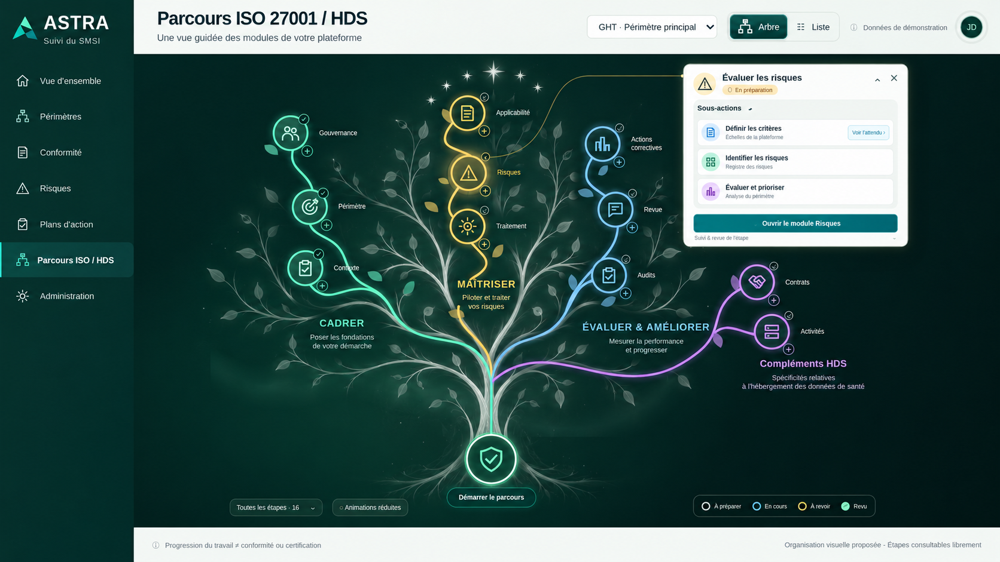

# Deux propositions visuelles · Arbre de Gondor

Images de conception générées le 23 octobre 2026 à partir de la capture `../images/01-reference-fonctionnelle.png`. Propositions à valider, non appliquées au HTML de la maquette. Elles ne prouvent aucune interaction ni fonctionnalité.

1. **Filigrane discret** : silhouette argentée fondue dans le fond vert, derrière les branches colorées.
2. **Tronc fusionné** : présence plus marquée de l’Arbre blanc, tronc et ramifications mêlés visuellement au parcours existant.

Conserver le menu, les couleurs, positions et fonctions lors d’une éventuelle intégration validée. Les textes et icônes de référence restent ceux du HTML : les images générées sont des propositions graphiques, pas de nouveaux contenus métier. Aucun ZIP/BAT.
