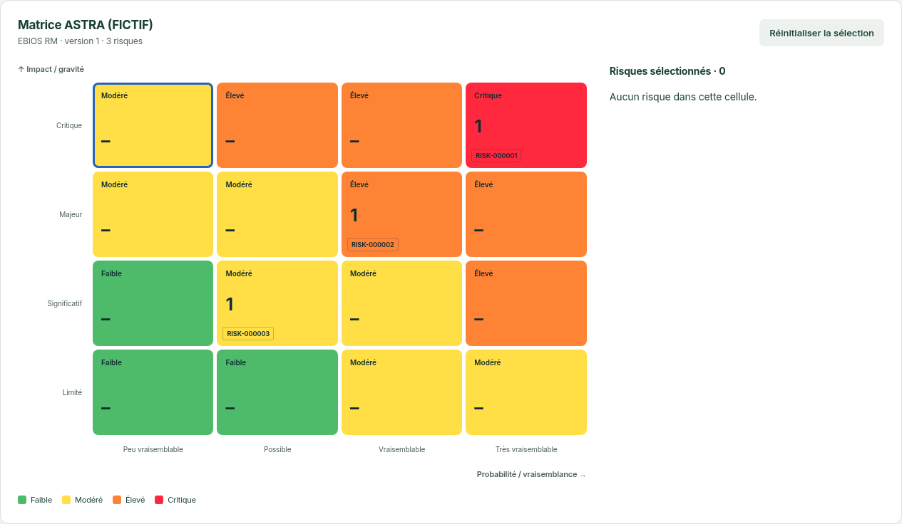
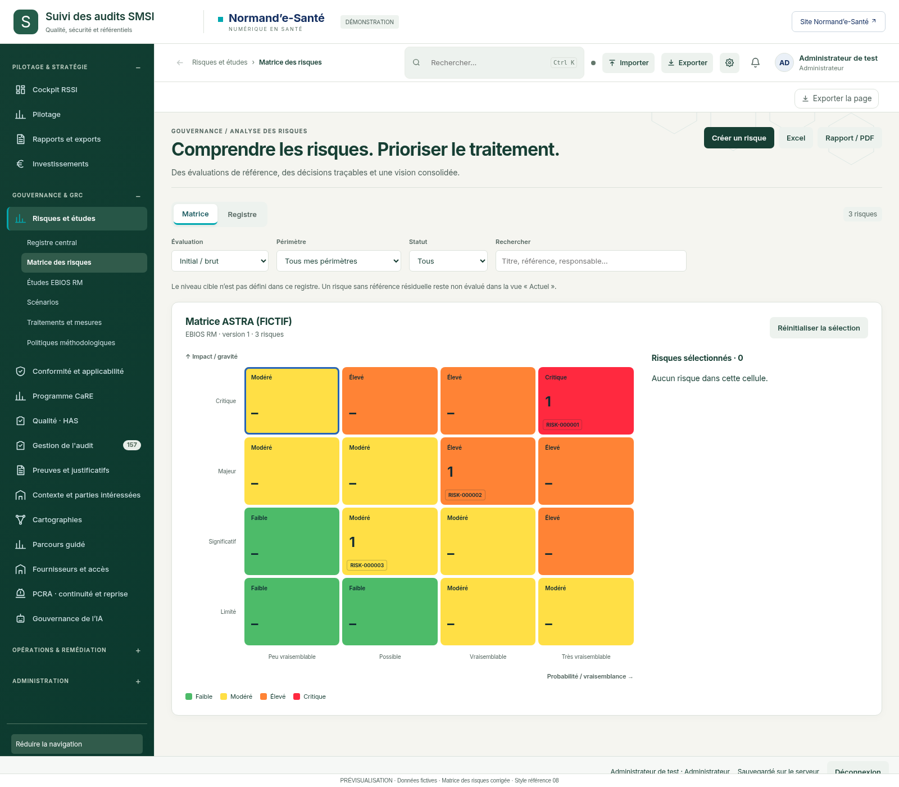

# Matrice des risques — aperçu corrigé

13 octobre 2026 · Référence applicative `909aebc4304f8fccdca760ba20a1c5eda7ce5631` · Branche `legacy`.

Grille 4 × 4, cases pleines vertes/jaunes/orange/rouges, niveaux, compteurs, références cliquables, contour bleu de sélection et panneau latéral. Habillage général : référence 08.

## Détail de la matrice

## Vue complète

**Aperçu sur données fictives, pas une intégration au code applicatif.** Une nouvelle politique matricielle de démonstration et de nouvelles évaluations ont été créées dans une base temporaire ; aucune politique existante de l’utilisateur n’a été modifiée. La cartographie dynamique est intacte. La navigation environnante reprend le prototype de la série 14 ; les chevrons prescrits au dossier restent à intégrer.

La fixture reprend le scénario de `tests/astra-browser.cjs`, avec la palette demandée. Les contrôles de la grille, des quatre couleurs, de la sélection vide, de l’ouverture des références et de la réinitialisation ont passé, sans erreur JavaScript ni requête externe. Voir [vérifications](technique/verification.json).

Cette image précise la correction de matrice du [dossier courant, § 4 bis](../../../_dossiers-transversaux/socle-astra/DOSSIER-IMPLEMENTATION.md) et remplace la vue 03 de la série 14 comme référence visuelle de cette matrice. Les anciennes images restent conservées.
