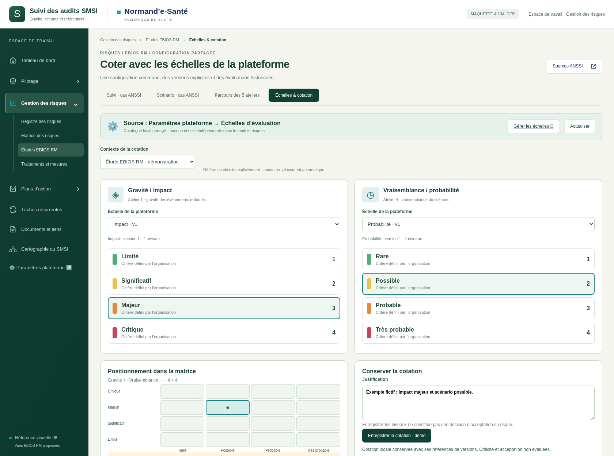
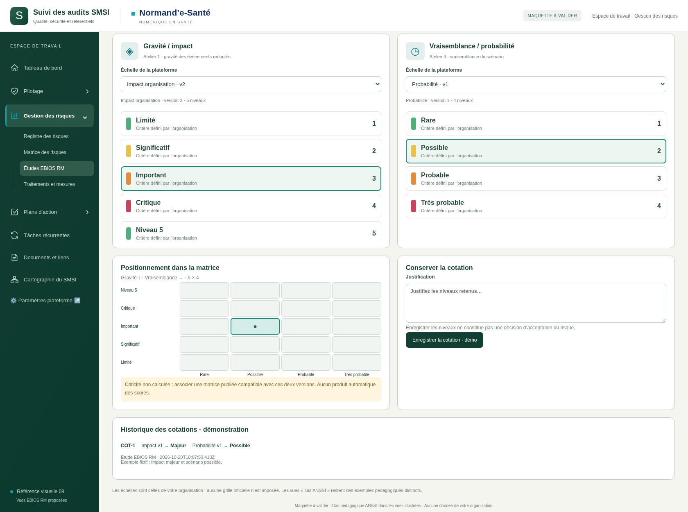

# Échelles partagées — Risques / EBIOS RM

Proposition du 20 octobre 2026, **à valider**.

Les échelles publiées dans Paramètres plateforme sont sélectionnables dans la cotation des risques et EBIOS RM. Leurs niveaux, libellés, critères, scores et couleurs sont repris. Une nouvelle publication ajoute une version ; les cotations historiques gardent leurs références.

La vue « Échelles & cotation » est accessible depuis le parcours, notamment les ateliers 1 et 4. La grille s’adapte au nombre de niveaux ; la criticité reste non calculée tant qu’une matrice compatible n’est pas raccordée. Les vues du cas pédagogique ANSSI restent distinctes et accessibles.

[Configuration partagée](../../../012-administration-apparence/maquettes/v007-echelles-partagees/README.md) · [Contrats techniques](../../implementation/ECHELLES-PLATEFORME.md) · [Sources du parcours ANSSI](../v001-parcours-anime/SOURCES.md).

## Essayer

Servir la racine du dépôt sur une même origine HTTP locale, puis ouvrir `index.html`. Les deux maquettes partagent un catalogue fictif via le stockage du navigateur. Un lancement séparé en `file://` ne garantit pas ce partage. Aucun ZIP ni BAT produit. Les publications et cotations locales sont conservées au rechargement ; ce stockage ne constitue pas une intégration au serveur.

[21 contrôles locaux réussis](technique/verification.json) : publication depuis la configuration, exclusion des brouillons, nouveaux niveaux, matrice dynamique, conservation des versions et archivage. Aucun backend ni permission serveur testé.

## Cotation avec les échelles de la plateforme

## Nouvelle version et historique conservé

