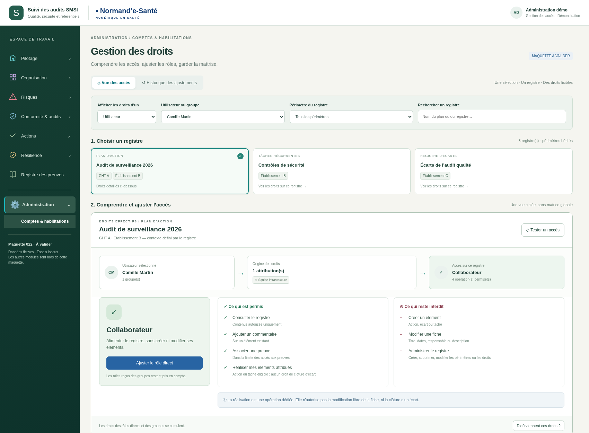
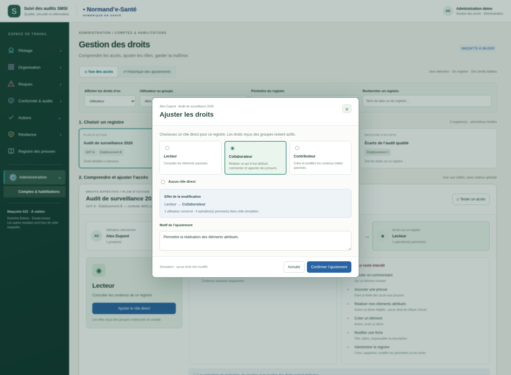
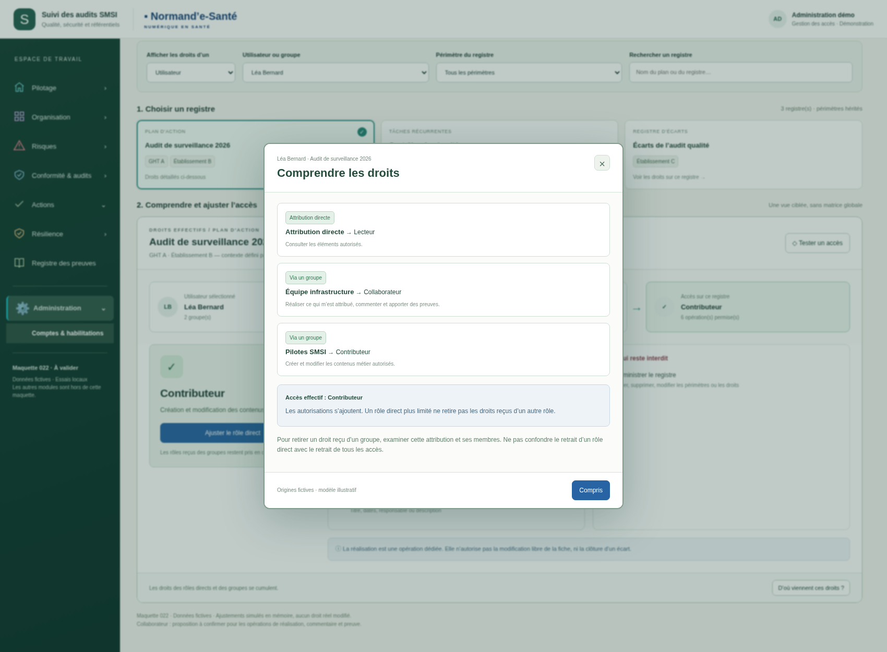
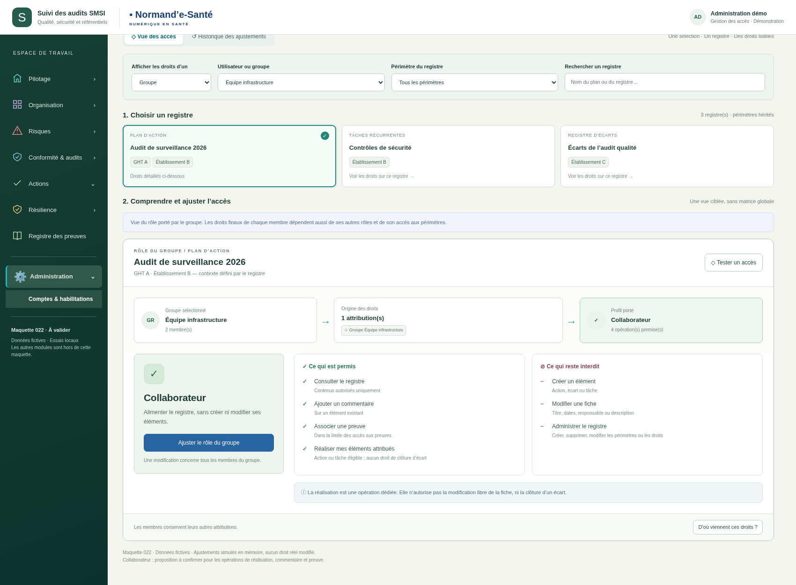
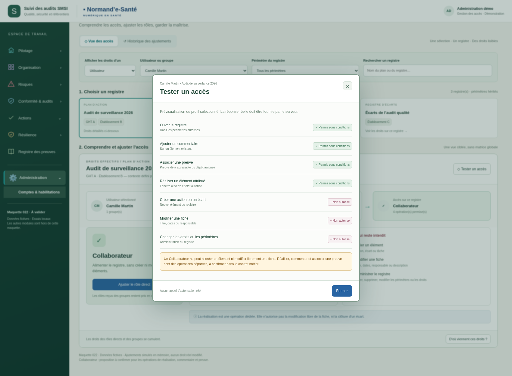
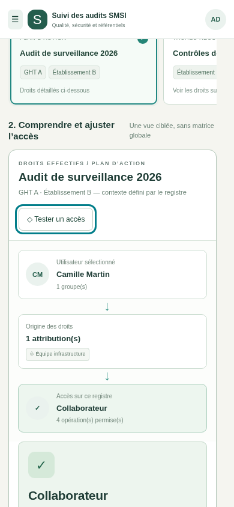

# Gestion des droits — v001

**Maquette à valider.** Données fictives, ajustements en mémoire, réinitialisés au rechargement. Aucune autorisation réelle n’est modifiée.

Ouvrir `index.html` avec ses fichiers voisins pour tester la sélection utilisateur/groupe, les filtres de registres, l’ajustement d’un rôle, les origines et l’historique local. Les autres modules du menu sont hors du périmètre de cette maquette. GitHub affiche le code HTML, pas une application hébergée.

L’écran garde un seul registre détaillé : identité → origine des droits → accès effectif. Les droits des groupes se cumulent ; un rôle direct Lecteur ne retire pas une autorisation plus large reçue d’un groupe. Le simulateur décrit des conditions, il ne réalise aucune opération métier.

La définition exacte des contributions du Collaborateur reste à confirmer. [Spécifications et limites](../../implementation/README.md).

## 1. Vue ciblée du Collaborateur

## 2. Ajuster un rôle : aperçu avant/après

## 3. Comprendre les droits reçus des groupes

## 4. Droits d’un groupe

## 5. Tester un accès : simulation

## 6. Vue mobile

