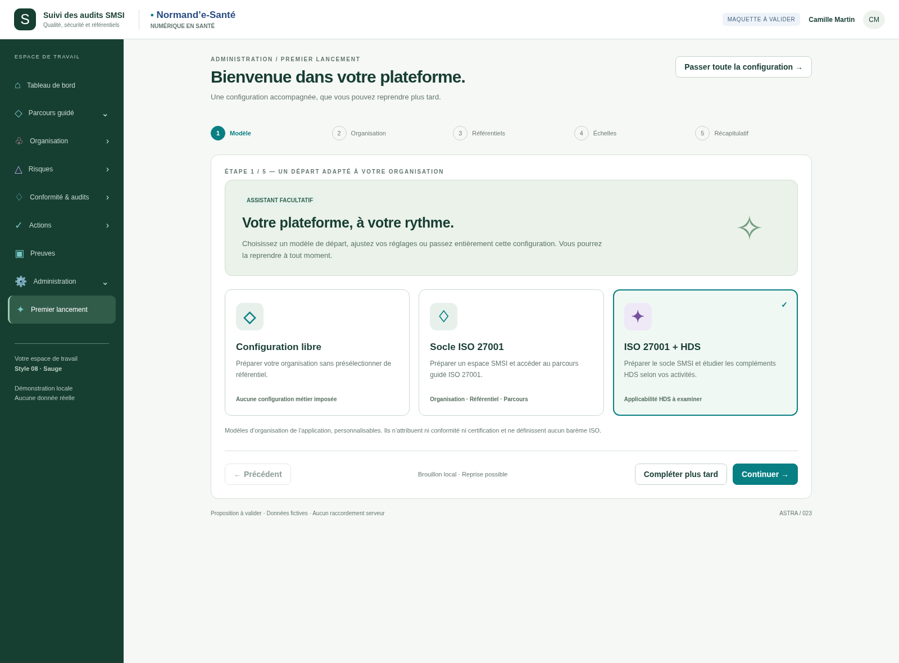
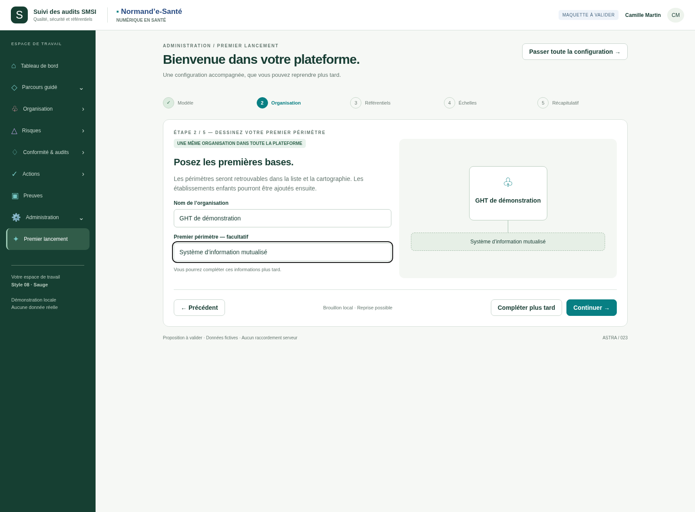
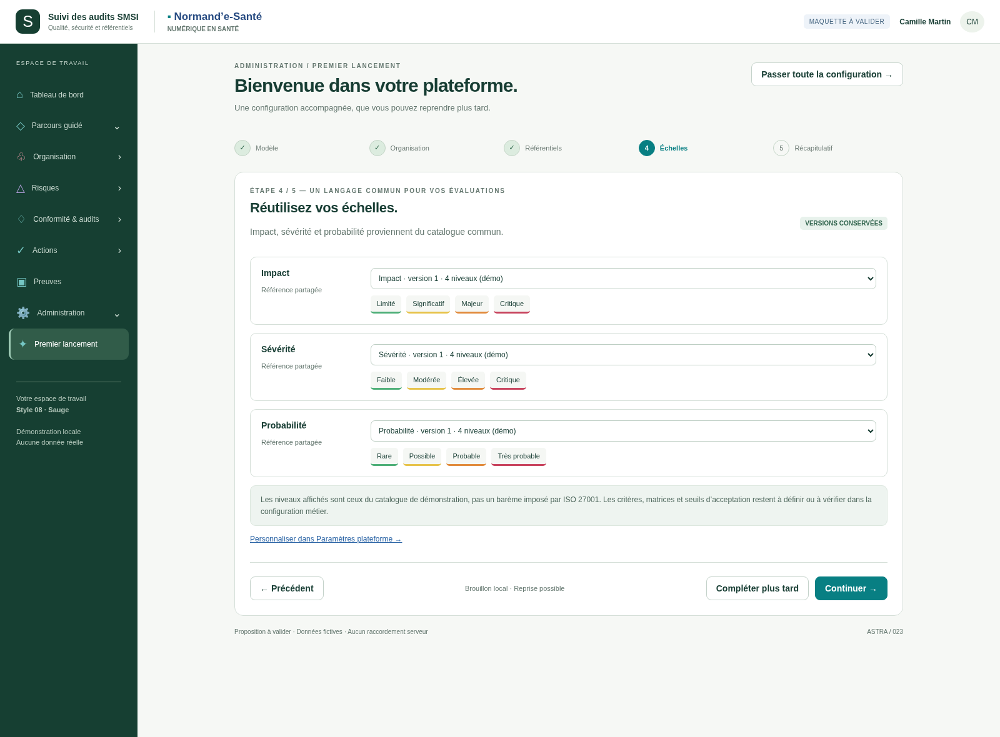
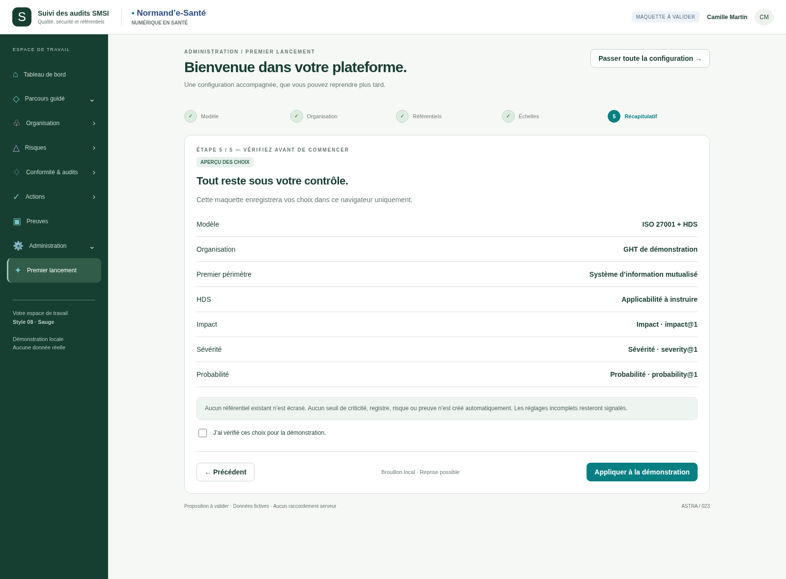

# 023 · v001-parcours-guide

**Maquette fonctionnelle locale, à valider. Données fictives.**

[Source du prototype](index.html) · [Sources officielles](../../../_prototype-transversal/demarrage-parcours-v1/SOURCES.md) · [Règles de conception](../../implementation/README.md).

Les liens GitHub donnent accès aux sources et images, pas à une application hébergée. Servir la racine du dépôt par HTTP local pour essayer les interactions ; conserver le dossier partagé et le catalogue commun. Les autres destinations du menu sont indicatives.

