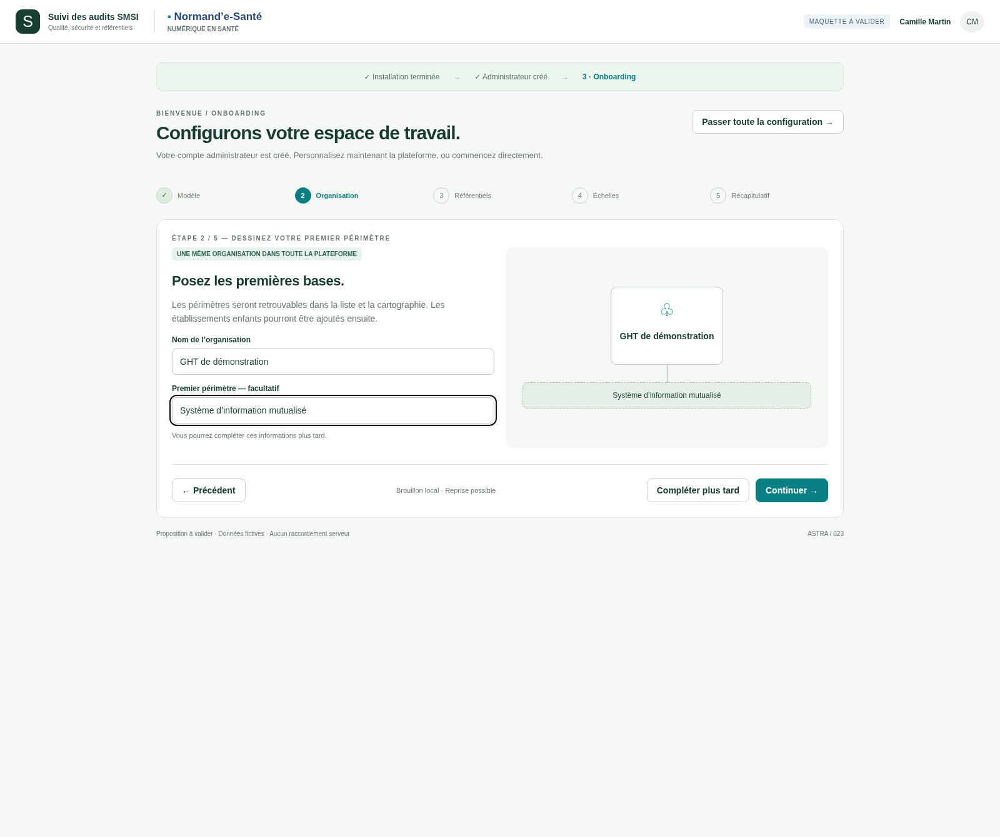

# 023 — Onboarding et sous-actions · v002

**Proposition à valider. Données fictives, aucune intégration backend.**

[Source interactive](index.html) · [Règles courantes](../../implementation/README.md) · [Galerie commune](../../../_prototype-transversal/demarrage-parcours-v2/README.md) · [Version précédente](../v001-parcours-guide/README.md).

