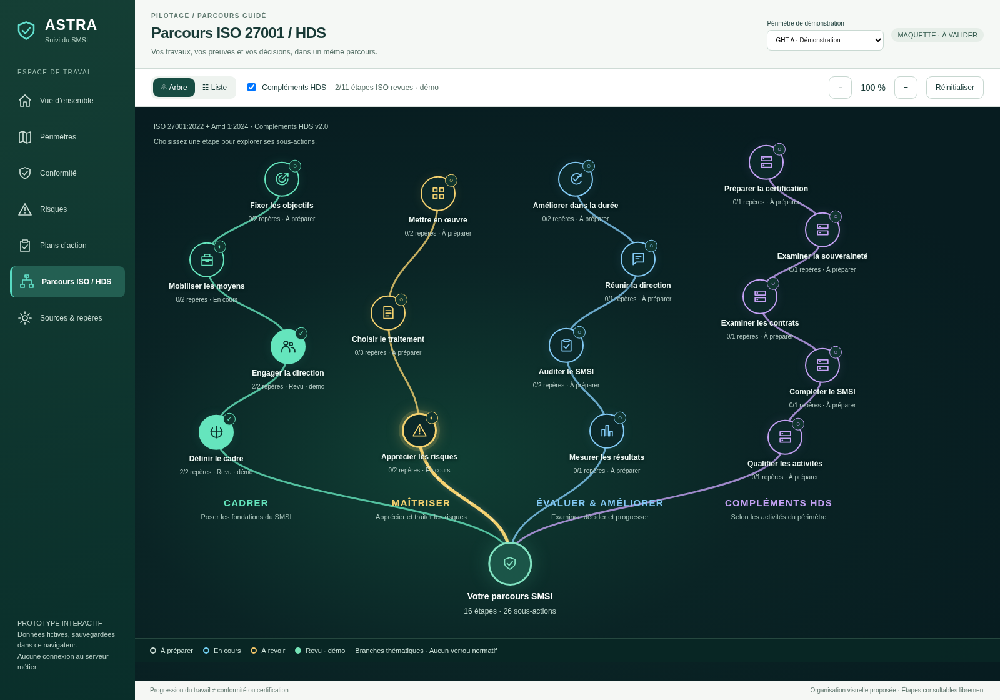
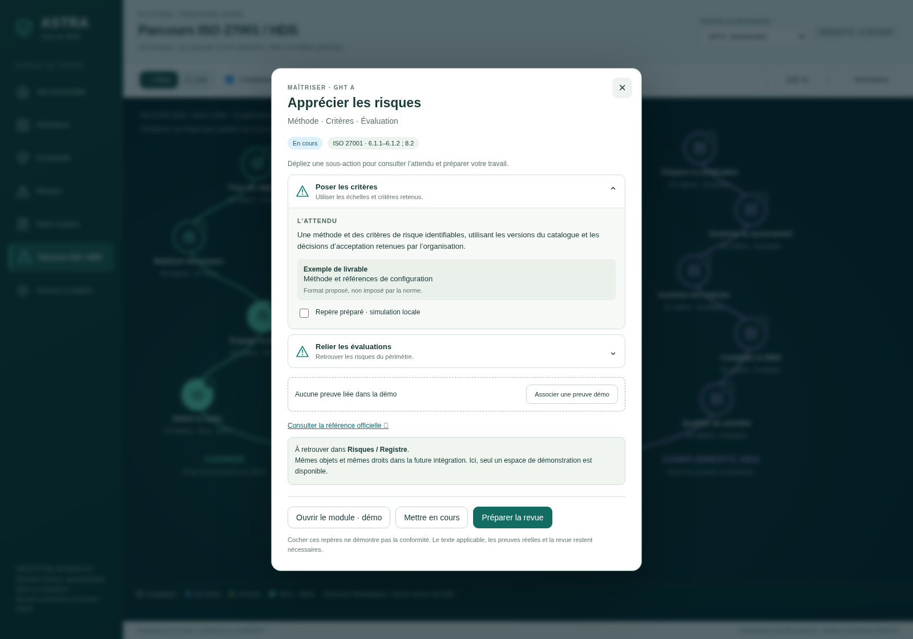
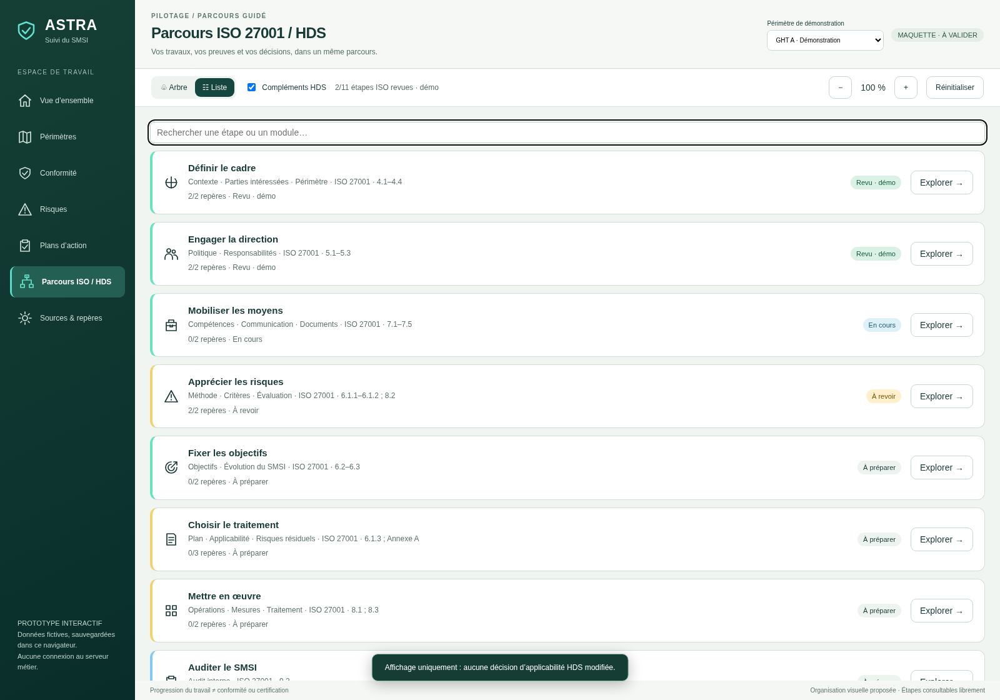

# 024 · Arbre de compétences interactif — v003

**Maquette fonctionnelle à valider.** Alternative sombre, branches courbes colorées, nœuds à icônes et fiches centrales. Aucun raccordement au backend de production.

## Tester sur votre PC

[Télécharger le fichier HTML autonome](https://github.com/yousername-ha/suivi-audits/raw/refs/heads/legacy/fonctionnalites-en-developpement/024-parcours-iso-hds/maquettes/v003-arbre-organique/index.html).

Enregistrer `index.html`, puis l’ouvrir dans Edge, Chrome ou Firefox. Si GitHub affiche le code, utiliser **Download raw file / Télécharger le fichier brut** sur la [page du fichier](https://github.com/yousername-ha/suivi-audits/blob/legacy/fonctionnalites-en-developpement/024-parcours-iso-hds/maquettes/v003-arbre-organique/index.html). Aucun ZIP, BAT, installation ou ressource externe nécessaire au contenu de la maquette. Les liens vers les sources officielles nécessitent Internet.

L’ouverture directe locale est prévue par la structure autonome ; elle n’a pas pu être vérifiée dans le navigateur géré de cet environnement, qui bloque `file://`. Les 40 contrôles ont été exécutés via HTTP local. La persistance dépend du navigateur et de ses autorisations ; un refus de stockage affiche un message et conserve l’essai en mémoire pour la session.

## Parcours de test

1. Cliquer sur **Apprécier les risques**. Déplier les sous-actions et consulter leurs attendus, exemples de livrables et source officielle.
2. Préparer les deux repères, associer la preuve fictive, puis préparer et confirmer la revue simulée. Ce statut ne constitue pas une conformité.
3. Ouvrir **le module · démo** : modifier un repère ou une note, enregistrer puis revenir au parcours. Les deux vues partagent le même enregistrement local ; une modification après revue remet à revoir.
4. Changer le périmètre, masquer/afficher HDS, passer à la liste et rechercher une étape. Recharger pour retrouver l’essai.
5. Tester le zoom, la navigation clavier, la fermeture par Échap et le défilement indépendant du menu. Réinitialiser seulement cette version avec confirmation.

## Aperçus de la maquette exécutée

[Liste mobile](images/05-liste-mobile.png) · [Attendu mobile](images/06-attendu-mobile.png) · [Proposition graphique initiale, image non fonctionnelle](images/00-reference-graphique.png).

## Contenu et limites

16 étapes, 26 sous-actions réutilisées depuis v002, avec les mêmes identifiants et références. Les quatre branches sont un regroupement graphique, pas un ordre normatif obligatoire. L’intégralité des sous-actions reste consultable. Les données, preuves et revues sont fictives, locales et réinitialisables ; aucune traçabilité immuable n’est revendiquée.

[Sources et limites documentaires](../../../_prototype-transversal/demarrage-parcours-v1/SOURCES.md) · [Dossier technique et règles d’intégration](../../implementation/README.md) · [Résultats des 40 contrôles](verification.json) · [Script de vérification](verifier.cjs).

## Sources de la maquette

`style.css` et `app.js` contiennent cette variante. `construire.py` incorpore le contenu métier de v002 et ces sources dans `index.html`. Exécuter `python construire.py` depuis ce dossier après une modification. L’HTML généré est autonome ; le script de génération utilise la version précédente conservée dans le dépôt. Aucune dépendance de runtime ajoutée.

La maquette reste en développement. La demande d’une version fonctionnelle ne vaut pas validation de son apparence ni passage à implémenter.
