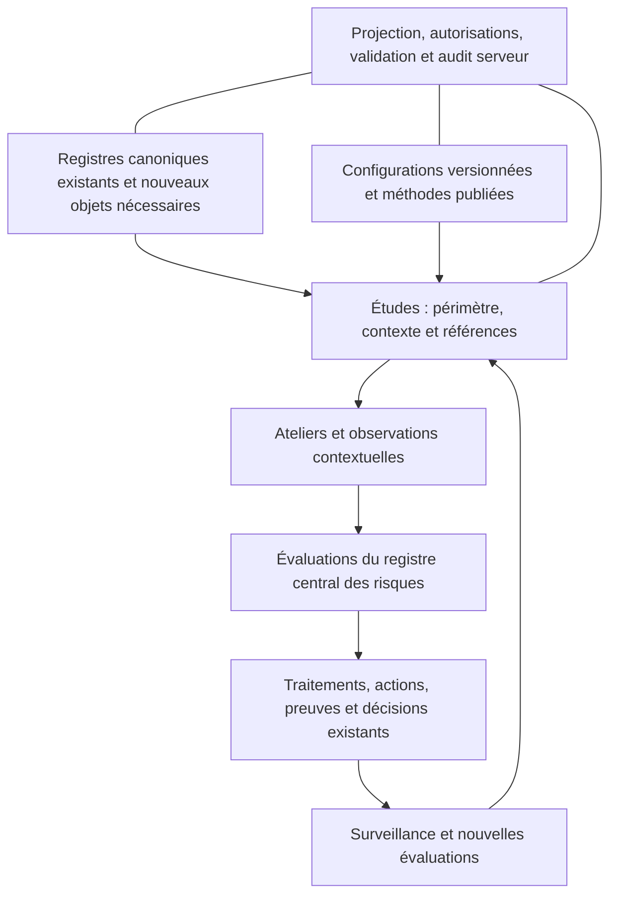

# Architecture cible — évolution de legacy

## Trois couches et stockage

Phase initiale : garder l’état JSON dans SQLite et l’API `/api/state`. Ajouter un namespace `grc` versionné et des adaptateurs vers les registres existants. Aucun deuxième serveur, ORM ou stockage métier concurrent. Le schéma conceptuel n’oblige pas à une refonte SQL. Extraire des services testables dans les modules actuels avant d’envisager des endpoints spécialisés.

Le namespace proposé comprend `organizations`, `catalogObjects`, `catalogRevisions`, `relations`, `configFamilies`, `configVersions`, `configAssignments`, `methodFamilies`, `methodVersions`, `studyContexts`, `stepRuns`, `observations`, `scenarioGraphs`, `importRuns`, `legacyBindings`. Ces noms sont des **ajouts proposés**, pas des collections déjà présentes. Chaque ajout doit être classé pour la projection et la fusion serveur ; ne pas ouvrir le namespace entier aux éditeurs.

Les objets préexistants restent canoniques dans leurs collections : `riskMgmt.studies`, `risks`, `assessments`, `policies`, `decisions`, `measures`, `treatments`, `scenarios`, `suppliers`, `roles`, `perimeters`, `processes`, `items`, `findings`, `evidences`. `legacyBindings` lie les anciens identifiants aux nouveaux concepts sans remplacer les enregistrements immuables.

## Frontières de modules proposées

| Fichier à créer ou adapter | Responsabilité |
|---|---|
| `modules/grc-catalog-core.js` | Références typées, adaptateurs de registres, rapprochement et relations |
| `modules/grc-config-core.js` | Validation de dimensions, matrices, résolution déterministe et bundles |
| `modules/grc-method-core.js` | Définitions publiées, compatibilité, étapes, transitions et validations déclaratives |
| `modules/grc-study-core.js` | Contexte d’étude, observations, révisions, dépendances et états de revue |
| `modules/grc-shared-ui.js` | Sélecteurs accessibles, niveaux, origine des configurations, historique |
| `modules/grc-admin-ui.js`, `modules/ebios-study-ui.js` | Administration et parcours, sous les routes de l’application actuelle |
| `legacy_grc.py` | Autorisations, intégrité référentielle, validation des versions et règles métier côté serveur |
| `legacy_server.py` | Projection/fusion, persistance atomique, audit, contrôle de concurrence |
| `legacy_risks.py`, `modules/risk-core.js` | Adaptation de versions d’évaluations, sans changement rétroactif |
| `modules/integration-core.js` | Exposition des nouveaux types et fournisseurs dans le catalogue de références |

Les noms définitifs doivent suivre les conventions du dépôt au SHA d’implémentation. Les tests du moteur pur et du validateur serveur utilisent les mêmes fixtures ; le client n’est jamais l’autorité du calcul ou des permissions. Aucune règle exécutable arbitraire (`eval`, script fourni par admin) dans les configurations : utiliser une liste fermée d’opérateurs validés (`manual`, `lookupMatrix`, `explicitMapping`, puis agrégations autorisées et documentées).

## Droits et frontières organisationnelles

Réutiliser `permission`, `canValidate`, rôles et périmètres ; ajouter des capacités explicites si nécessaire, avec migration restrictive : consulter les registres ; gérer les objets ; gérer les brouillons de configuration ; publier une version ; modifier une étude ; valider une étape ; accepter un risque. `canValidate` ne suffit pas, à lui seul, à ouvrir toutes les administrations.

Chaque objet non générique porte `organizationId` et des `perimeterIds`. Toute référence vérifie l’organisation, la visibilité de l’objet et la couverture du périmètre métier ; le droit de consulter un parent n’autorise pas à éditer une configuration héritée. Les configurations globales excluent les données réelles et ne sont modifiables que par une capacité dédiée. Le mode initial est mono-organisation explicite ; l’ouverture multi-organisation reste bloquée tant que les tests d’isolation ne passent pas.

Contrôler aussi les historiques, snapshots, journaux d’import, compteurs de dépendances, exports et résultats de recherche. Un compteur « utilisé par N études » n’affiche que les dépendances autorisées ; la désactivation tient compte de toutes les références côté serveur sans révéler leurs titres. L’administration actuelle donne accès à l’état complet : toute future séparation entre administrateur système et administrateur d’organisation nécessite une règle serveur nouvelle, pas un simple filtre UI.

## Concurrence et audit

Toute mutation métier suit : authentification/CSRF → contrôle de version d’état → fusion de la projection autorisée → validation des références et permissions → validation des invariants → écriture et audit dans une transaction → retour de la nouvelle projection. Rejeter les publications ou validations concurrentes ; proposer rechargement et réapplication explicite du brouillon. Garantir l’atomicité du contrôle de version et de l’écriture (transaction SQLite adaptée ou mise à jour conditionnelle), y compris entre requêtes simultanées.

L’auteur et l’horodatage sont attribués par le serveur. Une modification de configuration publiée produit une nouvelle version ; une modification d’objet produit une révision consultable. Les snapshots d’étude enregistrent la révision de chaque objet utilisé pour pouvoir restituer son nom et son contexte historiques sans copier un nouveau fournisseur.
