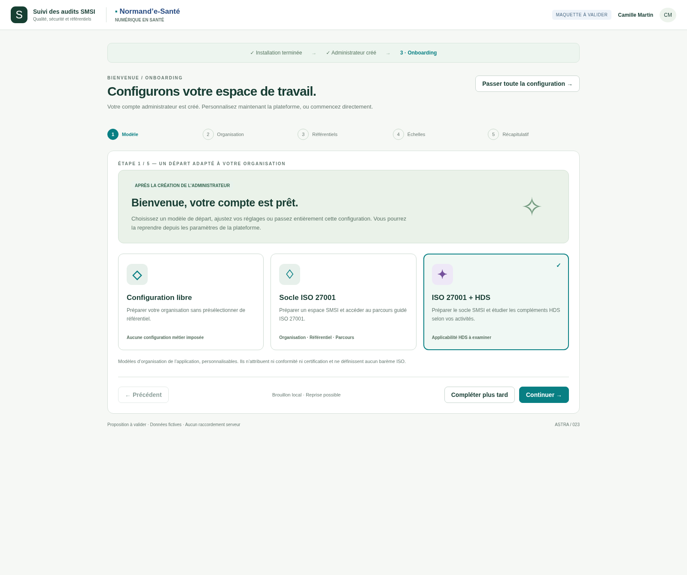
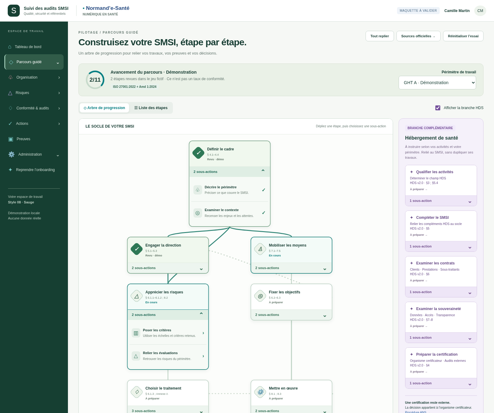
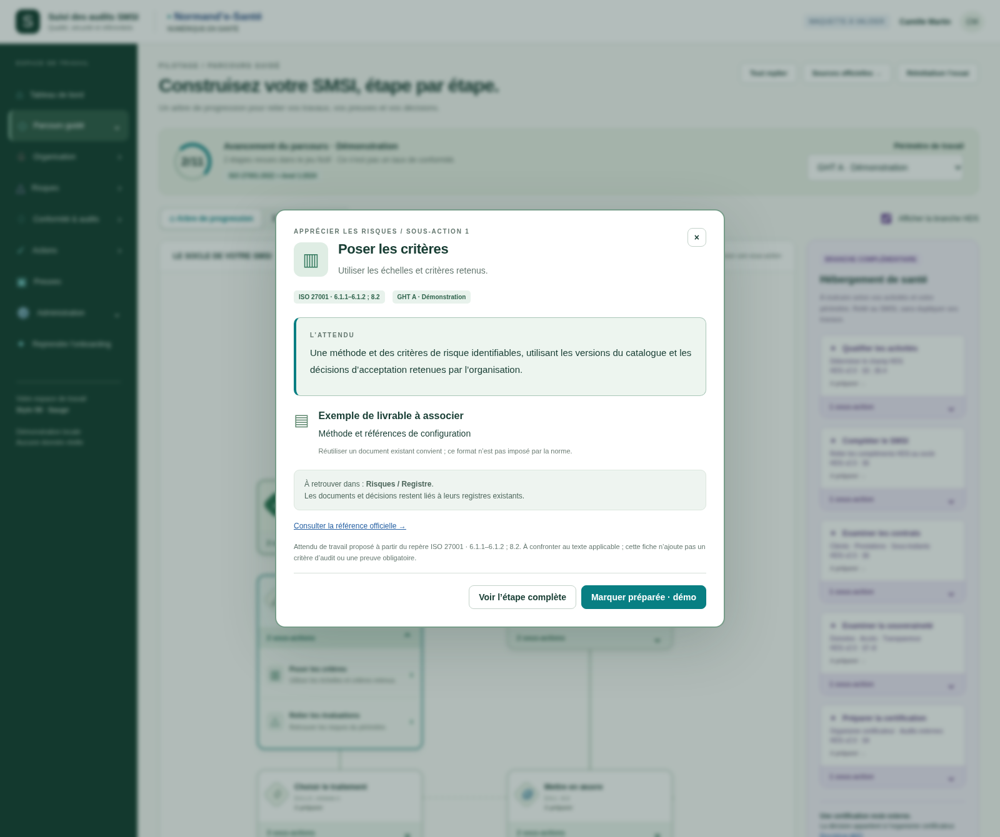

# Aperçus v002 — onboarding et sous-actions

**Maquettes à valider.** [Règles et sources officielles conservées](../demarrage-parcours-v1/SOURCES.md) · [24 contrôles exécutés](verification.json).

## Onboarding après création de l’administrateur

[Organisation et premier périmètre](../../023-premier-lancement/maquettes/v002-onboarding-sous-actions/images/02-organisation-onboarding.png) · [Sources interactives 023](../../023-premier-lancement/maquettes/v002-onboarding-sous-actions/README.md).

## Étapes dépliables et sous-actions

[Vue repliée](../../024-parcours-iso-hds/maquettes/v002-onboarding-sous-actions/images/01-arbre-replie.png) · [Sources interactives 024](../../024-parcours-iso-hds/maquettes/v002-onboarding-sous-actions/README.md).

## L’attendu au clic

[Attendu HDS](../../024-parcours-iso-hds/maquettes/v002-onboarding-sous-actions/images/04-attendu-contrats-hds.png) · [Fenêtre sur mobile](../../024-parcours-iso-hds/maquettes/v002-onboarding-sous-actions/images/05-attendu-mobile.png).

Les attendus sont des repères de travail proposés, pas de nouveaux critères normatifs. Aucune certification ou intégration métier n’est déclarée. Les versions v001 restent accessibles dans chaque fonctionnalité. Aucun ZIP/BAT.
