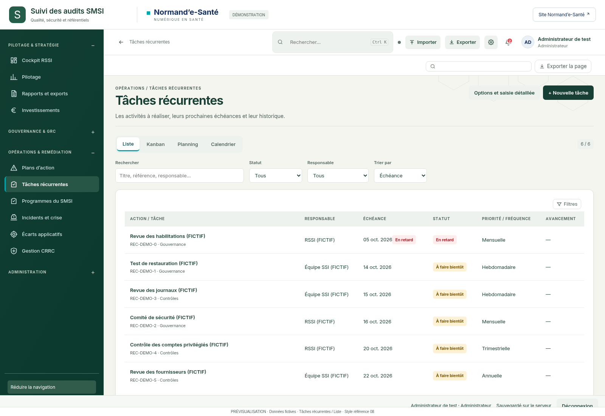
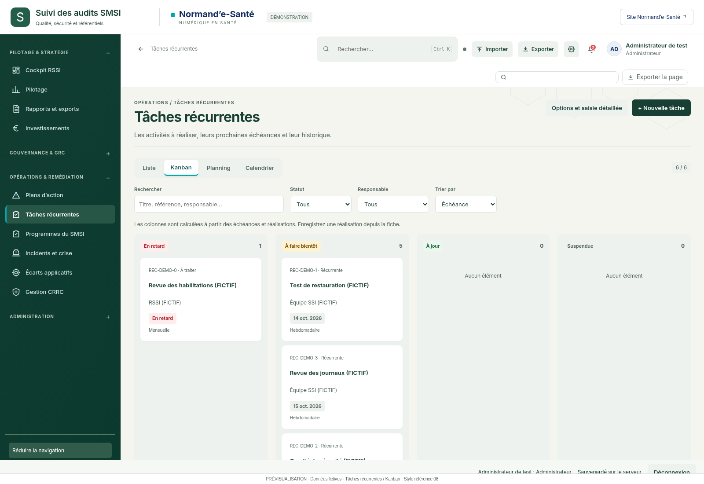
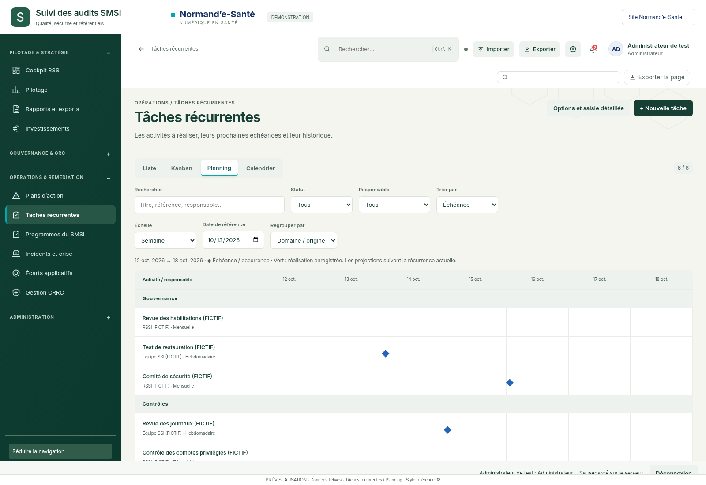
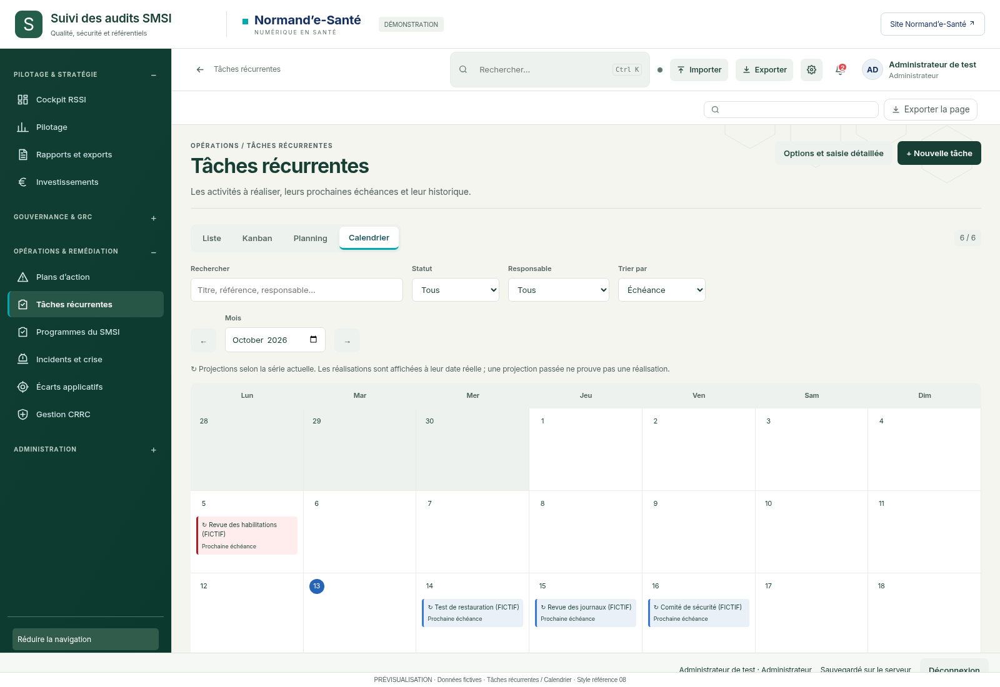
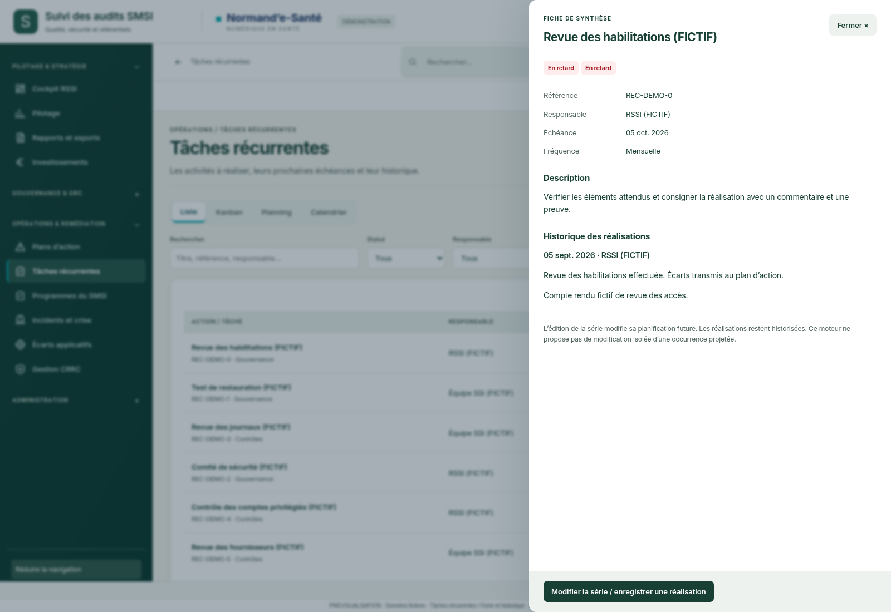

# Tâches récurrentes — référence 08

Aperçus existants regroupés par fonctionnalité. Version à valider ; aucune nouvelle fonctionnalité métier n’est déclarée implémentée. Les images sont conservées une seule fois dans les références transversales.

