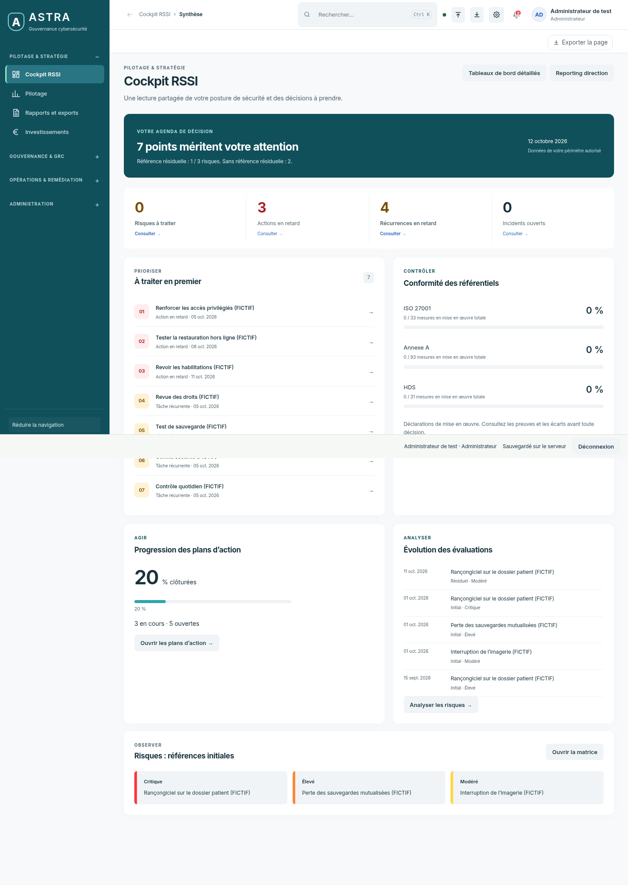
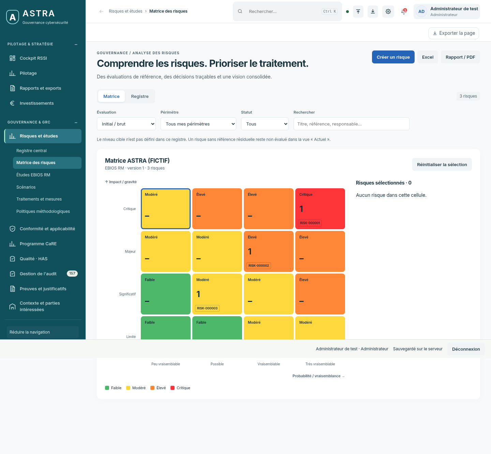
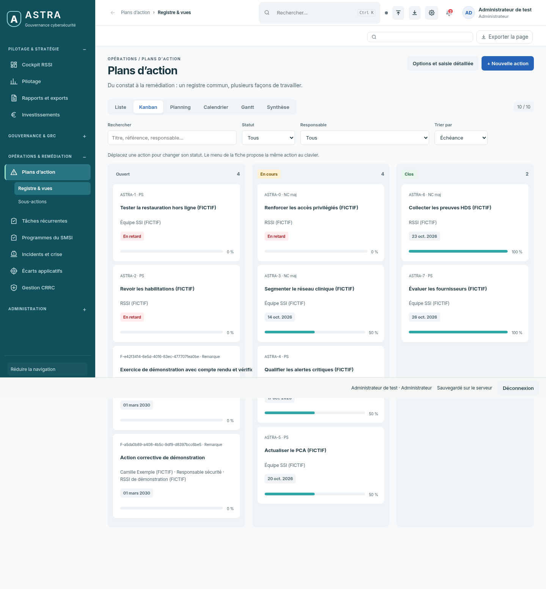

# ASTRA — aperçus du 12 octobre 2026

Première série conservée. Captures réelles de la recette avec données fictives.
Interface correspondant au commit [`1e8d9f0`](https://github.com/yousername-ha/suivi-audits/commit/1e8d9f0fe1e9eeec3bdc59ae7bd7fbcc3881106d).
Les dimensions originales et empreintes figurent dans [metadata.json](metadata.json).

[Revenir à l’historique](../README.md)

## Cockpit RSSI

## Matrice des risques

## Plans d’action — Kanban

