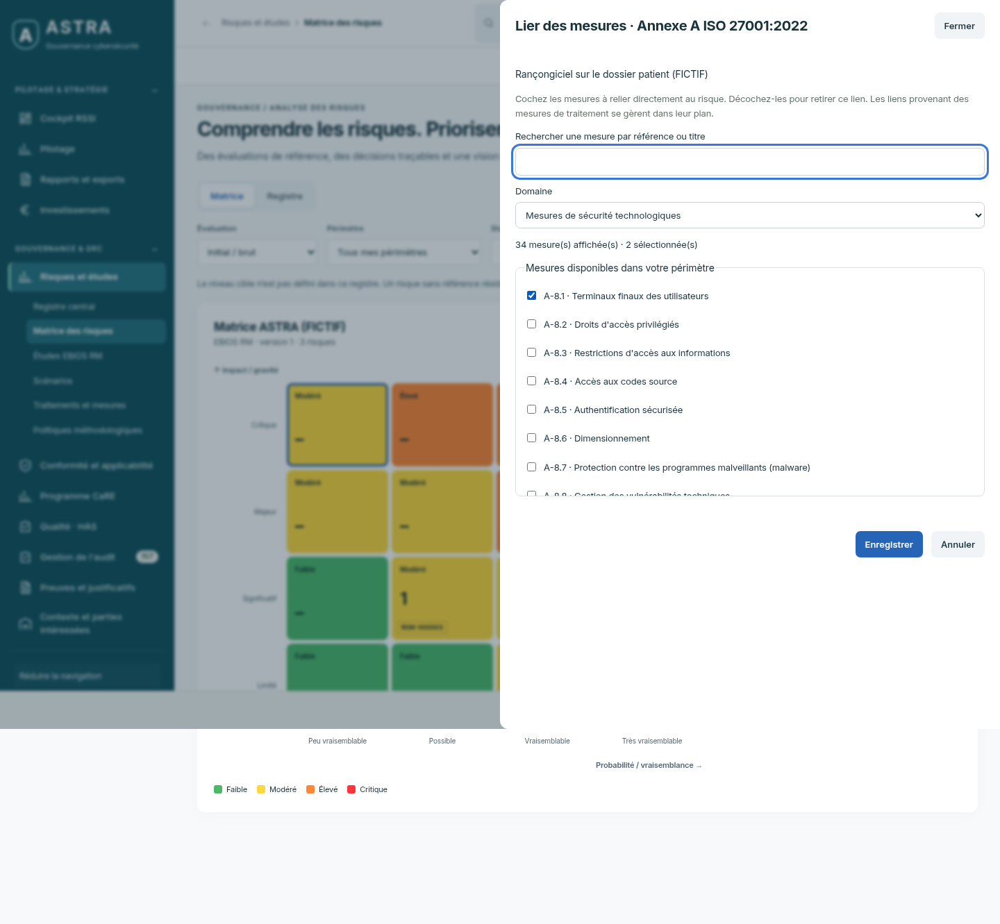
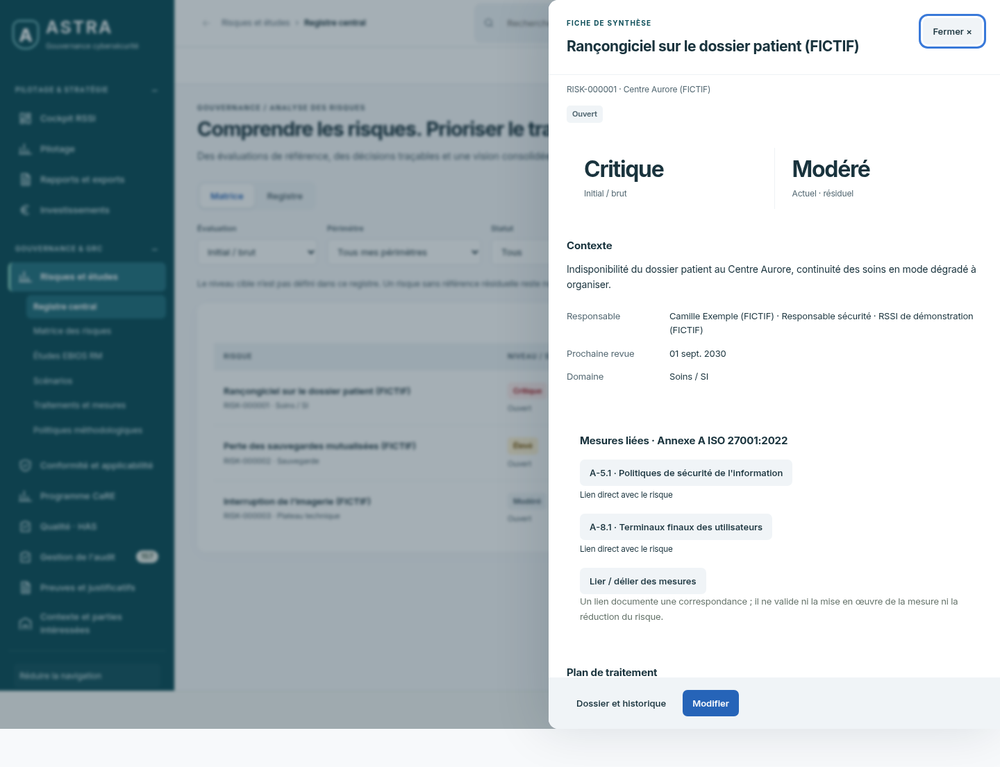

# ASTRA — liens risques / Annexe A — 12 octobre 2026

Série 02. Captures de l’application au commit [`6de35a3`](https://github.com/yousername-ha/suivi-audits/commit/6de35a3cdc5203d3f45c8c6c2e3dae870fd31e5f), avec données fictives.

[Revenir à l’historique](../README.md)

## Choisir les mesures de l’Annexe A ISO 27001:2022

Recherche par référence ou titre, filtre par domaine et sélection multiple.

## Consulter les mesures liées depuis la fiche du risque

Chaque mesure ouvre sa fiche de conformité. Les liens directs peuvent être retirés
sans supprimer la mesure ni modifier les évaluations du risque.

