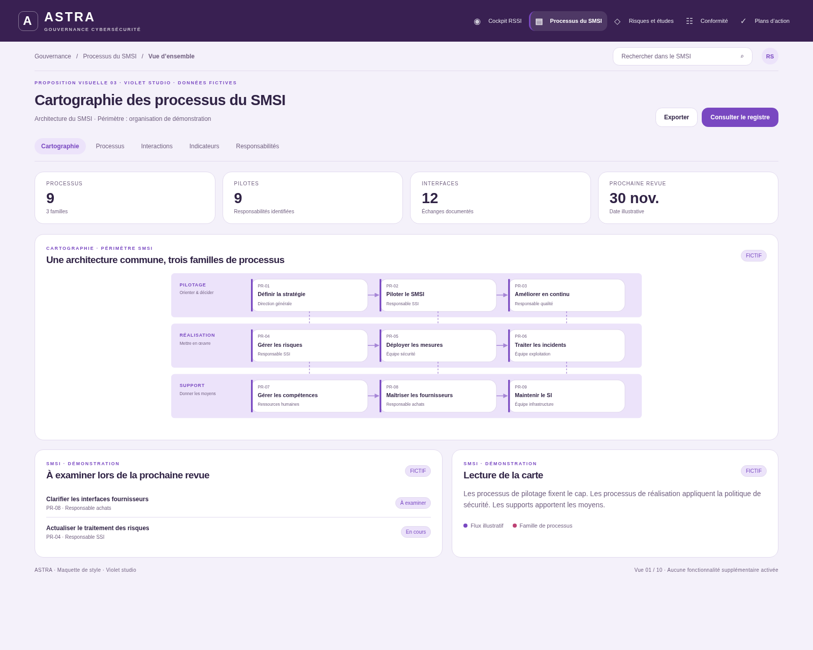
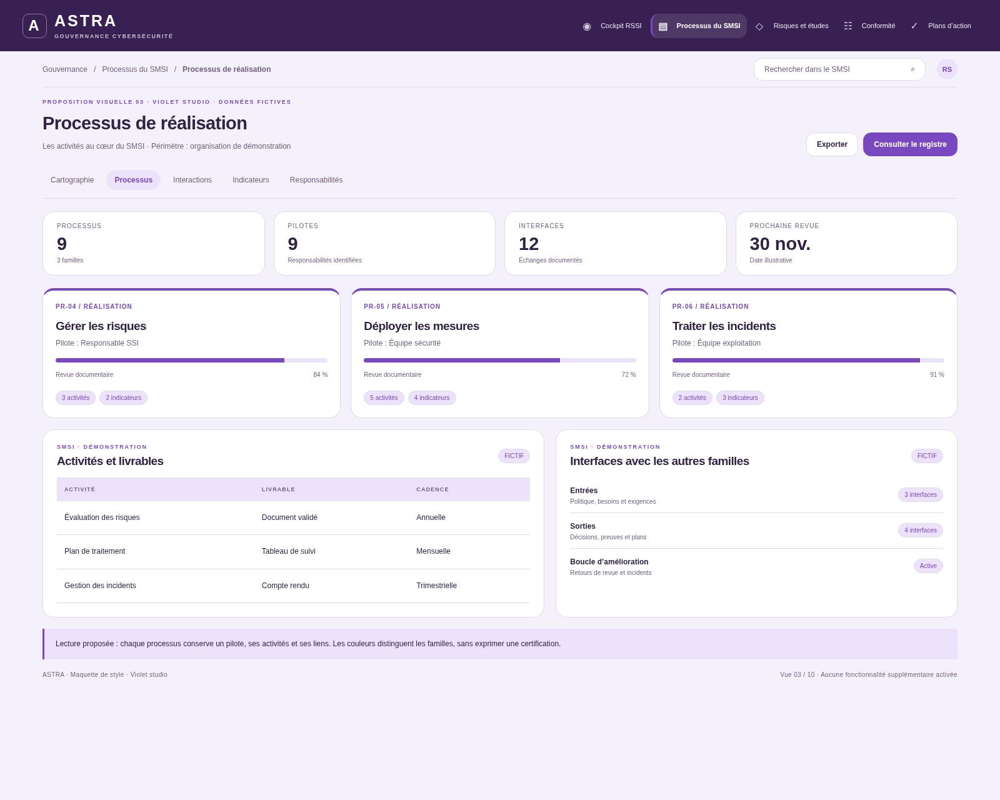
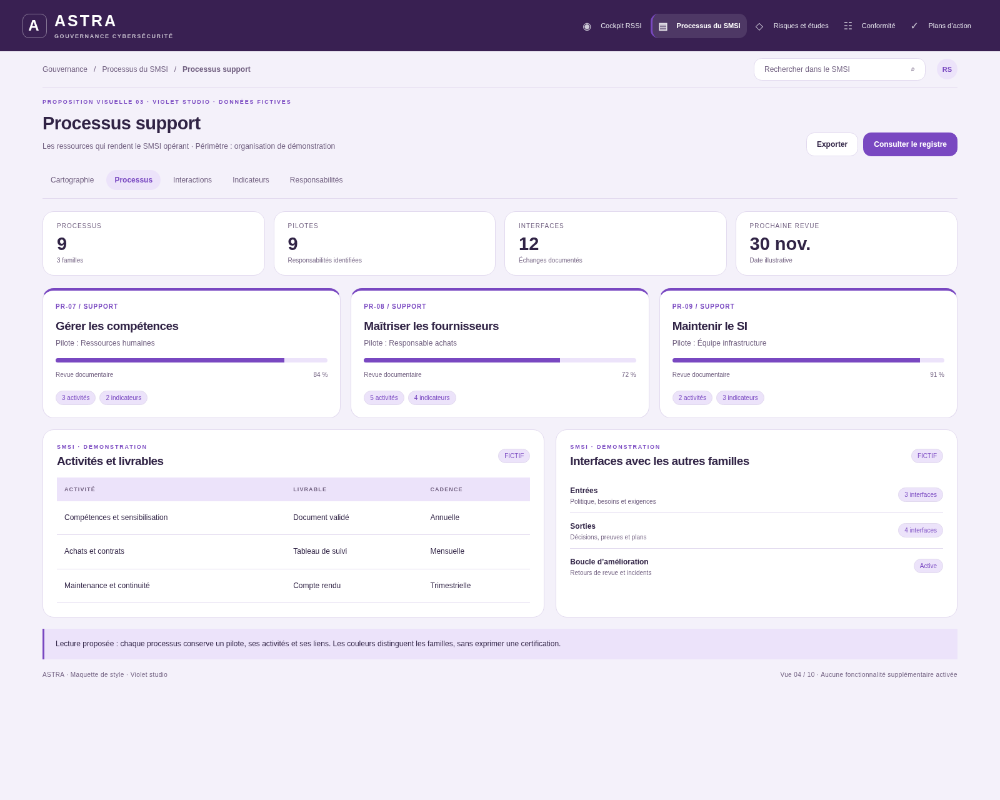
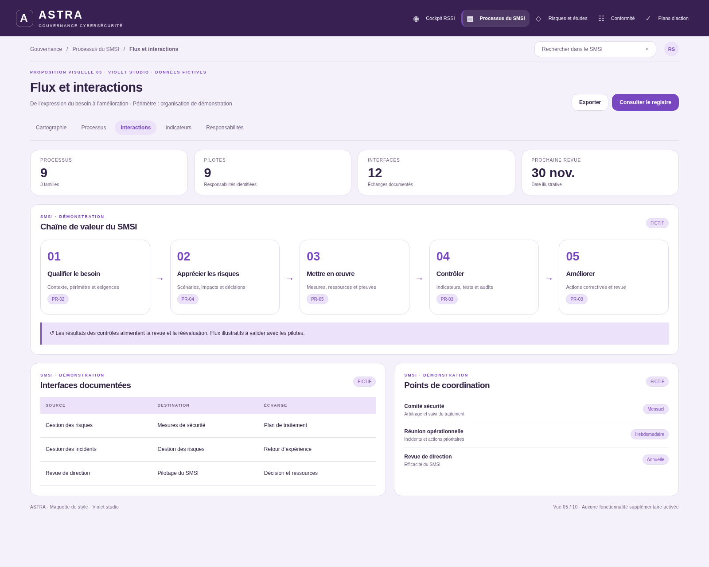
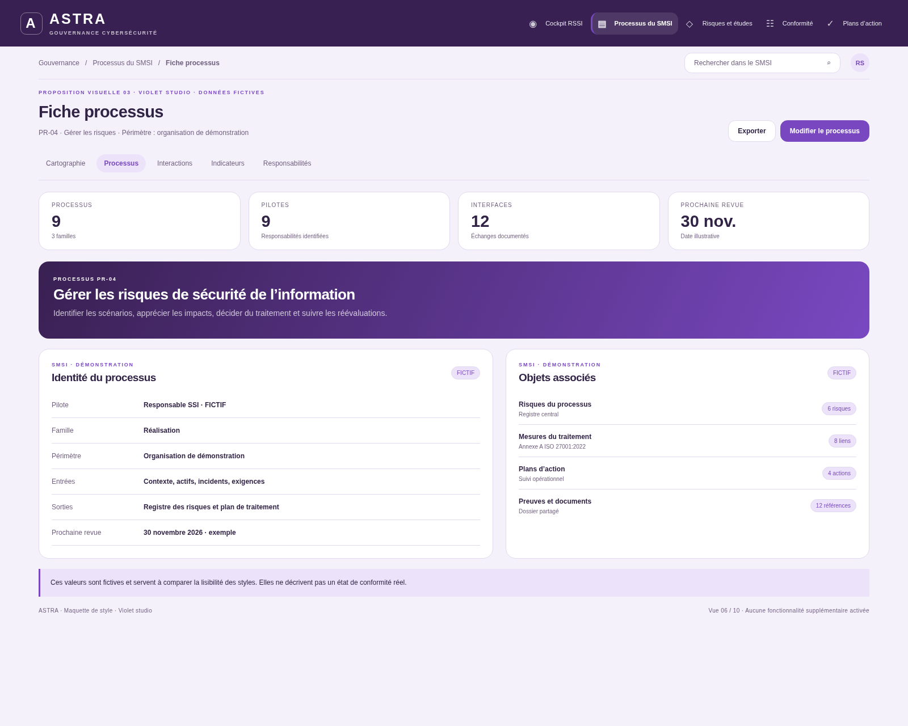
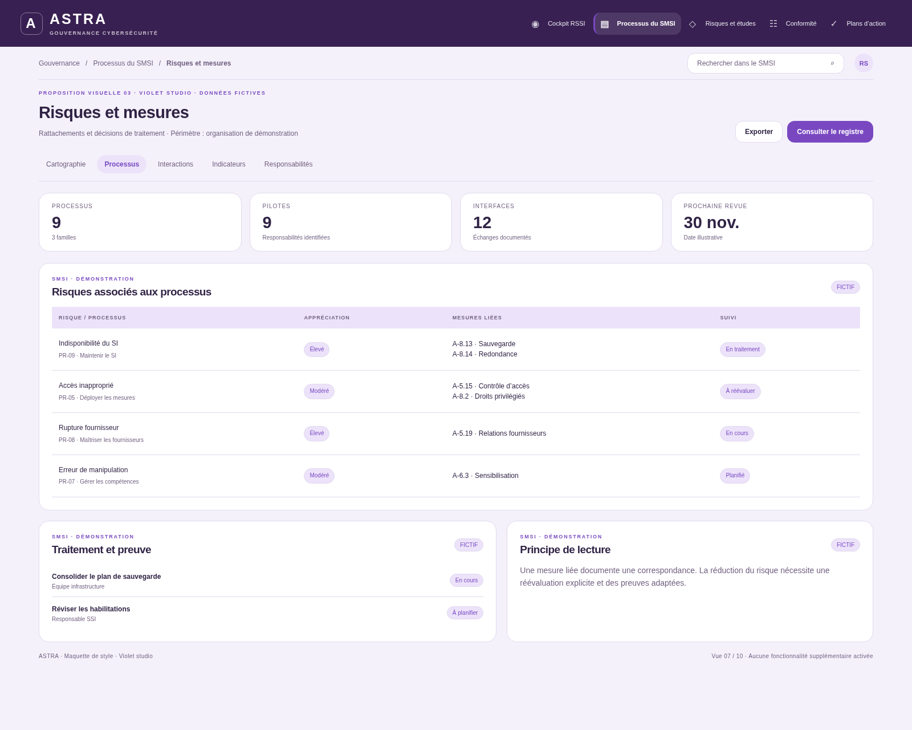
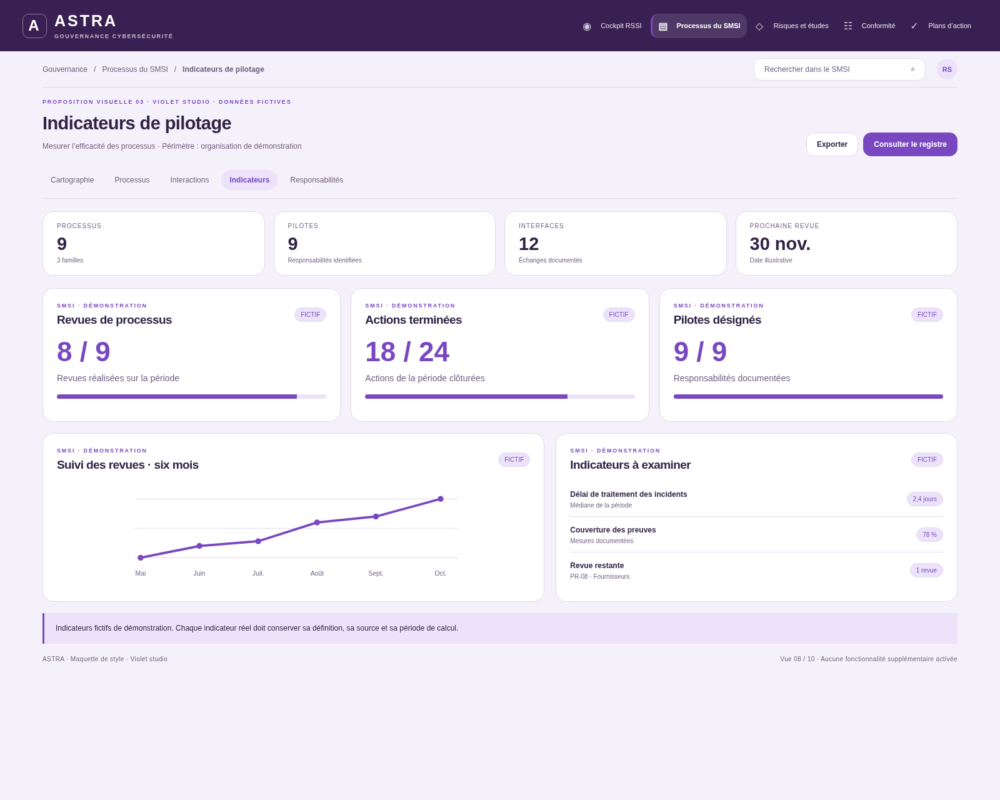
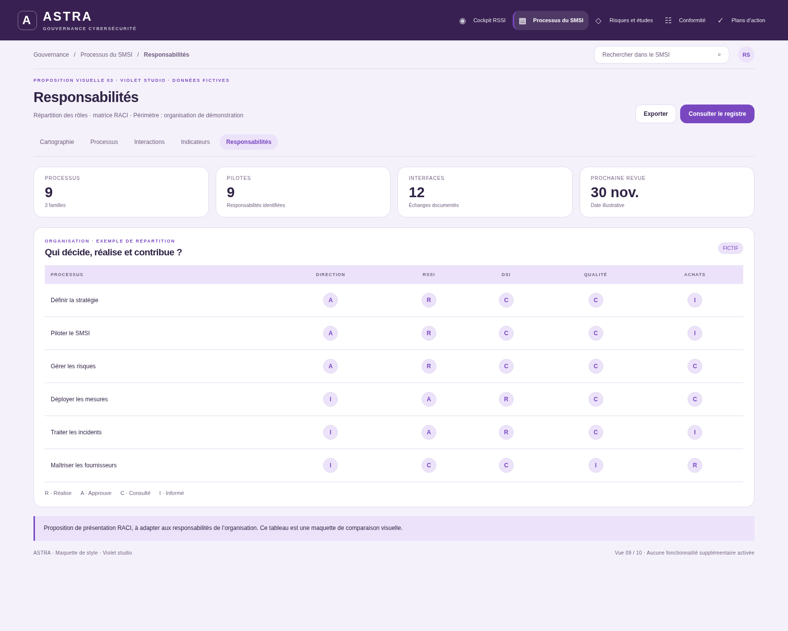
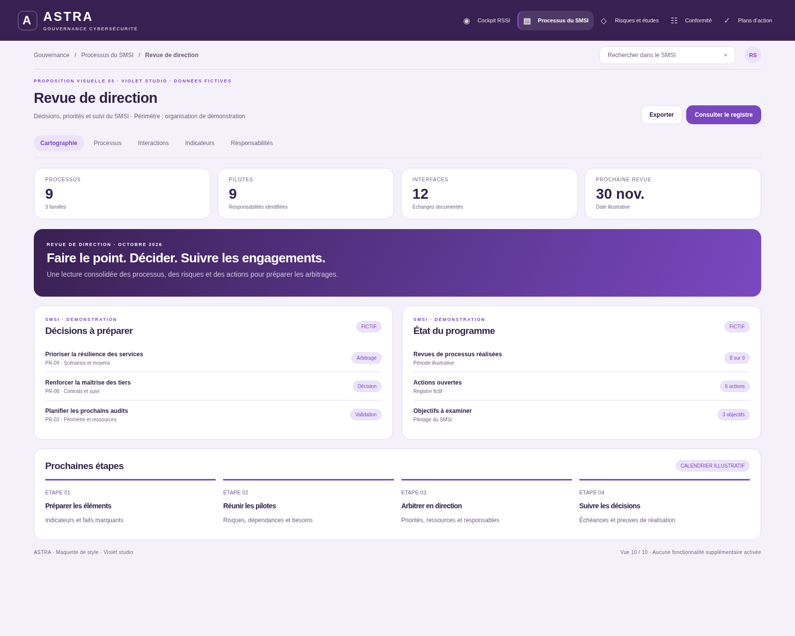

# Violet studio

Navigation supérieure, onglets arrondis et accents lilas.

Palette : navigation `#392052` · accent `#7948c1` · fond `#f4f1fa`.

**10 vues originales · 1600 × 1280 · données fictives · propositions non intégrées à l’application.**

[Comparer les dix styles](../README.md)

## 01 · Vue d’ensemble

## 02 · Processus de pilotage

## 03 · Processus de réalisation

## 04 · Processus support

## 05 · Flux et interactions

## 06 · Fiche processus

## 07 · Risques et mesures

## 08 · Indicateurs

## 09 · Responsabilités / RACI

## 10 · Revue de direction

