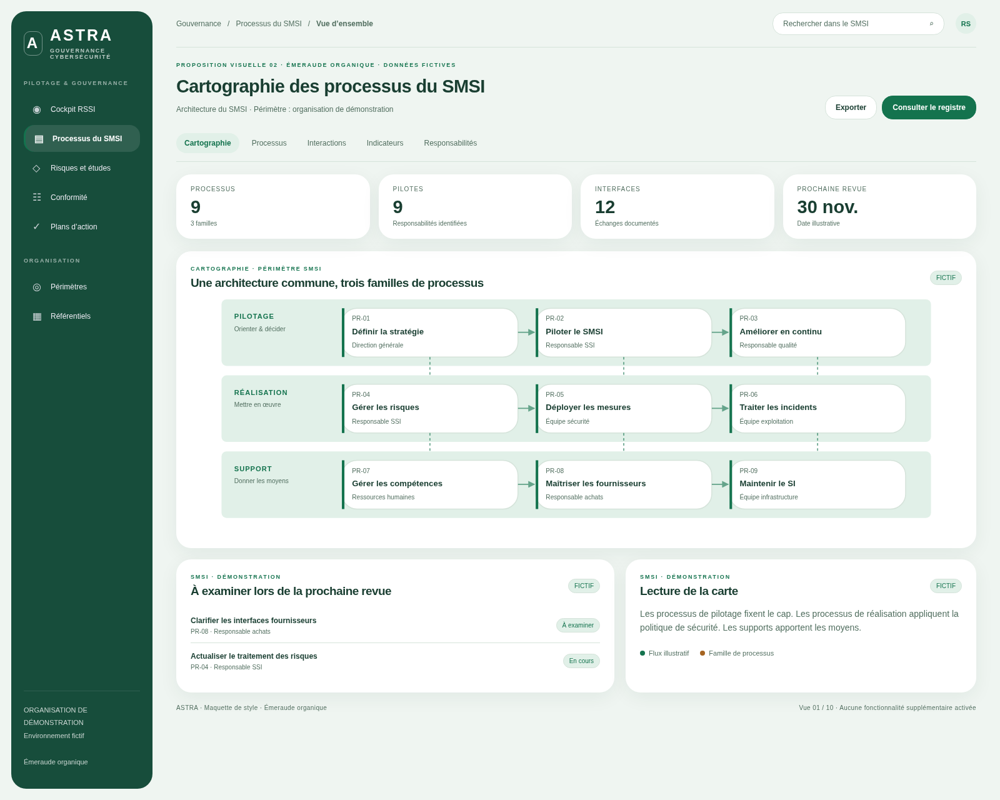
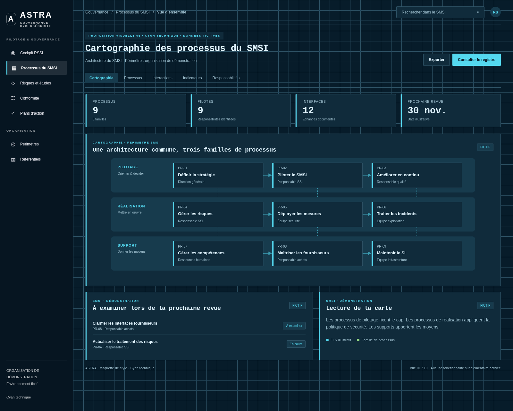
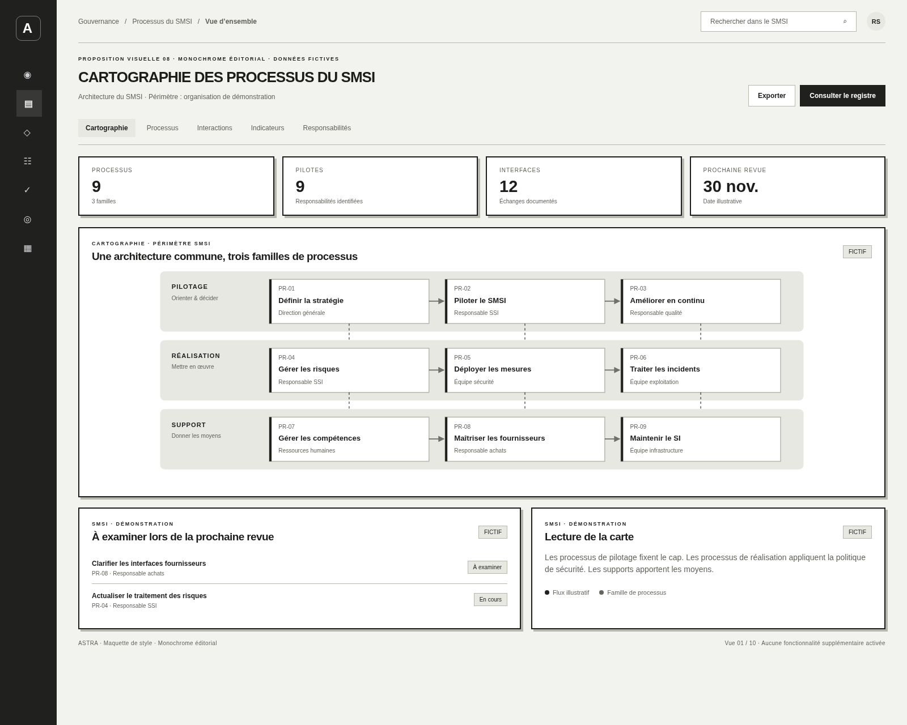

# 10 styles de cartographie des processus du SMSI

**100 images : 10 styles × 10 vues, en PNG 1600 × 1280.**

Propositions visuelles sur données fictives. Ces images servent à choisir une direction graphique ; elles ne constituent pas une modification de l’application ni une preuve de fonctionnalités déjà intégrées. Le périmètre retenu est la cartographie des processus du SMSI, conformément au contexte de la demande.

[Revenir à l’historique des aperçus](../README.md)

## Comparer les styles

| Style | Direction | Palette | Galerie |
| --- | --- | --- | --- |
| **Bleu institutionnel** | Grille structurée, cartes nettes et navigation latérale. | `#152e53` · `#2363d4` · `#f1f5fa` | [Voir les 10 images](01-bleu-institutionnel/README.md) |
| **Émeraude organique** | Surfaces douces, angles généreux et navigation flottante. | `#174d3b` · `#14734e` · `#eff5f1` | [Voir les 10 images](02-emeraude-organique/README.md) |
| **Violet studio** | Navigation supérieure, onglets arrondis et accents lilas. | `#392052` · `#7948c1` · `#f4f1fa` | [Voir les 10 images](03-violet-studio/README.md) |
| **Graphite & ambre** | Interface sombre, contrastes chauds et information dense. | `#111419` · `#efb34d` · `#191c21` | [Voir les 10 images](04-graphite-ambre/README.md) |
| **Cyan technique** | Grille de précision, typographie monospace et cyan lumineux. | `#061521` · `#54d8ef` · `#071c2a` | [Voir les 10 images](05-cyan-technique/README.md) |
| **Terre cuite** | Fond lin, titres éditoriaux et palette terre naturelle. | `#643e2b` · `#a4482d` · `#f4eee5` | [Voir les 10 images](06-terre-cuite/README.md) |
| **Encre & or** | Titres sérif, filets fins et compositions sobres sur fond nuit. | `#101322` · `#d9b873` · `#171b2c` | [Voir les 10 images](07-encre-et-or/README.md) |
| **Monochrome éditorial** | Noir et blanc, cadres francs, repères numérotés et rail compact. | `#20201f` · `#20201f` · `#f2f2ee` | [Voir les 10 images](08-monochrome-editorial/README.md) |
| **Corail & marine** | Cartes expressives, aplats corail et navigation horizontale. | `#203047` · `#b84332` · `#fff1ed` | [Voir les 10 images](09-corail-marine/README.md) |
| **Lavande minérale** | Palette désaturée, grandes respirations et surfaces feutrées. | `#514860` · `#766095` · `#f1f0f5` | [Voir les 10 images](10-lavande-minerale/README.md) |

## Aperçus des dix directions

### Bleu institutionnel

### Émeraude organique

### Violet studio

### Graphite & ambre

### Cyan technique

### Terre cuite

### Encre & or

### Monochrome éditorial

### Corail & marine

### Lavande minérale

## Les dix vues de chaque style

1. Vue d’ensemble.
2. Processus de pilotage.
3. Processus de réalisation.
4. Processus support.
5. Flux et interactions.
6. Fiche processus.
7. Risques et mesures.
8. Indicateurs.
9. Responsabilités / RACI.
10. Revue de direction.

## Conservation et reproduction

Les séries précédentes restent intactes. Toute nouvelle proposition sera ajoutée dans une autre série datée. Aucune suppression sans demande explicite de l’utilisateur.

Sources autonomes : `preview.html` et `styles.json`. Pour consulter les maquettes dans un navigateur, servir ce dossier avec `python3 -m http.server 8000 --bind 127.0.0.1`, puis ouvrir `http://127.0.0.1:8000/preview.html`. Les paramètres `style` (identifiant du dossier) et `view` (1 à 10) sélectionnent le rendu.

Pour reproduire la série, copier d’abord ce dossier dans un répertoire temporaire : ne pas écraser la série archivée. Le script `generate.cjs` produit les captures avec Playwright et Chromium. Il vérifie les dimensions, les débordements, les erreurs JavaScript et l’unicité des 100 images ; `metadata.json` consigne les empreintes SHA-256. Les boutons des maquettes sont illustratifs.
