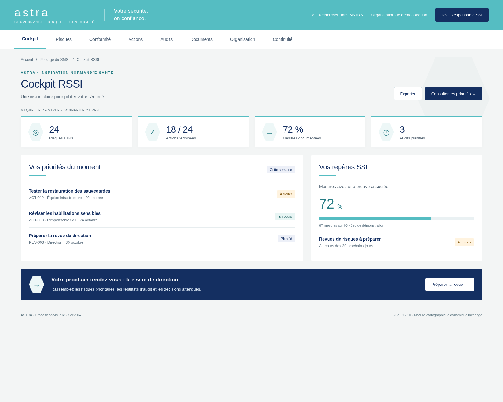
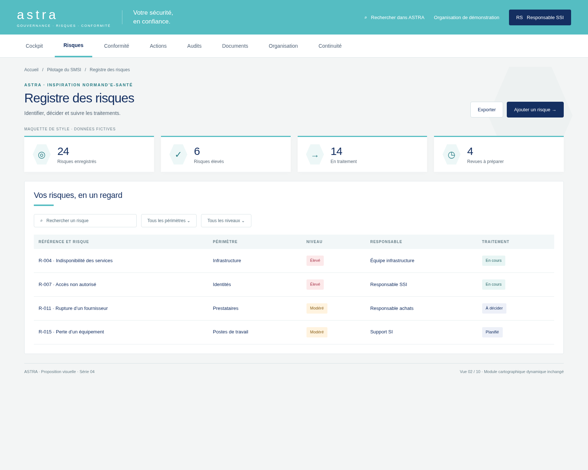
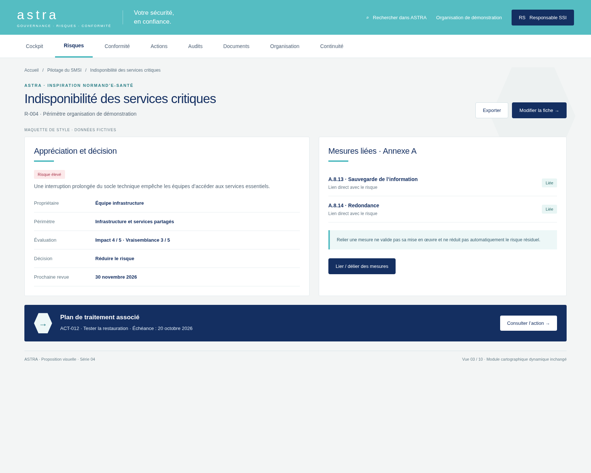
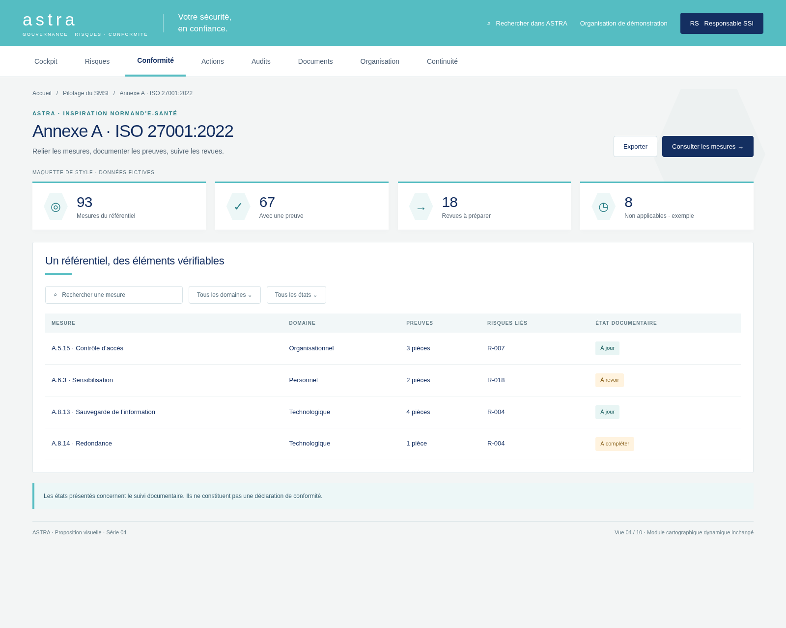
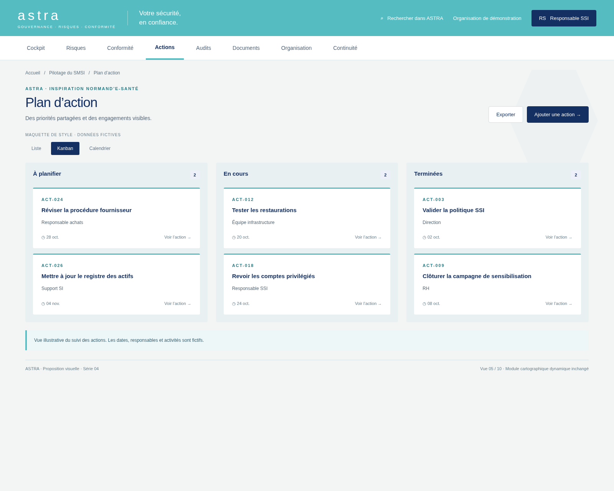
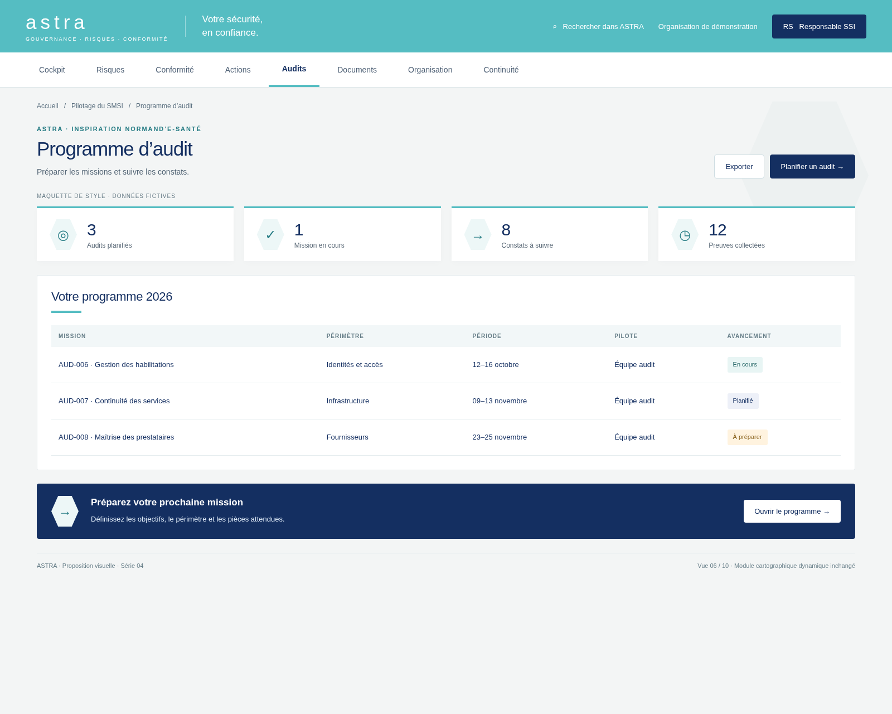
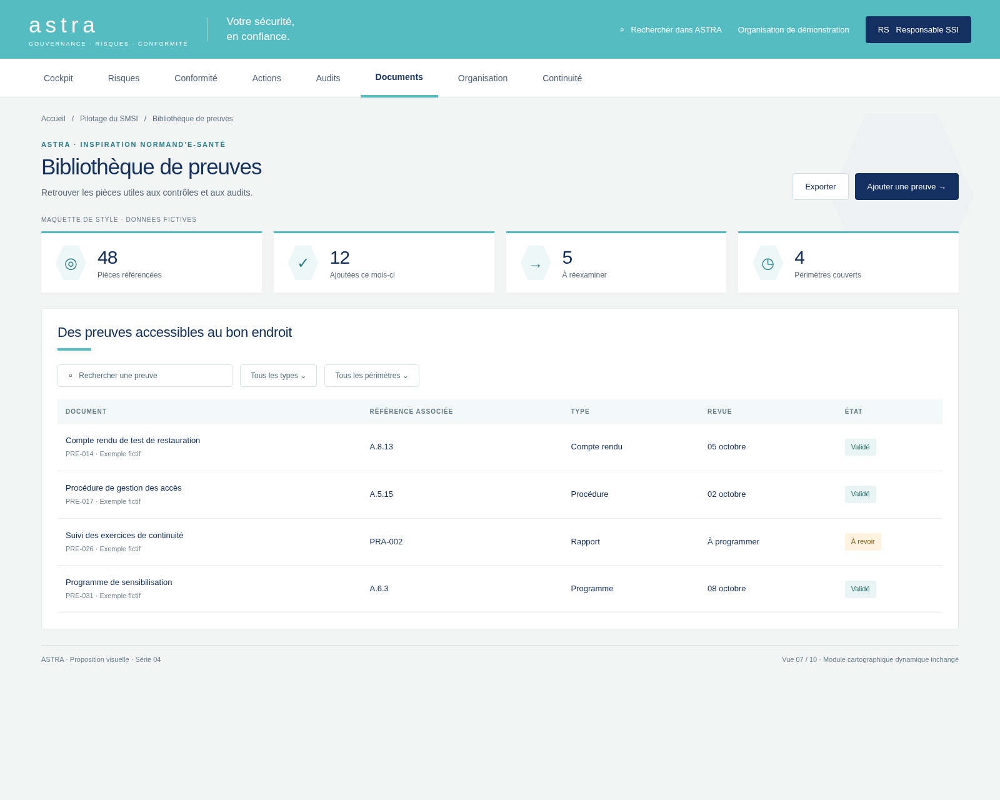
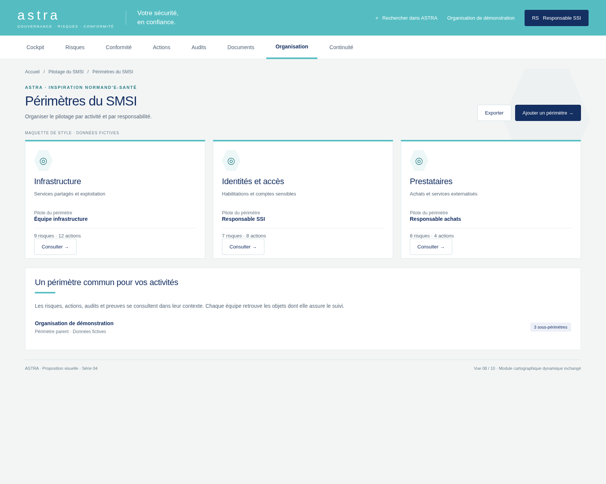
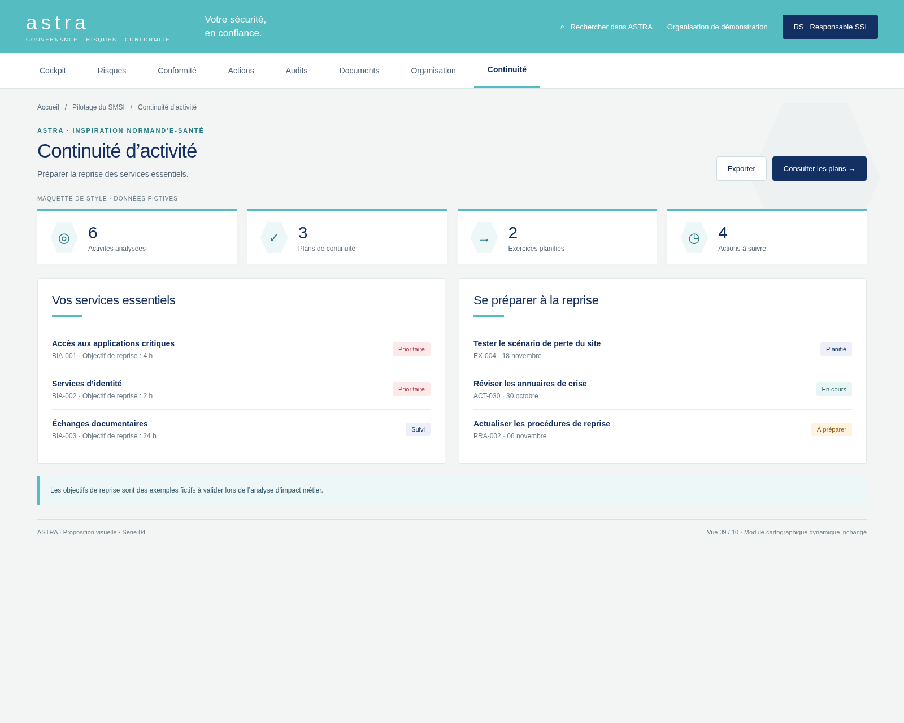
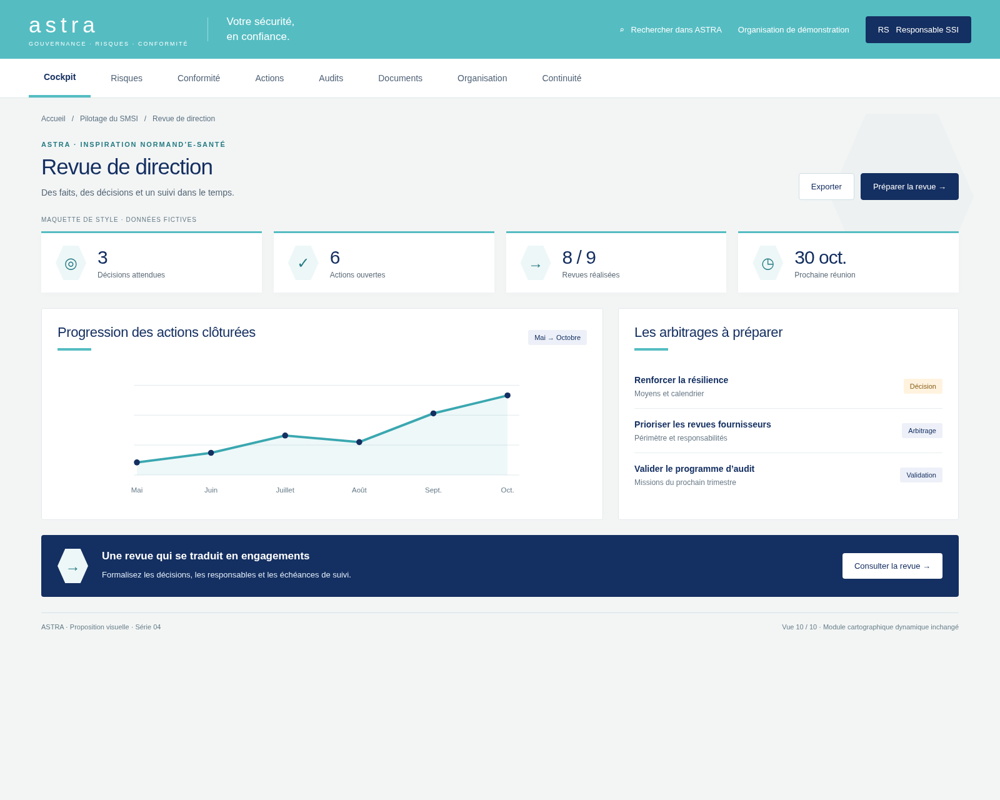

# ASTRA — Inspiration Normand’e-Santé

Dix propositions visuelles inspirées du [site Normand’e-Santé](https://www.normand-esante.fr/), consulté le 12 octobre 2026.

Bandeau turquoise, titres et boutons bleu marine, surfaces claires, séparateurs fins et motifs hexagonaux. Adaptation originale pour ASTRA : le logo, les photographies, les polices du site et les contenus du site ne sont pas repris. La typographie utilise Arial et les polices système.

**Maquettes uniquement, non intégrées à l’application. Données entièrement fictives. La cartographie dynamique et son interface sont inchangées.** Les séries précédentes sont conservées.

Référence de l’application : `06656bfd3e8c25416bf3cf1d51f0a9cb091a752f` sur `legacy`. Le rendu illustre une direction graphique ; il ne constitue pas une capture des fonctionnalités déployées.

## Palette

| Usage | Couleur |
| --- | --- |
| Bandeau et accents | `#55BDC2` |
| Titres et boutons | `#142F61` |
| Texte turquoise foncé | `#267C84` |
| Fond | `#F3F5F5` |
| Surfaces | `#FFFFFF` |

## Les dix écrans

### Cockpit RSSI

[Ouvrir en pleine résolution](01-cockpit.png)

### Registre des risques

[Ouvrir en pleine résolution](02-registre-risques.png)

### Indisponibilité des services critiques

[Ouvrir en pleine résolution](03-detail-risque.png)

### Annexe A · ISO 27001:2022

[Ouvrir en pleine résolution](04-annexe-a.png)

### Plan d’action

[Ouvrir en pleine résolution](05-plan-actions.png)

### Programme d’audit

[Ouvrir en pleine résolution](06-audits.png)

### Bibliothèque de preuves

[Ouvrir en pleine résolution](07-preuves.png)

### Périmètres du SMSI

[Ouvrir en pleine résolution](08-perimetres.png)

### Continuité d’activité

[Ouvrir en pleine résolution](09-continuite.png)

### Revue de direction

[Ouvrir en pleine résolution](10-revue-direction.png)

## Reproduire les captures

Avec Node.js, Playwright et Chromium disponibles : `node generate.cjs`. Le script sert uniquement cette maquette sur localhost et ne charge pas l’application. `CHROMIUM_EXECUTABLE` permet de préciser le navigateur. `preview.html?view=1` à `?view=10` sélectionne un écran. Les boutons sont illustratifs.
