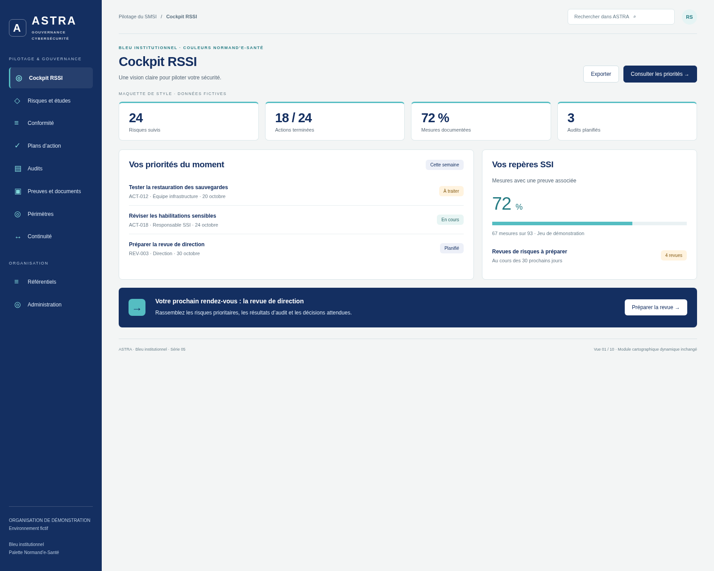
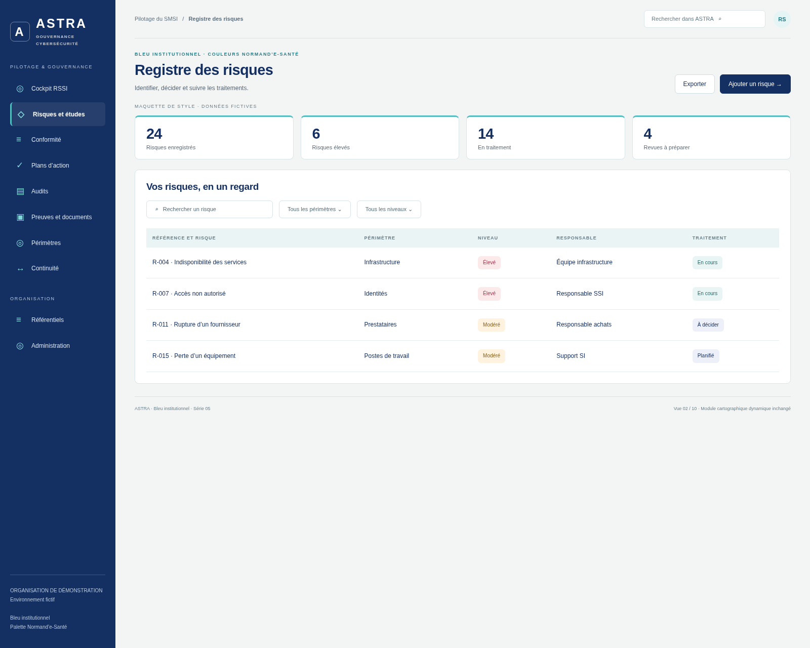
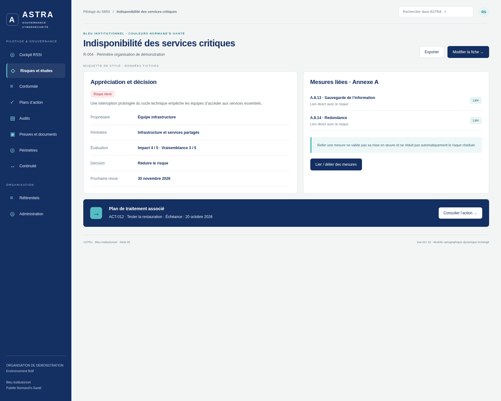
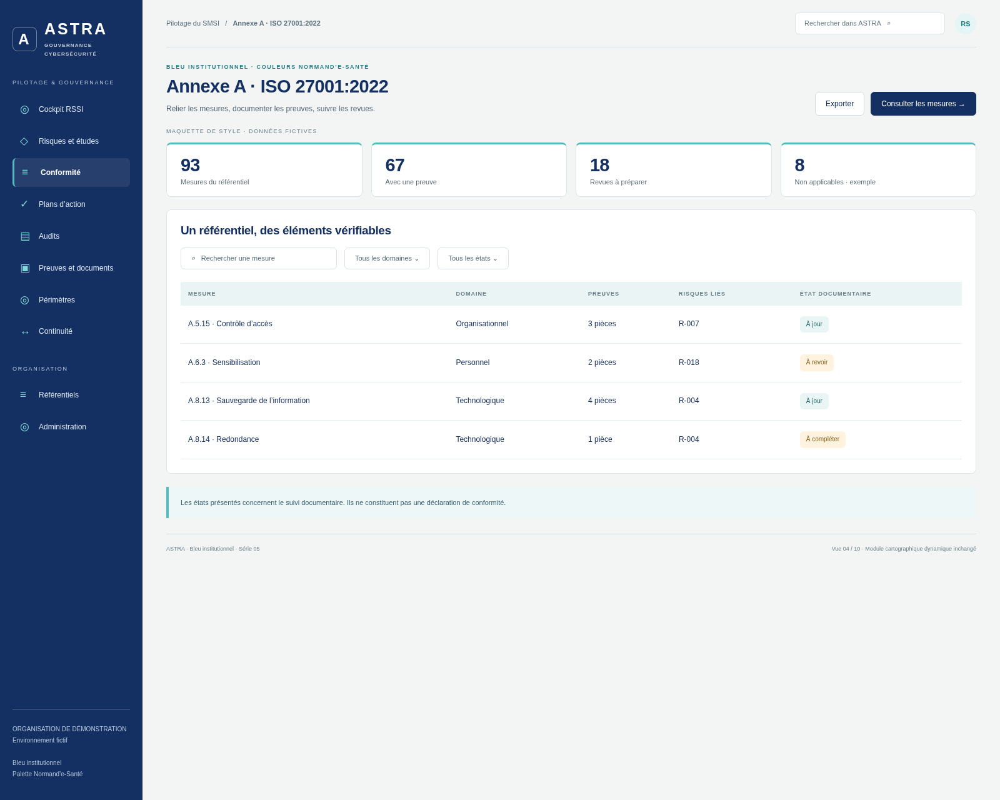
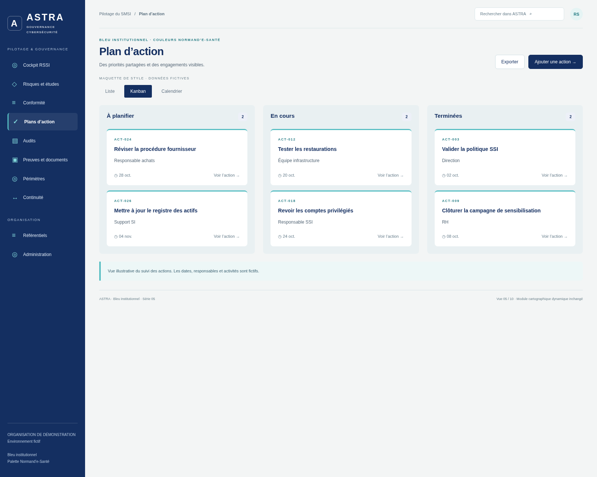
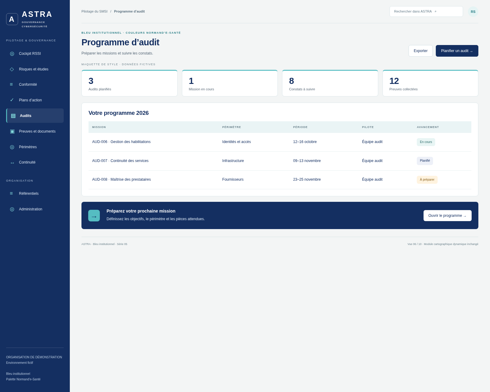
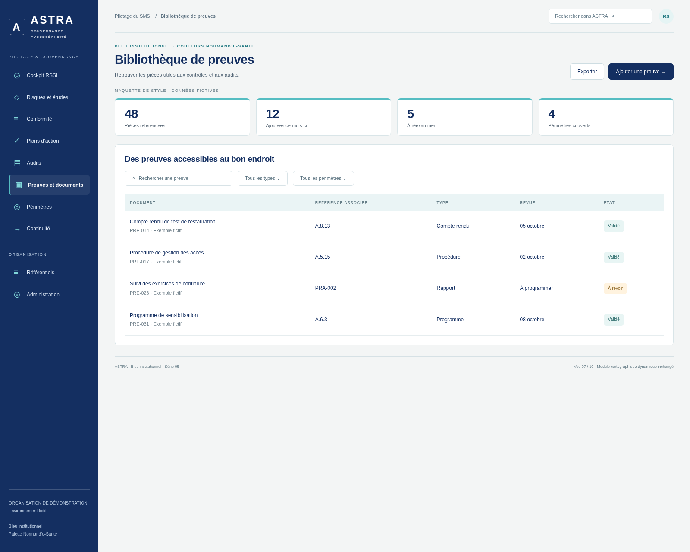
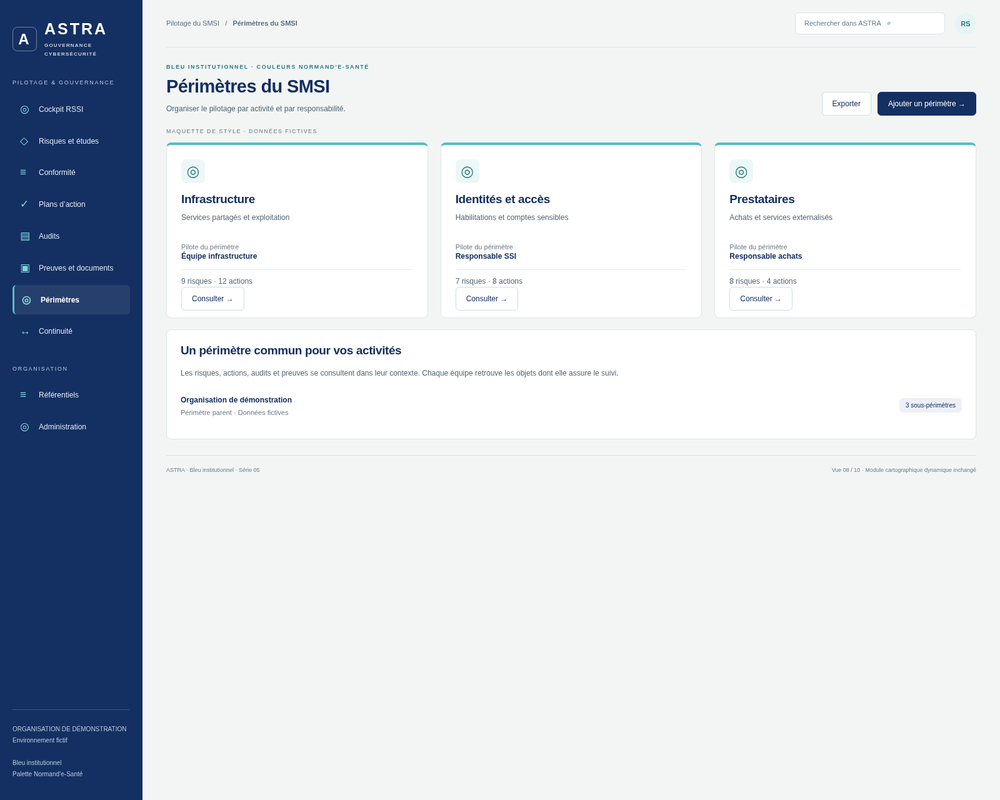
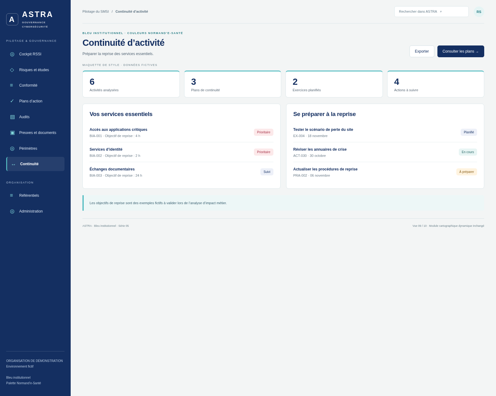
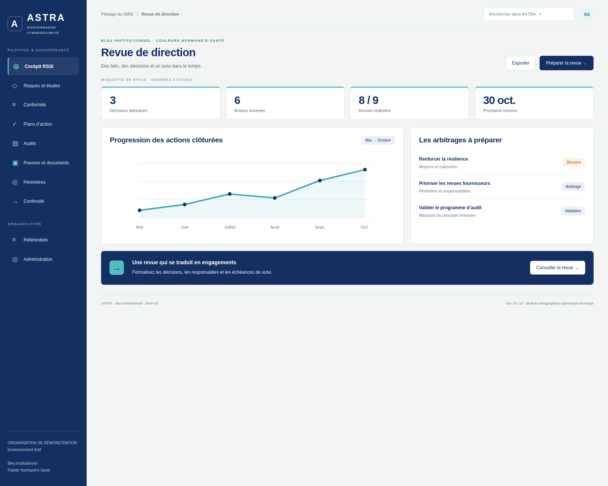

# ASTRA — Bleu institutionnel, couleurs Normand’e-Santé

Le style **Bleu institutionnel** de la [série 03](../2026-10-12-astra-03/01-bleu-institutionnel/README.md), décliné avec la palette du [site Normand’e-Santé](https://www.normand-esante.fr/).

Navigation latérale bleu marine, grille structurée, cartes blanches aux angles de 8 px, accents turquoise et typographie sobre. Les dix vues reprennent les écrans de la série 04 pour faciliter la comparaison.

**Propositions visuelles uniquement, non intégrées à l’application. Données fictives. La cartographie dynamique, son interface et son fonctionnement restent inchangés.** L’historique des images est conservé.

Référence de l’application : `18ac83c168663463ca40cf349d1c2f2660858dce`, branche `legacy`.

## Palette

| Usage | Couleur |
| --- | --- |
| Navigation, titres et boutons | `#142F61` |
| Accents et repères | `#55BDC2` |
| Texte turquoise foncé | `#267C84` |
| Fond | `#F3F5F5` |
| Cartes | `#FFFFFF` |

## Dix aperçus · 1600 × 1280

### Cockpit RSSI

[Ouvrir l’image originale](01-cockpit.png)

### Registre des risques

[Ouvrir l’image originale](02-registre-risques.png)

### Indisponibilité des services critiques

[Ouvrir l’image originale](03-detail-risque.png)

### Annexe A · ISO 27001:2022

[Ouvrir l’image originale](04-annexe-a.png)

### Plan d’action

[Ouvrir l’image originale](05-plan-actions.png)

### Programme d’audit

[Ouvrir l’image originale](06-audits.png)

### Bibliothèque de preuves

[Ouvrir l’image originale](07-preuves.png)

### Périmètres du SMSI

[Ouvrir l’image originale](08-perimetres.png)

### Continuité d’activité

[Ouvrir l’image originale](09-continuite.png)

### Revue de direction

[Ouvrir l’image originale](10-revue-direction.png)

## Reproduire les captures

Avec Node.js, Playwright et Chromium : `node generate.cjs`. Le script sert uniquement cette maquette sur localhost. `CHROMIUM_EXECUTABLE` permet de choisir le navigateur. `preview.html?view=1` à `?view=10` sélectionne un écran. Les boutons sont illustratifs.
