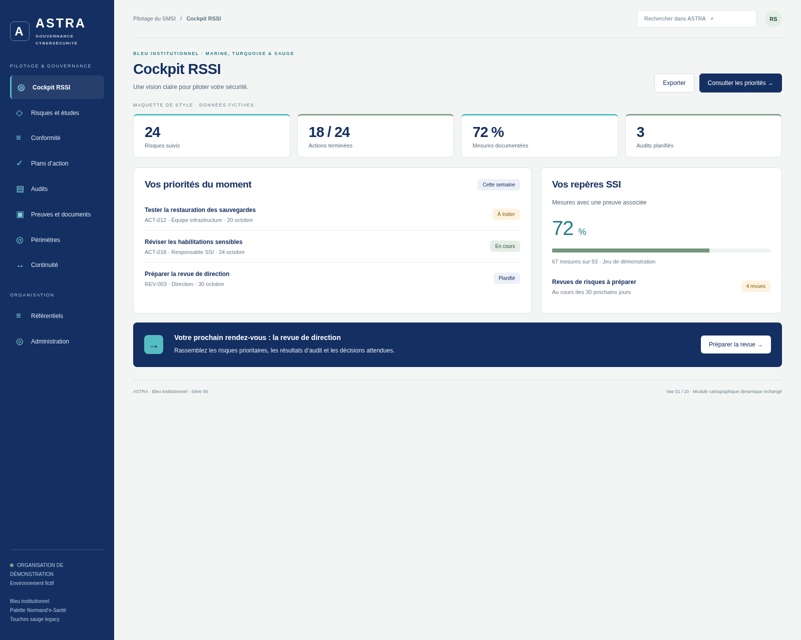
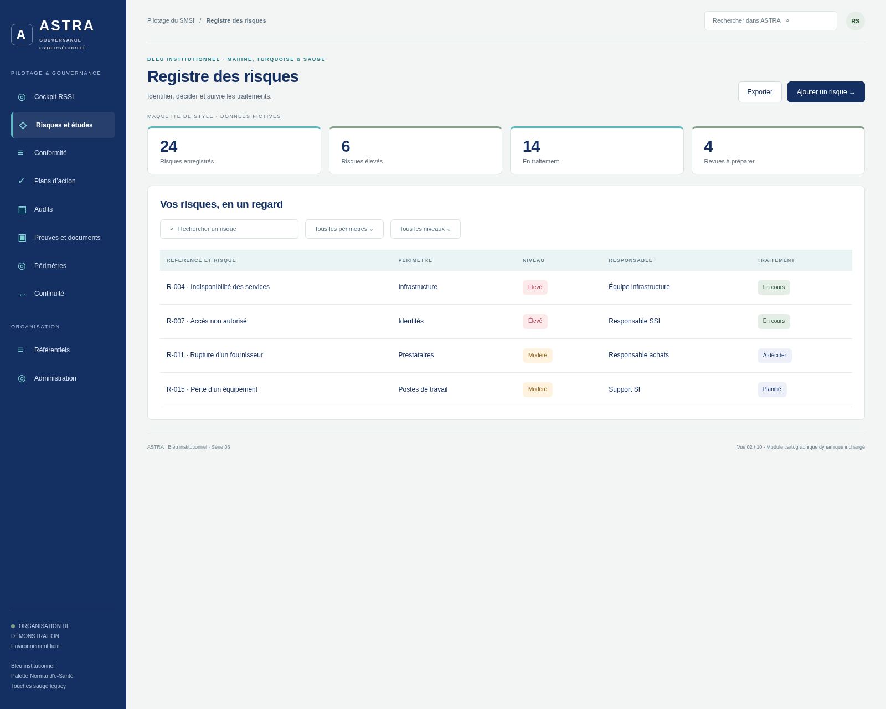
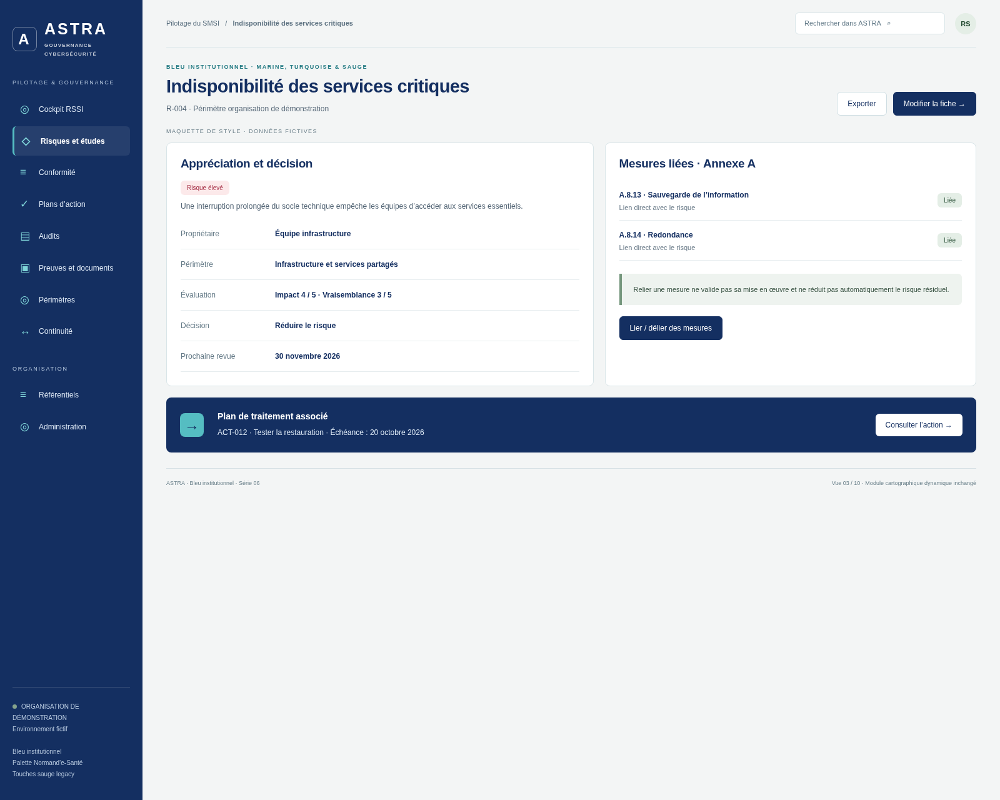
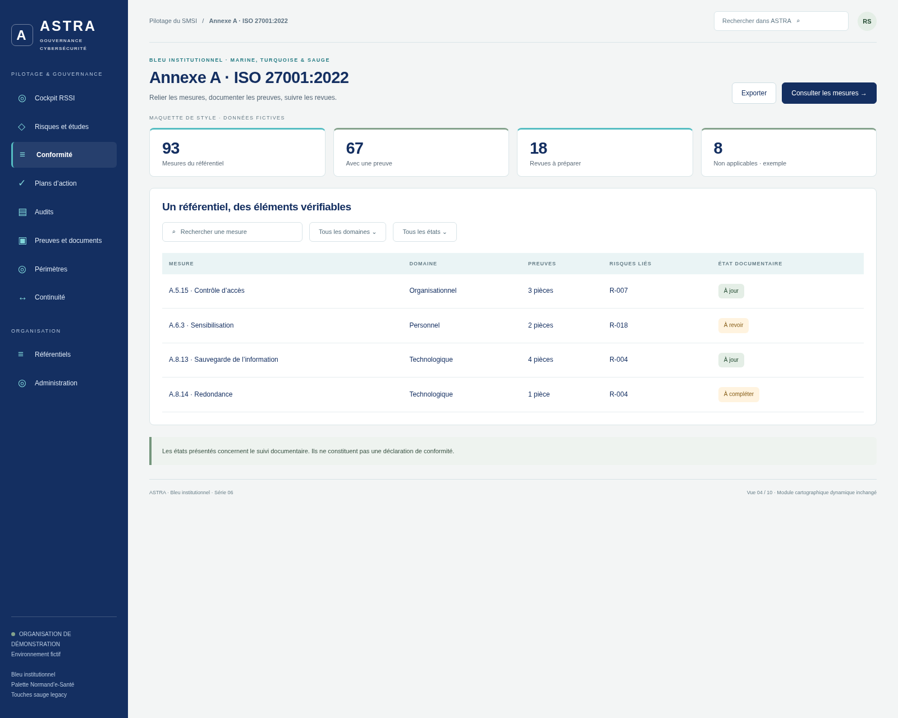
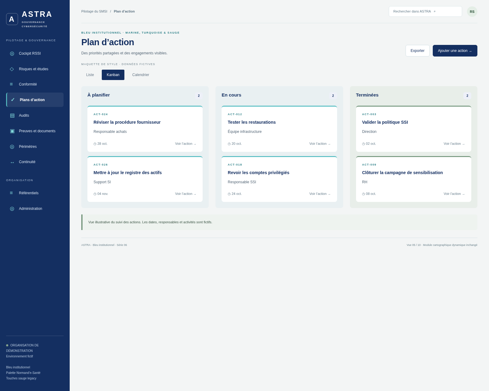
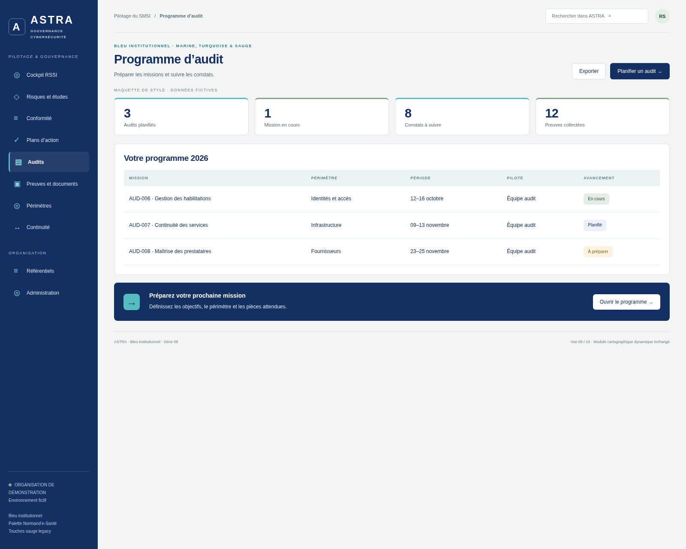
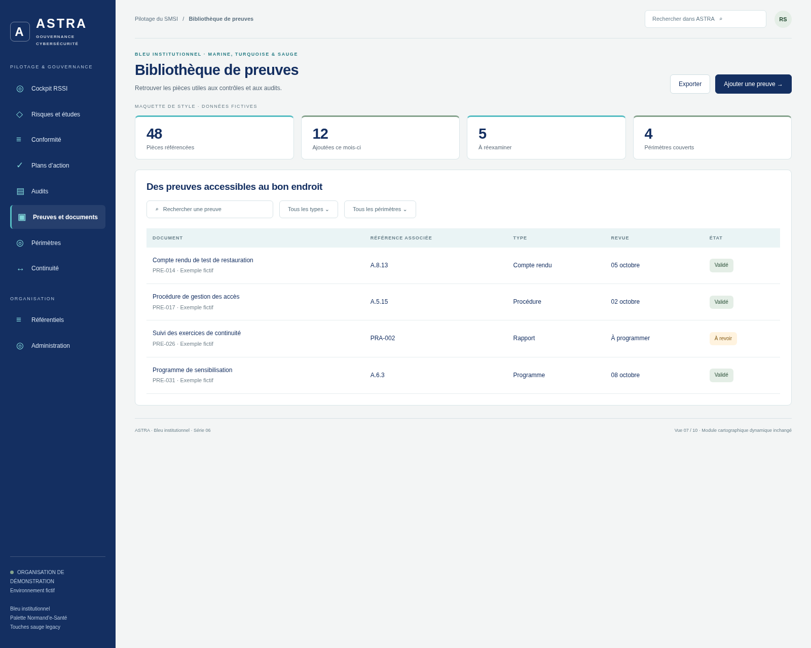
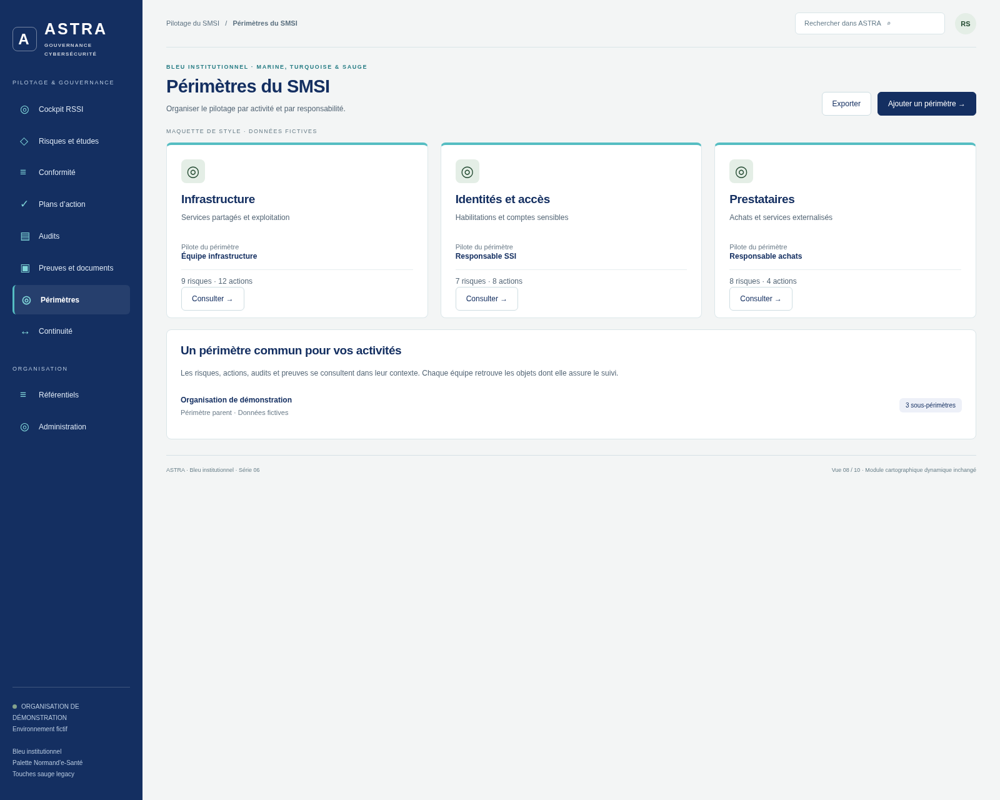
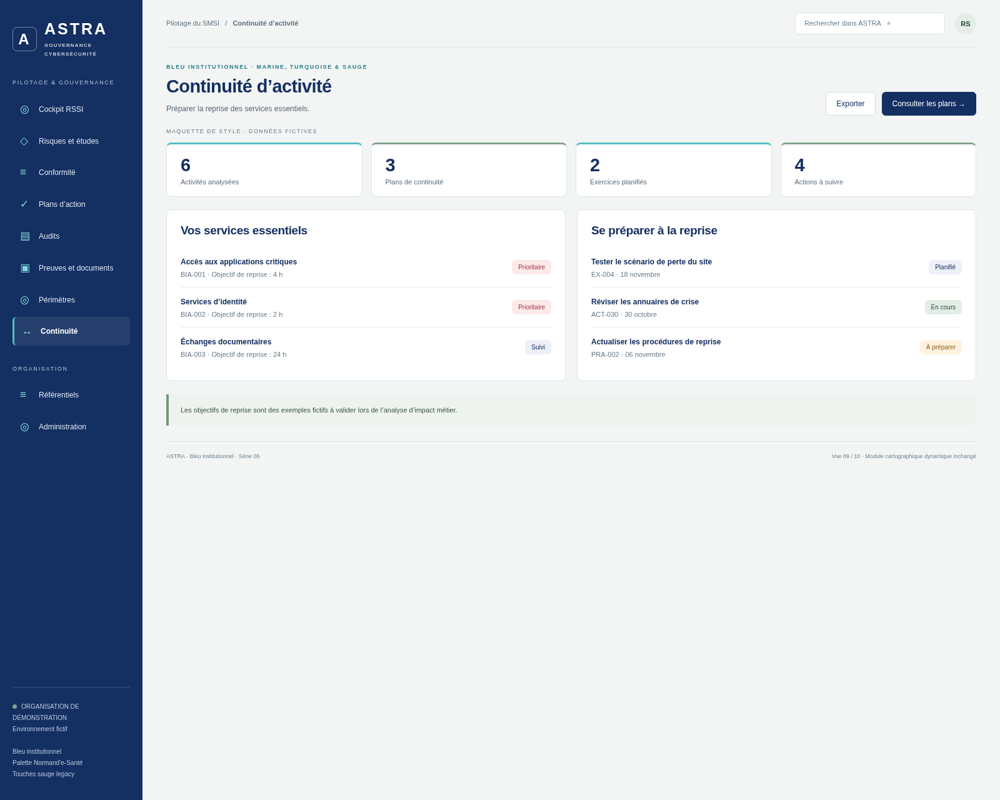
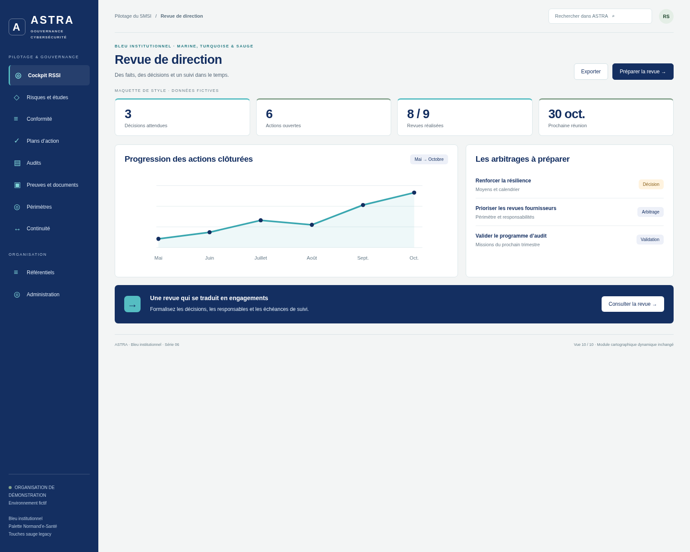

# ASTRA — Bleu institutionnel, marine, turquoise et sauge

La structure et les couleurs de la [série 05](../2026-10-12-astra-05/README.md), enrichies de touches de **vert sauge de la legacy**.

Le marine et le turquoise restent dominants. La sauge apparaît sur certains repères de cartes, les badges de suivi, les progressions, les encadrés et la colonne des actions terminées. Les couleurs d’alerte restent distinctes.

**Dix maquettes avec données fictives, non intégrées à l’application. La cartographie dynamique, son interface et son fonctionnement sont inchangés. Toutes les séries précédentes sont conservées.**

Référence de l’application : `99427687079f565cbd698e3aa6a04e0d1cfef73c`, branche `legacy`.

## Palette

| Usage | Couleur | Origine |
| --- | --- | --- |
| Marine | `#142F61` | Inspiration Normand’e-Santé |
| Turquoise | `#55BDC2` | Inspiration Normand’e-Santé |
| Sauge | `#84A28C` | Legacy, `modules/integration.css` |
| Accent sauge | `#74967C` | Legacy |
| Fond sauge doux | `#E4EEE6` | Legacy |
| Texte sur fond sauge | `#244B32` | Legacy |

## Dix aperçus · 1600 × 1280

### Cockpit RSSI

[Ouvrir l’image originale](01-cockpit.png)

### Registre des risques

[Ouvrir l’image originale](02-registre-risques.png)

### Indisponibilité des services critiques

[Ouvrir l’image originale](03-detail-risque.png)

### Annexe A · ISO 27001:2022

[Ouvrir l’image originale](04-annexe-a.png)

### Plan d’action

[Ouvrir l’image originale](05-plan-actions.png)

### Programme d’audit

[Ouvrir l’image originale](06-audits.png)

### Bibliothèque de preuves

[Ouvrir l’image originale](07-preuves.png)

### Périmètres du SMSI

[Ouvrir l’image originale](08-perimetres.png)

### Continuité d’activité

[Ouvrir l’image originale](09-continuite.png)

### Revue de direction

[Ouvrir l’image originale](10-revue-direction.png)

## Reproduire les captures

Avec Node.js, Playwright et Chromium : `node generate.cjs`. Le script sert uniquement la maquette sur localhost. `CHROMIUM_EXECUTABLE` permet de préciser le navigateur. `preview.html?view=1` à `?view=10` sélectionne un écran. Les boutons sont illustratifs.
