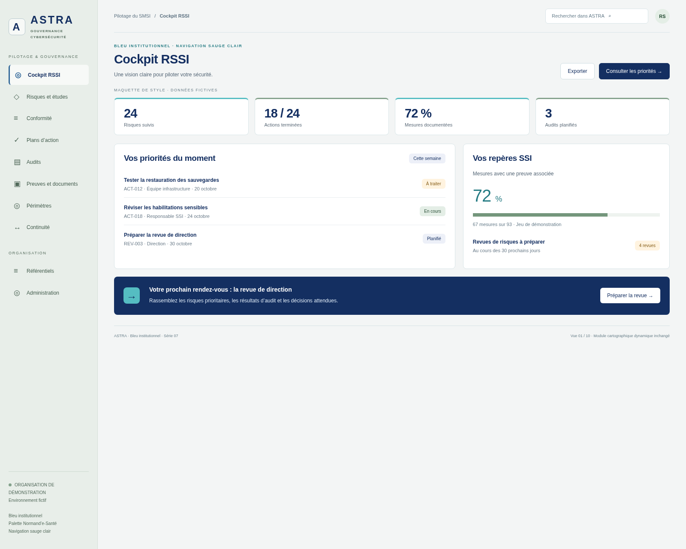
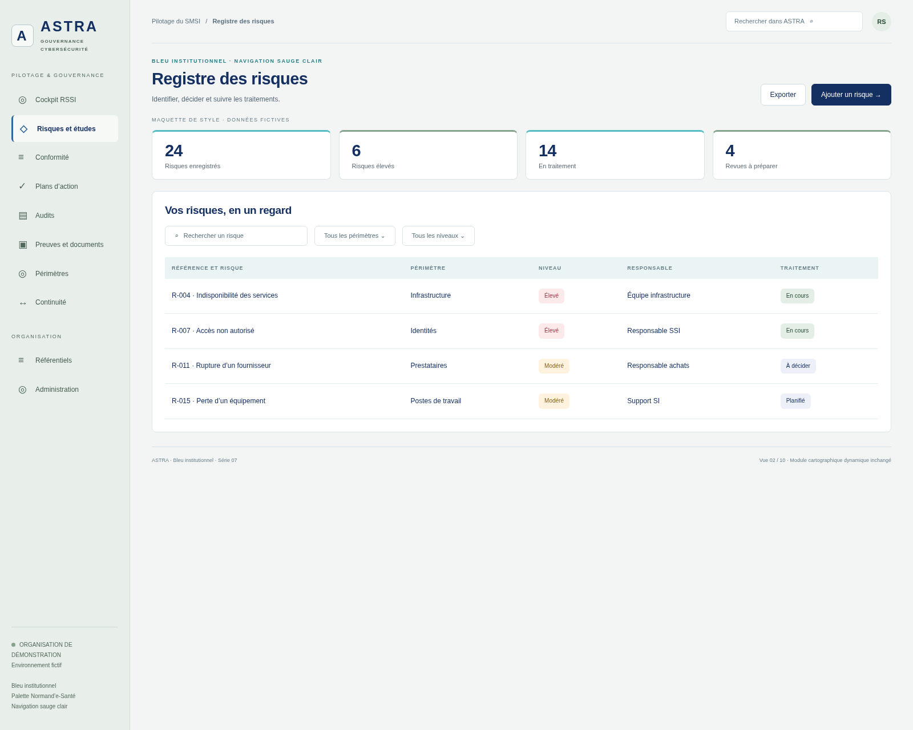
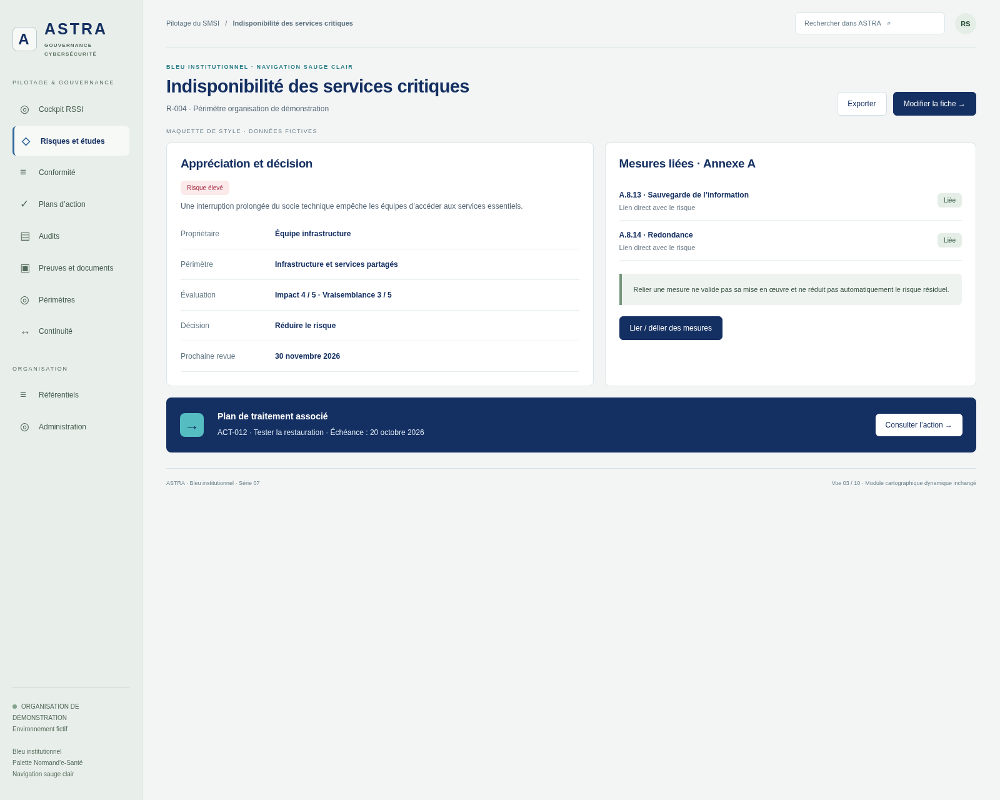
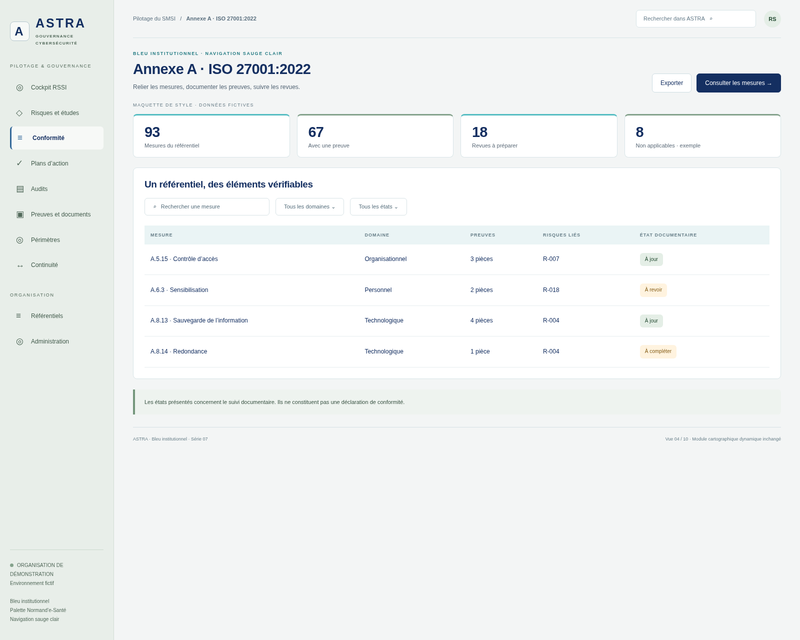
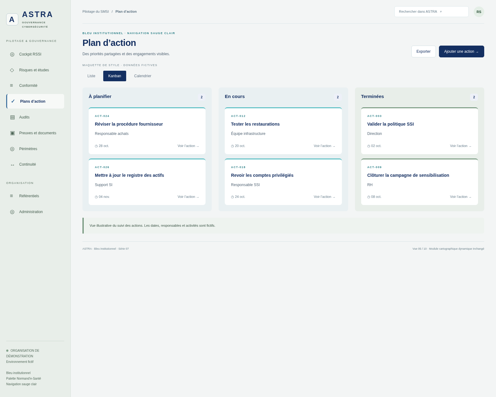
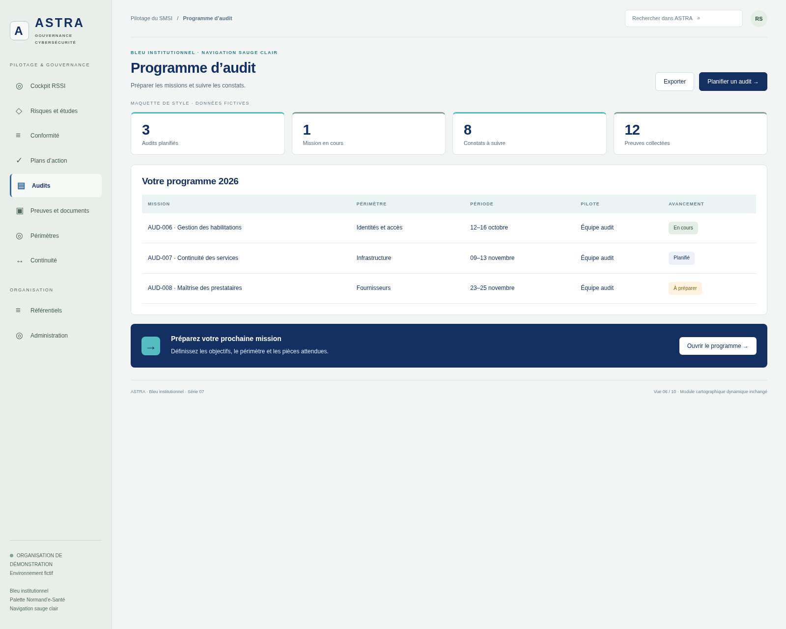
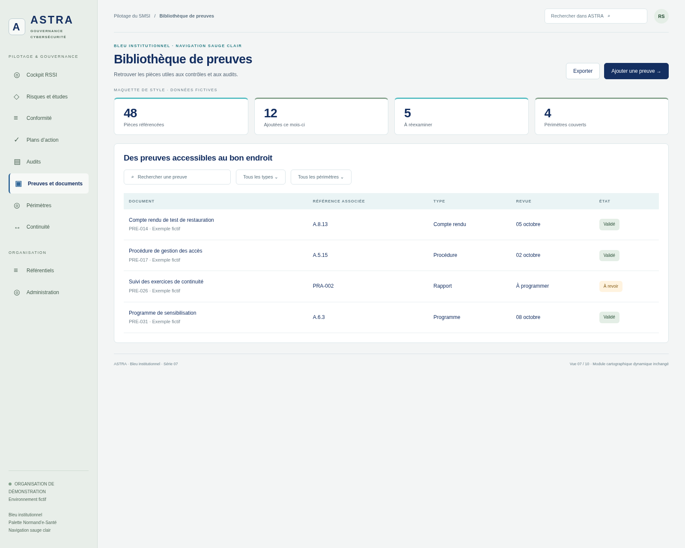
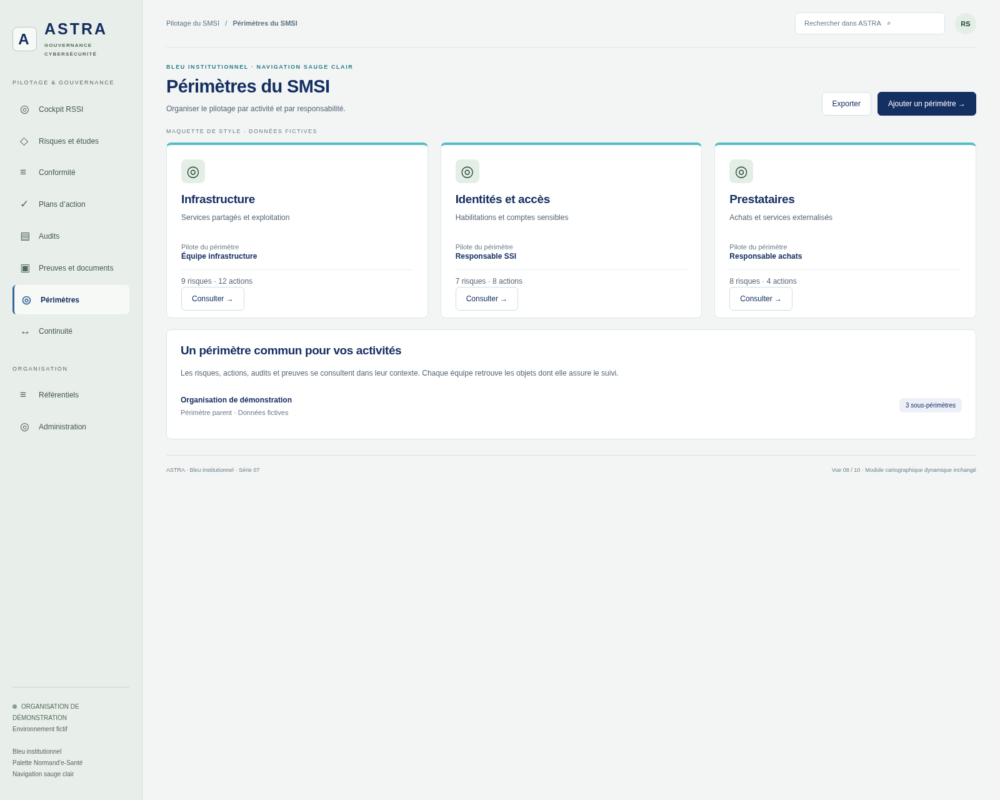
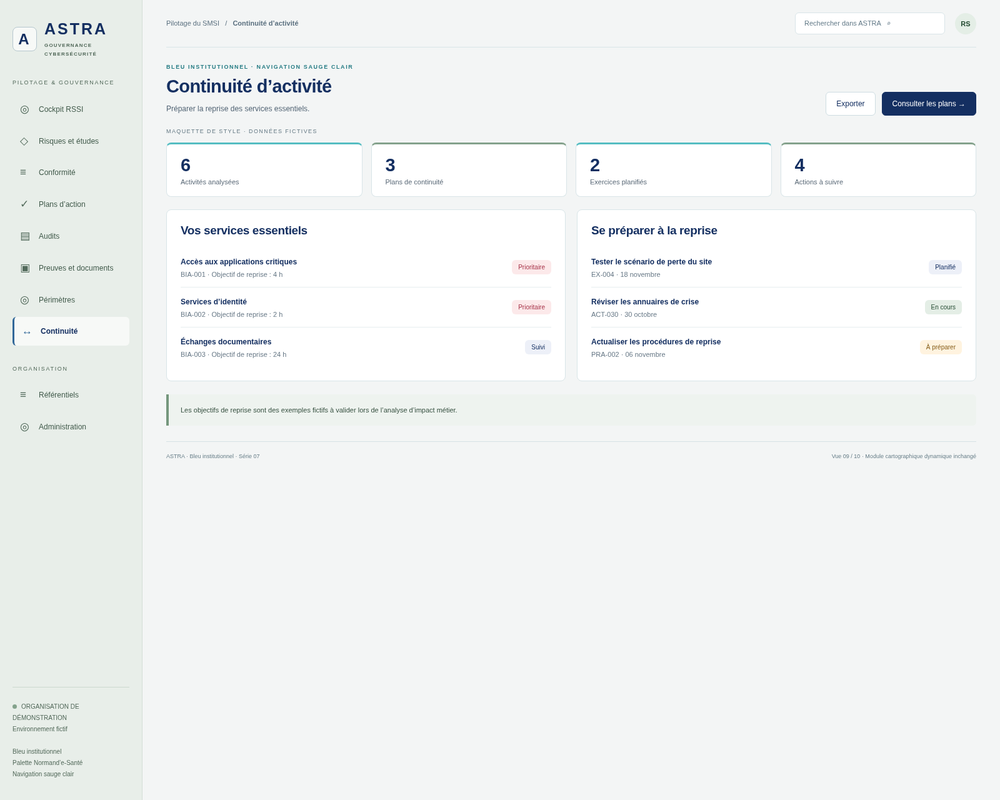
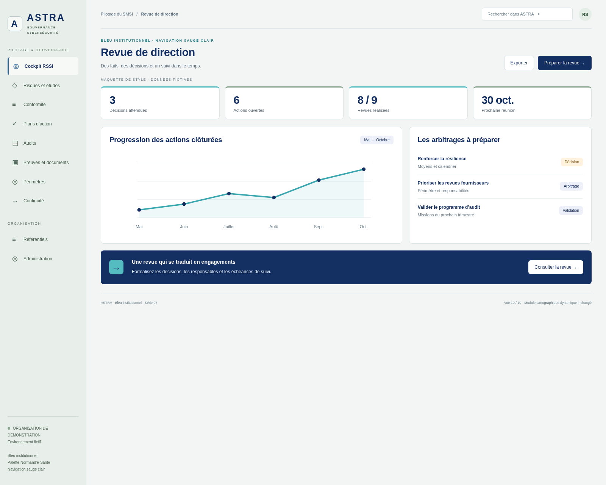

# ASTRA — Barre latérale sauge clair, touches bleues

Variante de la [série 06](../2026-10-12-astra-06/README.md) : le fond bleu de la navigation gauche devient **sauge clair**, avec des textes vert sombre. Le logo et l’élément actif apportent une touche de bleu ; le contenu central conserve sa palette marine, turquoise et sauge.

**Dix maquettes avec données fictives, non intégrées à l’application. La cartographie dynamique, son interface et son fonctionnement restent inchangés. L’historique des aperçus est conservé.**

Référence de l’application : `e327531b3bc0c19f12b7770f7332bf1c2ff7e053`, branche `legacy`.

## Palette de la navigation

| Usage | Couleur |
| --- | --- |
| Fond sauge clair | `#E8EEE9` |
| Libellés | `#425B4C` |
| Icônes et textes secondaires | `#52695A` / `#526A5B` |
| Fond de l’élément actif | `#F7F9F7` |
| Filet et icône actifs | `#326899` |
| Logo et libellé actif | `#142F61` |

## Dix aperçus · 1600 × 1280

### Cockpit RSSI

[Ouvrir l’image originale](01-cockpit.png)

### Registre des risques

[Ouvrir l’image originale](02-registre-risques.png)

### Indisponibilité des services critiques

[Ouvrir l’image originale](03-detail-risque.png)

### Annexe A · ISO 27001:2022

[Ouvrir l’image originale](04-annexe-a.png)

### Plan d’action

[Ouvrir l’image originale](05-plan-actions.png)

### Programme d’audit

[Ouvrir l’image originale](06-audits.png)

### Bibliothèque de preuves

[Ouvrir l’image originale](07-preuves.png)

### Périmètres du SMSI

[Ouvrir l’image originale](08-perimetres.png)

### Continuité d’activité

[Ouvrir l’image originale](09-continuite.png)

### Revue de direction

[Ouvrir l’image originale](10-revue-direction.png)

## Reproduire les captures

Avec Node.js, Playwright et Chromium : `node generate.cjs`. Le script sert uniquement la maquette sur localhost. `CHROMIUM_EXECUTABLE` permet de préciser le navigateur. `preview.html?view=1` à `?view=10` sélectionne un écran. Les boutons sont illustratifs.
