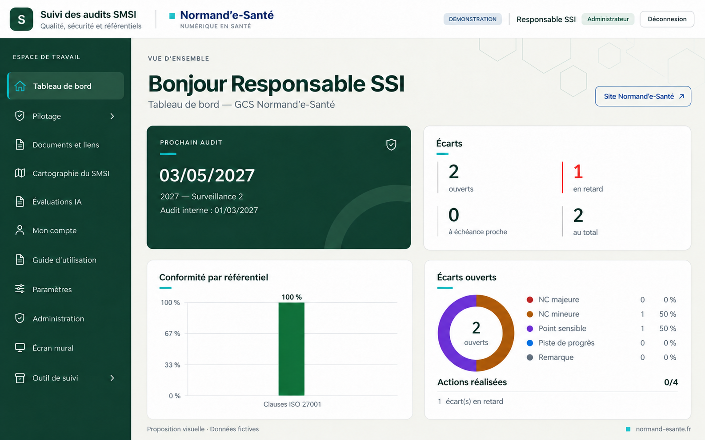

# Intégration de Normand’e-Santé — étape intermédiaire

Aperçu généré à partir de la capture fournie, avec signature discrète et premier assombrissement du turquoise. L’utilisateur a ensuite demandé une nuance plus sombre.

**Cette image est une étape historique, pas la palette finale.** La référence technique retenue est dans le [dossier de la série 09](../2026-10-12-astra-09/README.md), accent `#236B70`. Aucune modification de l’application ou de la cartographie.

