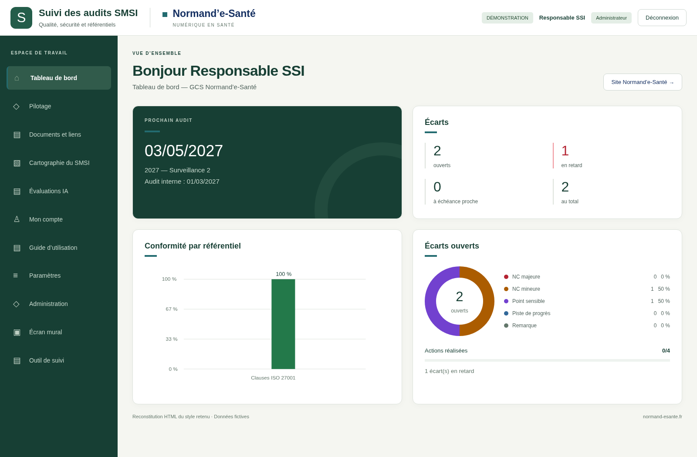

# Dossier d’implémentation — style SMSI retenu

**Style : vert profond, blanc chaud, sauge, marine et bleu-vert sombre `#236B70`.** Signature Normand’e-Santé visible et discrète. Préparation commencée le 12 octobre, livraison le 13 octobre 2026, branche `legacy`.

Cette livraison prépare l’implémentation ; elle ne modifie pas l’application. La cartographie dynamique est explicitement protégée.

## Commencer ici

1. [Dossier technique](DOSSIER-TECHNIQUE.md) — architecture, palette, composants, fichiers à modifier, invariants et recette.
2. [Dossier PDF](DOSSIER-TECHNIQUE.pdf) — version de consultation incluant le prompt.
3. [Prompt d’implémentation prêt à copier](PROMPT-IMPLEMENTATION.md).
4. [Galerie des 105 images sur GitHub](GALERIE.md).
5. [Inventaire des 24 rubriques et 100 destinations](INVENTAIRE-MENUS.md).
6. [Résultats des vérifications et limites](VERIFICATIONS.md).

## Consulter hors ligne

Après extraction du ZIP, ouvrir `index.html` : galerie filtrable avec les 105 images originales, sans installation. Sur GitHub, utiliser `GALERIE.md` ; GitHub n’exécute pas le HTML de cette page comme un site publié.

## Contenu technique

- `technique/navigation.json` et `navigation.csv` : IDs et paramètres de chaque route.
- `technique/preview.css` : prototype de rendu, à adapter avant intégration.
- `technique/reference.html` : reconstitution reproductible du tableau de bord de référence.
- `technique/capture.cjs` : recette de capture sur serveur et base temporaires.
- `technique/verification.json` : provenance, empreintes et résultats réels.

Les 100 captures de routes montrent l’application réelle avec un habillage en mémoire et des données fictives ; les trois cartographies montrent le rendu existant sans habillage. La référence HTML est une reconstitution du style choisi, pas le fichier image généré original. Les chiffres illustratifs ne doivent jamais être codés en dur.

L’historique `samples` est conservé. L’implémentation doit rester sur `legacy`, sans migration de stack ni modification métier.
