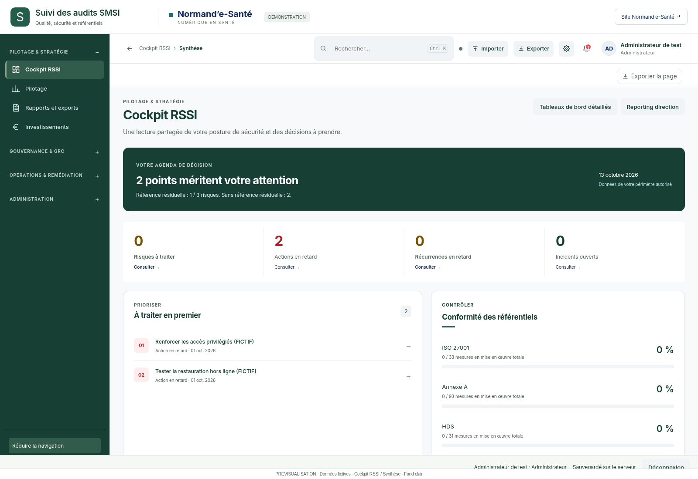
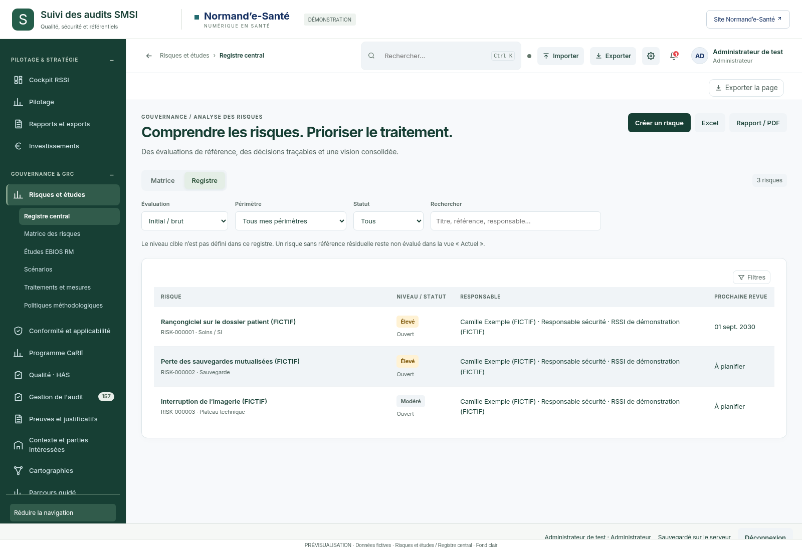
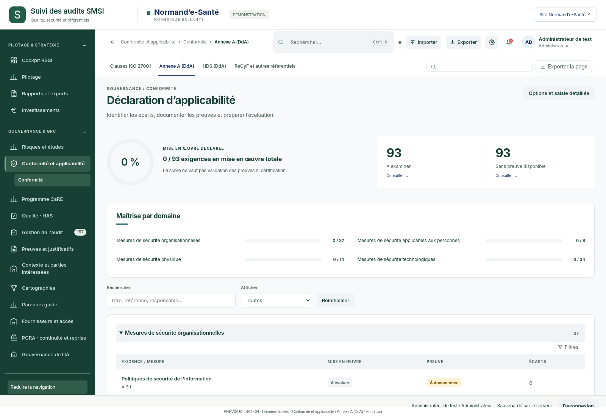
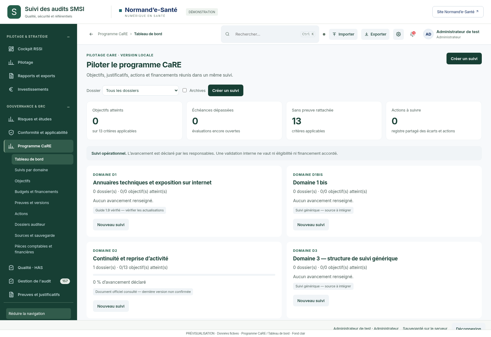
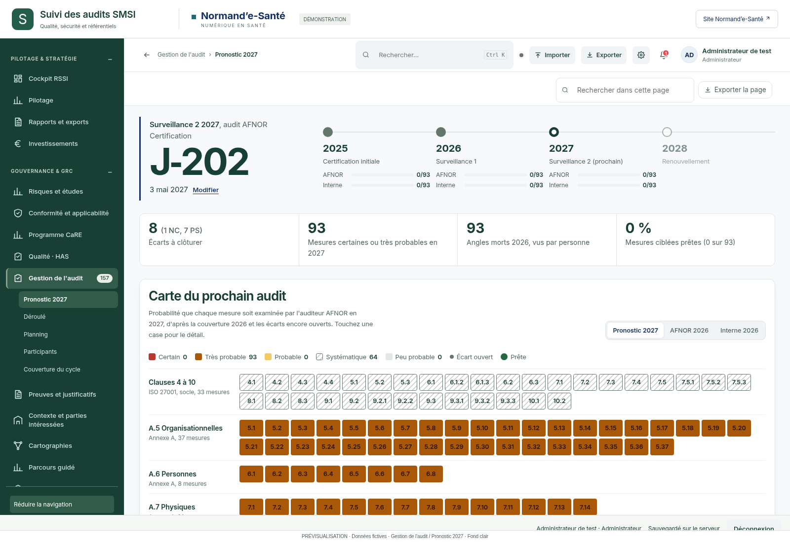
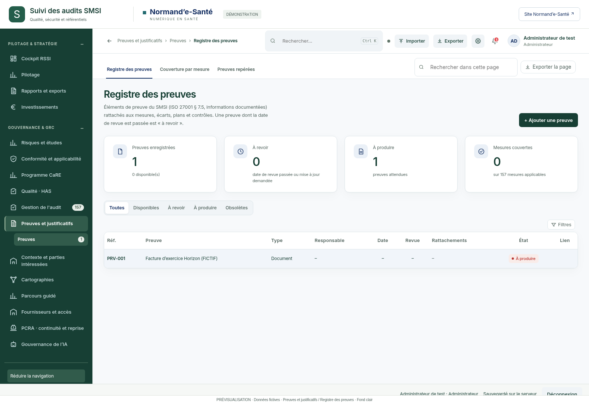
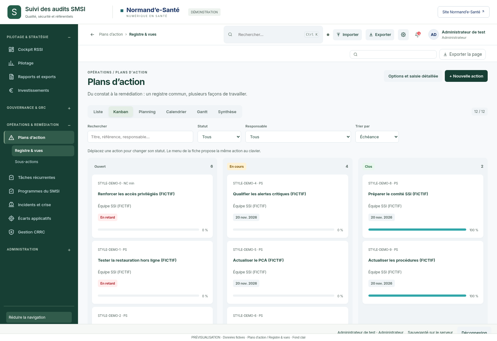
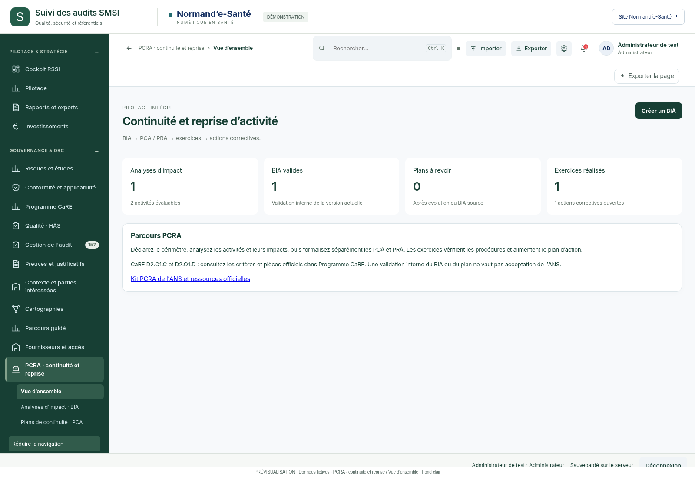
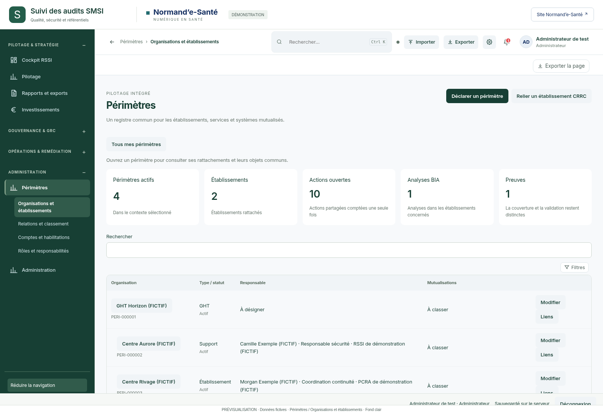
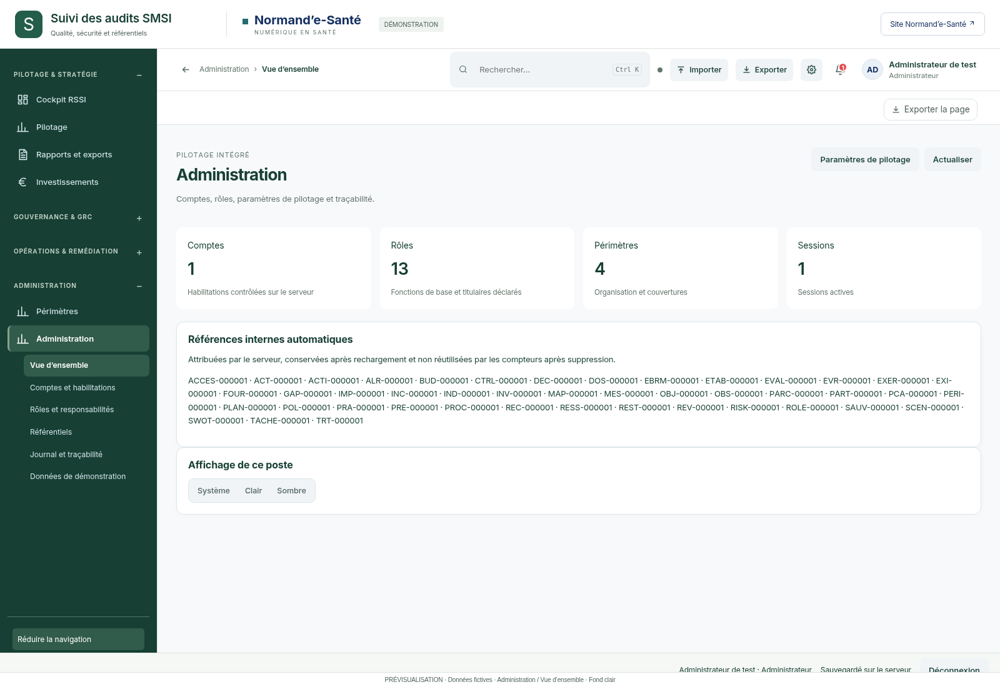

# Dix aperçus — fond éclairci

Variante du style retenu avec un **fond gris bleuté très clair**, inspiré de la capture Kanban fournie le 13 octobre 2026.

- Fond principal : `#F7F9FB`.
- Surfaces secondaires et colonnes : `#F0F4F7`.
- Cartes : `#FFFFFF`.
- Navigation vert profond `#173F34`, sauge et accents bleu-vert `#236B70` conservés.

**Prévisualisations uniquement**, réalisées sur une base temporaire avec données fictives. Aucune modification de l’application ou de la cartographie dynamique. L’historique précédent est conservé.

Base de l’application : `9770314c5db2835516449d700b33516b940567e8`. Dix PNG de 1600 × 1100, vérifiés sans erreur JavaScript, requête tierce ni débordement global.

## Galerie

### Cockpit RSSI · Synthèse

[Ouvrir l’image originale](images/001-dash-dash.png)

### Risques et études · Registre central

[Ouvrir l’image originale](images/002-risks-risk-register.png)

### Conformité et applicabilité · Annexe A (DdA)

[Ouvrir l’image originale](images/003-compliance-ann.png)

### Programme CaRE · Tableau de bord

[Ouvrir l’image originale](images/004-care-df-care-dash.png)

### Gestion de l'audit · Pronostic 2027

[Ouvrir l’image originale](images/005-audit-cibles.png)

### Preuves et justificatifs · Registre des preuves

[Ouvrir l’image originale](images/006-proofs-prv-reg.png)

### Plans d’action · Kanban

[Ouvrir l’image originale](images/007-actions-fd.png)

### PCRA · continuité et reprise · Vue d’ensemble

[Ouvrir l’image originale](images/008-pcra-pcra-dashboard.png)

### Périmètres · Organisations et établissements

[Ouvrir l’image originale](images/009-perimeters-perimeter-registry.png)

### Administration · Vue d’ensemble

[Ouvrir l’image originale](images/010-admin-admin-overview.png)

## Reproduire

Depuis la racine du dépôt, avec Node.js, Playwright, Python 3 et Chromium : `node samples/2026-10-13-astra-10/technique/capture.cjs`. Le script utilise un serveur et une base temporaires ; les styles sont injectés en mémoire. Les captures montrent le premier écran de chaque destination.
