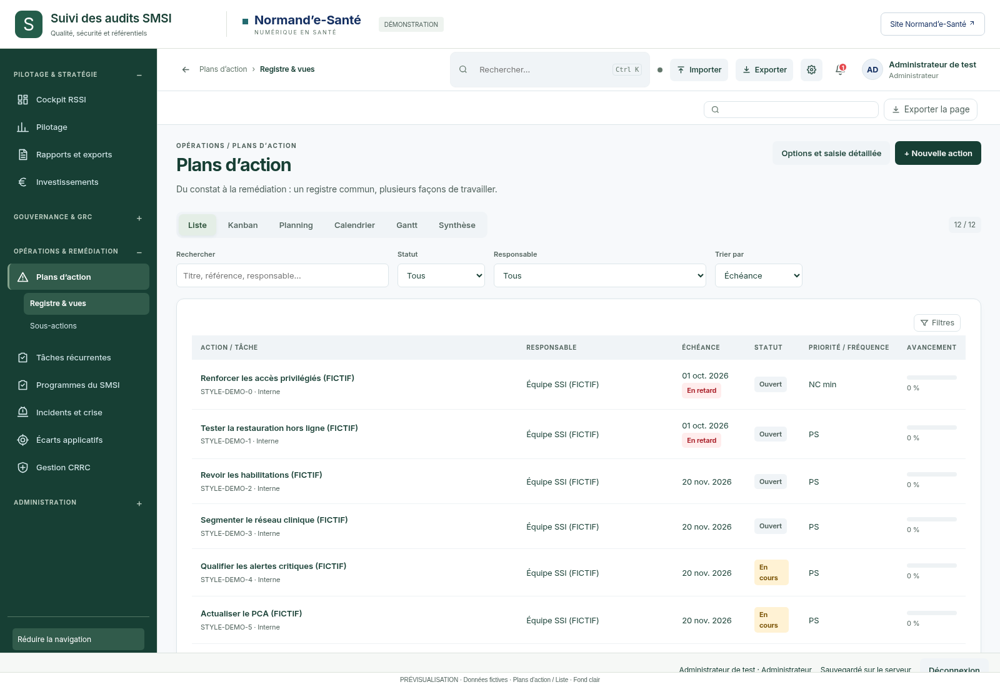
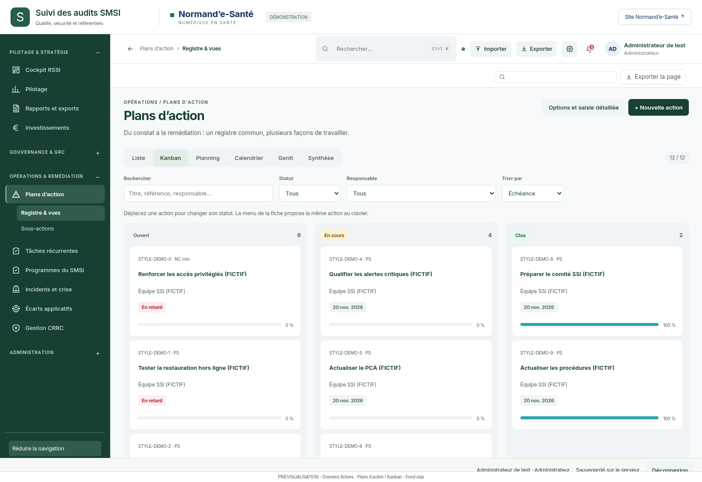
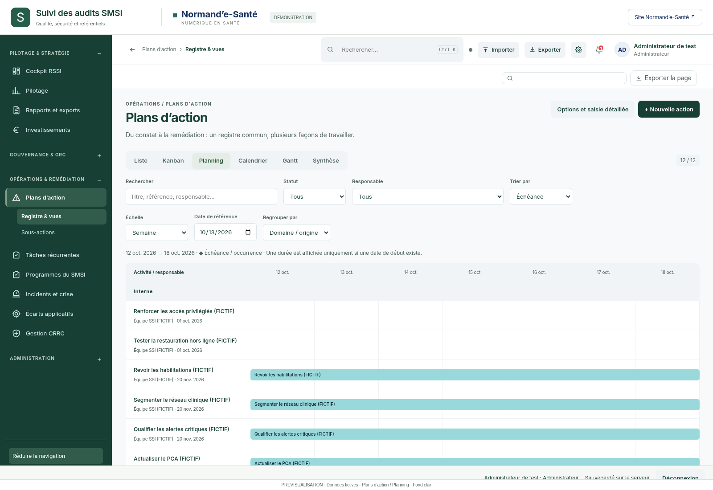
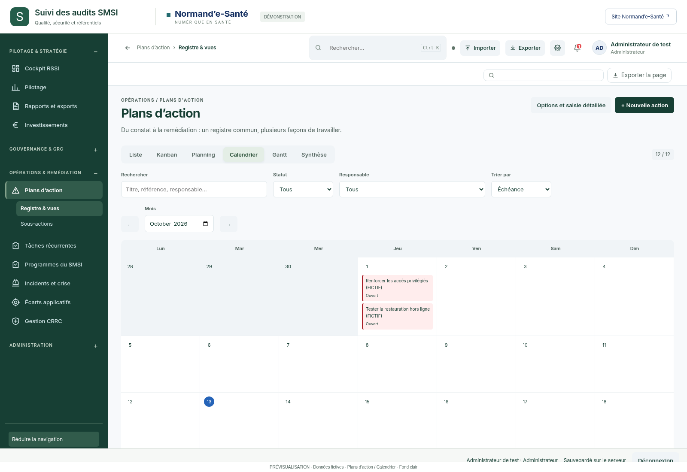
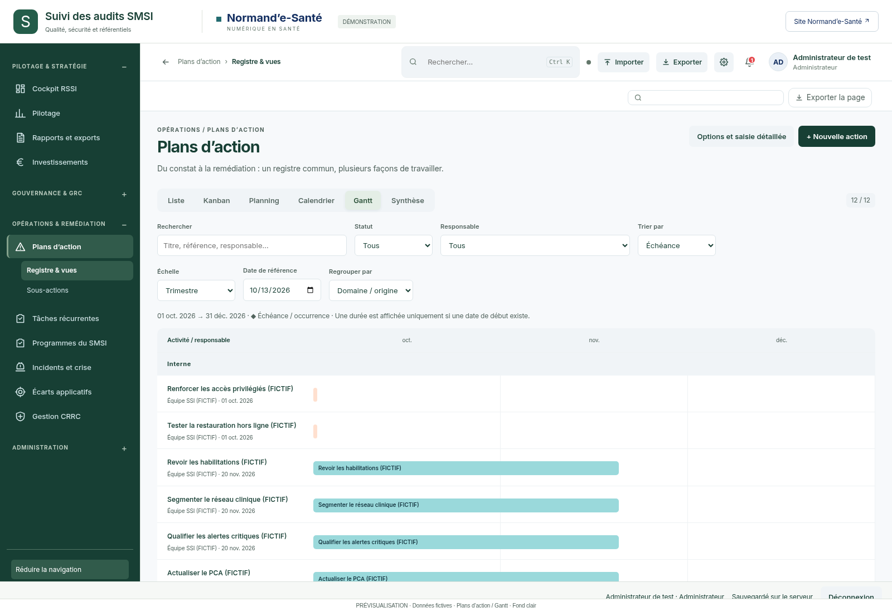
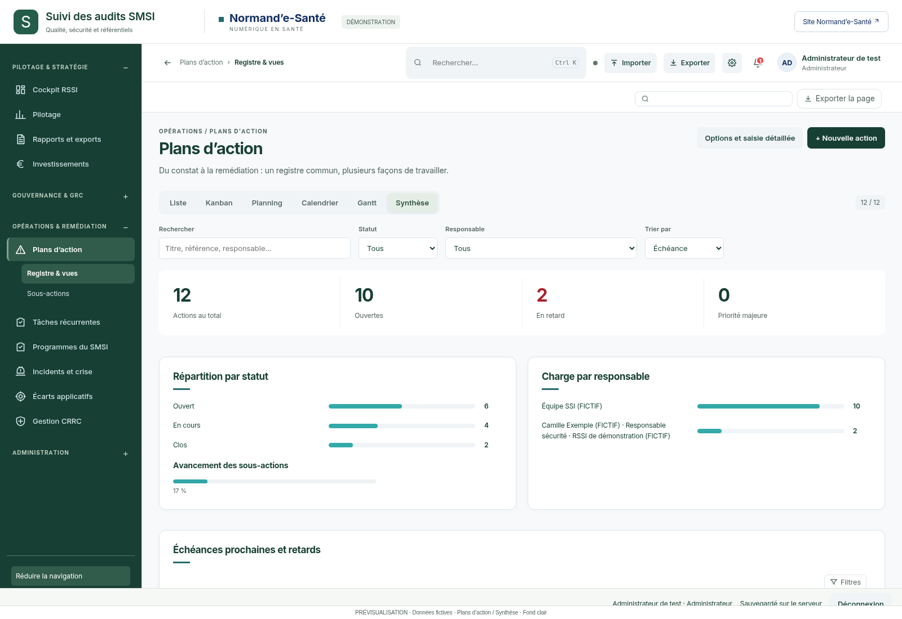

# Plans d’action — les six vues sur fond clair

Cette série complète les dix aperçus précédents avec **toutes les représentations du plan d’action** : Liste, Kanban, Planning, Calendrier, Gantt et Synthèse.

Fond principal `#F7F9FB`, surfaces secondaires `#F0F4F7`, cartes blanches, navigation vert profond conservée. Les images utilisent les écrans réels et des données fictives ; le thème est injecté en mémoire. **Aucun changement de l’application ni de la cartographie dynamique.**

## Accès direct

- [Liste](images/001-plan-actions-list.png)
- [Kanban](images/002-plan-actions-kanban.png)
- [Planning](images/003-plan-actions-planning.png)
- [Calendrier](images/004-plan-actions-calendar.png)
- [Gantt](images/005-plan-actions-gantt.png)
- [Synthèse](images/006-plan-actions-summary.png)

## Aperçus

### Liste

### Kanban

### Planning

### Calendrier

### Gantt

### Synthèse

## Autres modules

La [galerie complète de 100 destinations](../2026-10-12-astra-09/GALERIE.md) couvre toutes les rubriques de l’application. Les [dix aperçus sur fond éclairci](../2026-10-13-astra-10/README.md) constituent une sélection, pas l’inventaire exhaustif.

## Vérifications

Six PNG de 1600 × 1100, six vues distinctes et état actif de chaque onglet vérifiés. Aucune erreur JavaScript, requête tierce ni débordement global durant la capture. Les tableaux longs sont cadrés sur le premier écran. Générateur et résultats : `technique/capture.cjs` et `technique/verification.json`.

Base de l’application : `889cbfd53305dd6302dd1154fdd1aa9d7bdc3746`. L’historique des séries précédentes est conservé.
