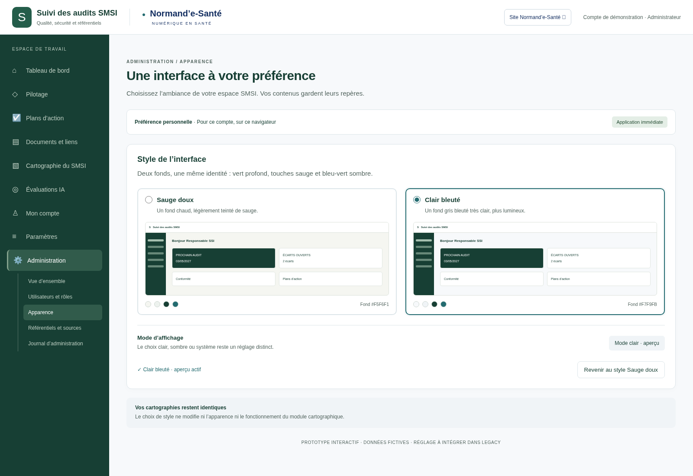

# Série 12 — Administration : choix du style

**Préparation d’implémentation**, le 13 octobre 2026, référence `12a08a1d1c47053889f080c639309f7f2dc4fc85` sur `legacy`. Aucun changement du code applicatif ni des cartographies.

Le panneau prévu permet de passer entre **Sauge doux** et **Clair bleuté**. Les deux conservent la barre gauche vert profond et le turquoise sombre. Portée proposée : préférence personnelle du compte administrateur, sur ce navigateur. Le réglage clair/sombre reste distinct.

- [Prototype interactif hors ligne](index.html) — télécharger le dossier puis ouvrir ce fichier dans un navigateur.
- [Complément au dossier technique](COMPLEMENT-TECHNIQUE.md).
- [Prompt complet d’implémentation mis à jour](PROMPT-IMPLEMENTATION.md).
- [Vérifications du prototype](technique/verification.json).
- [Dossier initial et galerie des menus](../2026-10-12-astra-09/README.md).

## Sauge doux sélectionné

## Clair bleuté sélectionné

Le menu de ce prototype est illustratif. La future intégration conserve toutes les destinations réelles. Les images historiques sont conservées.
