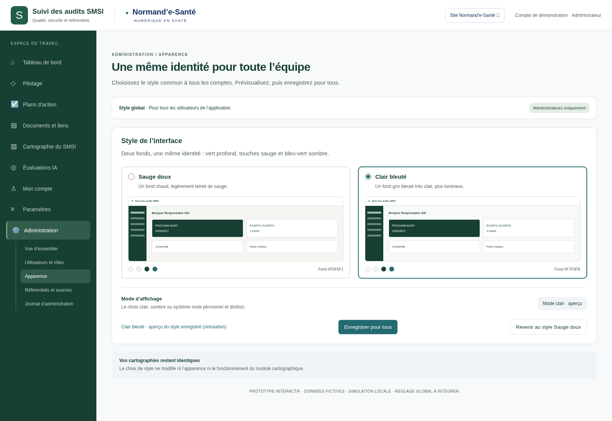

# Série 13 — Administration : choix du style

**Préparation d’implémentation**, le 13 octobre 2026, référence `0f074fbfe69ee7cb7d77071eb343d98871d33531` sur `legacy`. Aucun changement du code applicatif ni des cartographies.

Le panneau prévu permet de passer entre **Sauge doux** et **Clair bleuté**. Les deux conservent la barre gauche vert profond et le turquoise sombre. **Portée confirmée : tous les utilisateurs de l’application.** Seuls les administrateurs changent le style global, enregistré côté serveur dans la future implémentation. La sélection prévisualise ; « Enregistrer pour tous » valide. Cette série remplace la proposition personnelle de la série 12, conservée pour historique. Le réglage clair/sombre reste distinct.

- [Prototype interactif hors ligne](index.html) — télécharger le dossier puis ouvrir ce fichier dans un navigateur.
- [Complément au dossier technique](COMPLEMENT-TECHNIQUE.md).
- [Prompt complet d’implémentation mis à jour](PROMPT-IMPLEMENTATION.md).
- [Vérifications du prototype](technique/verification.json).
- [Dossier initial et galerie des menus](../2026-10-12-astra-09/README.md).

## Sauge doux sélectionné

## Clair bleuté sélectionné

Le bouton d’enregistrement du prototype est une simulation locale, sans propagation à d’autres utilisateurs. Le menu est illustratif. La future intégration conserve toutes les destinations réelles. Les images historiques sont conservées.
