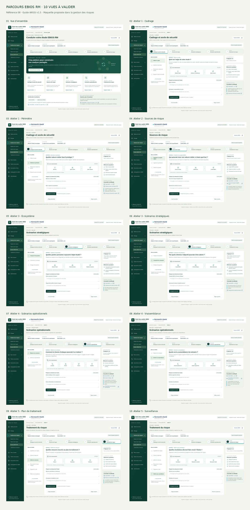
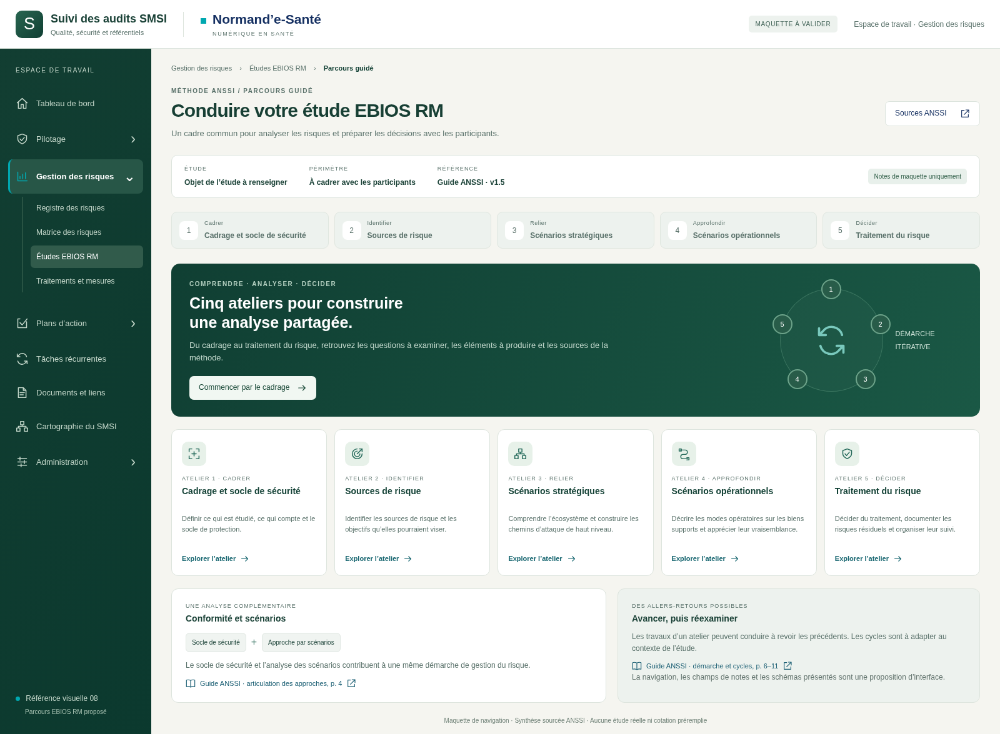
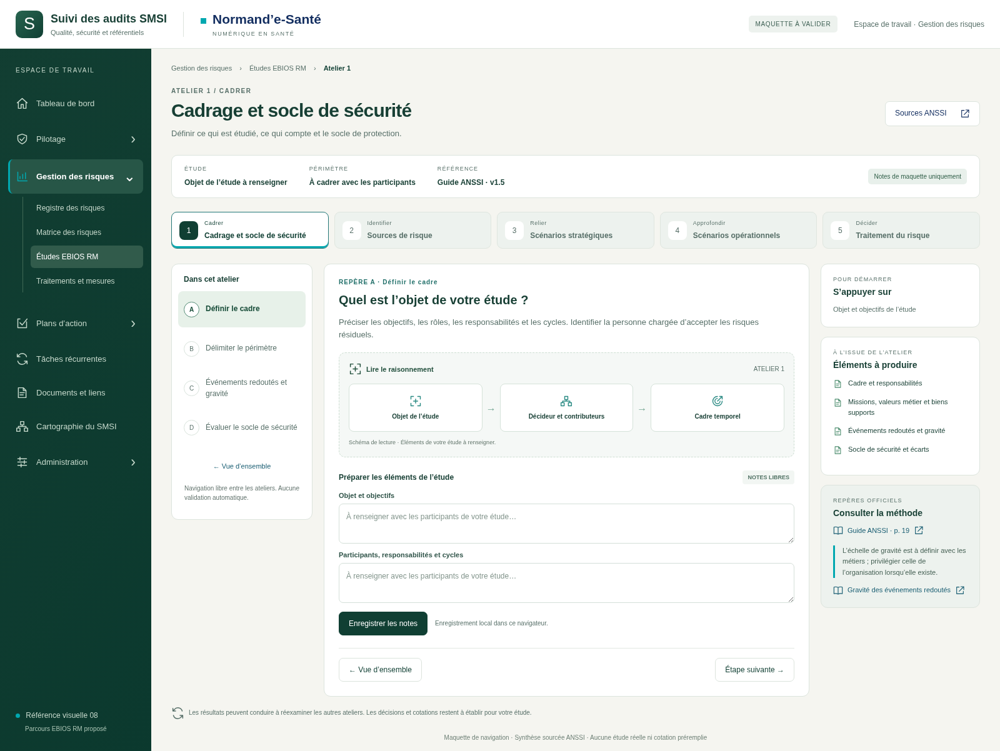
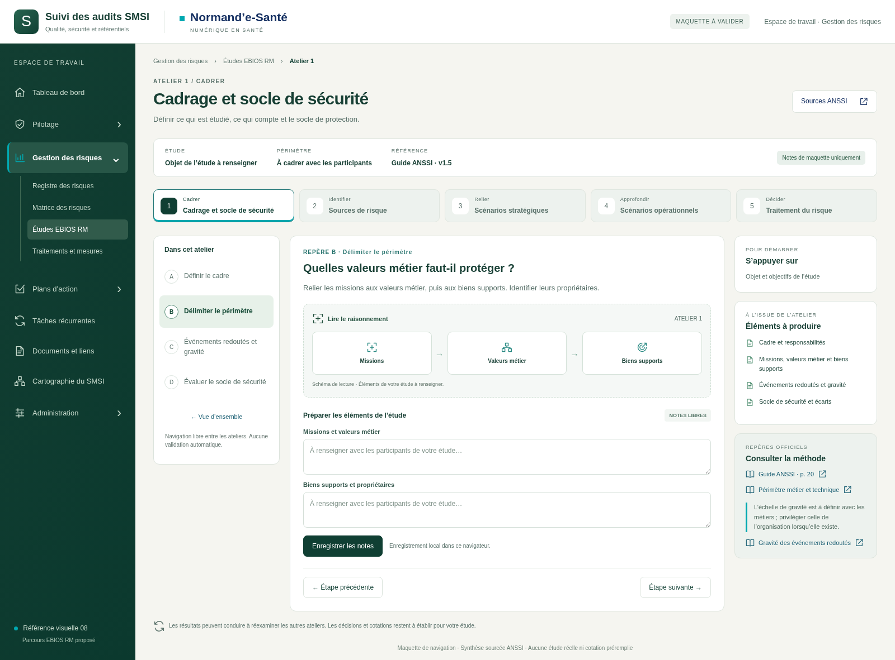
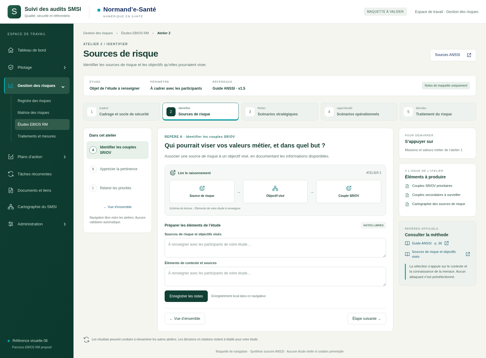
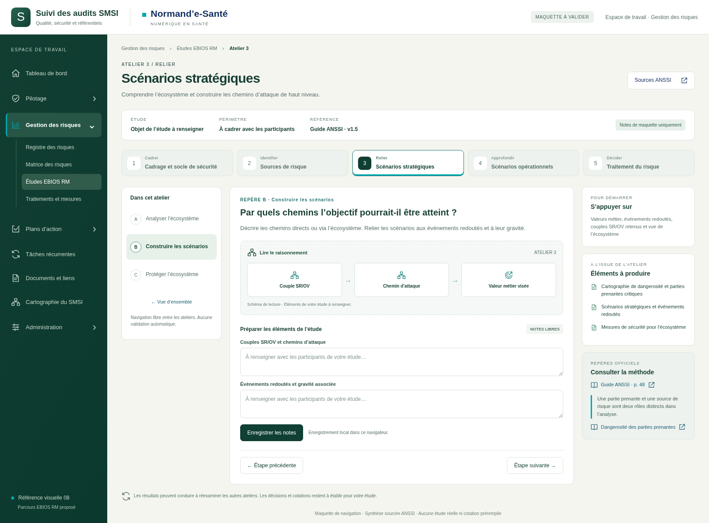
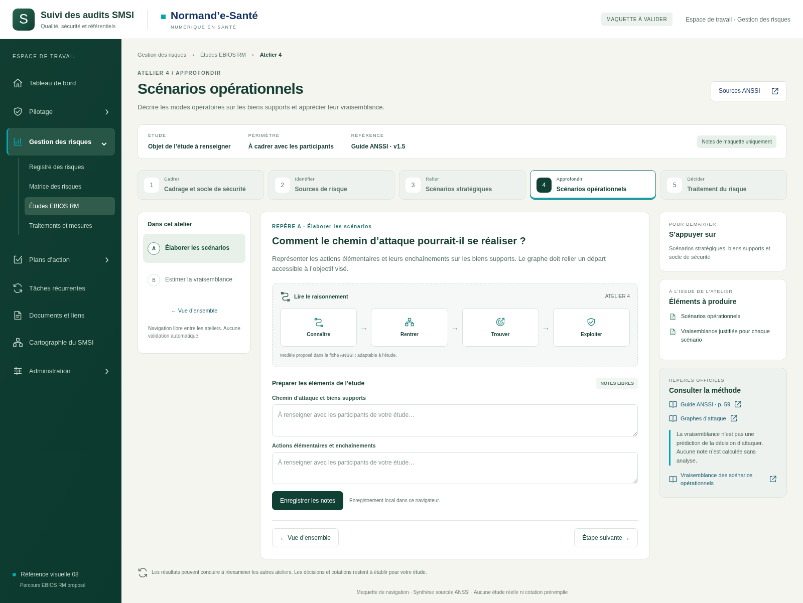
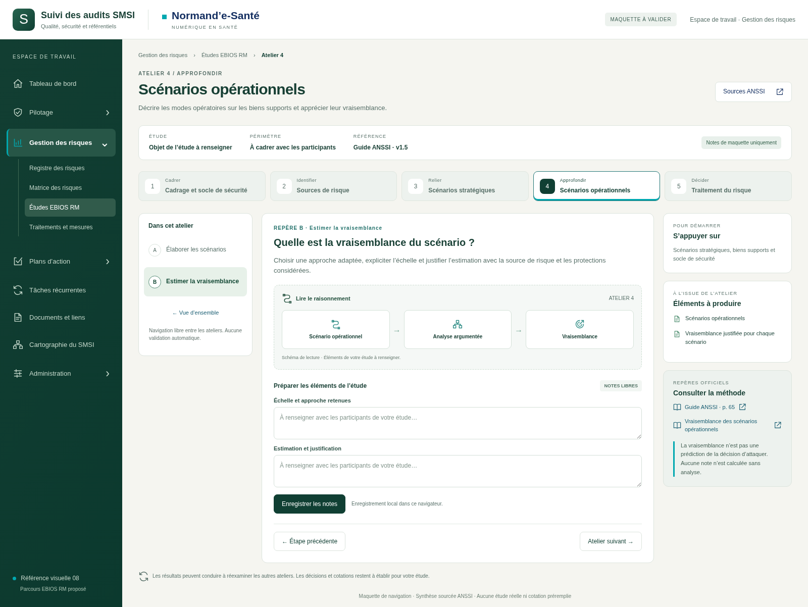
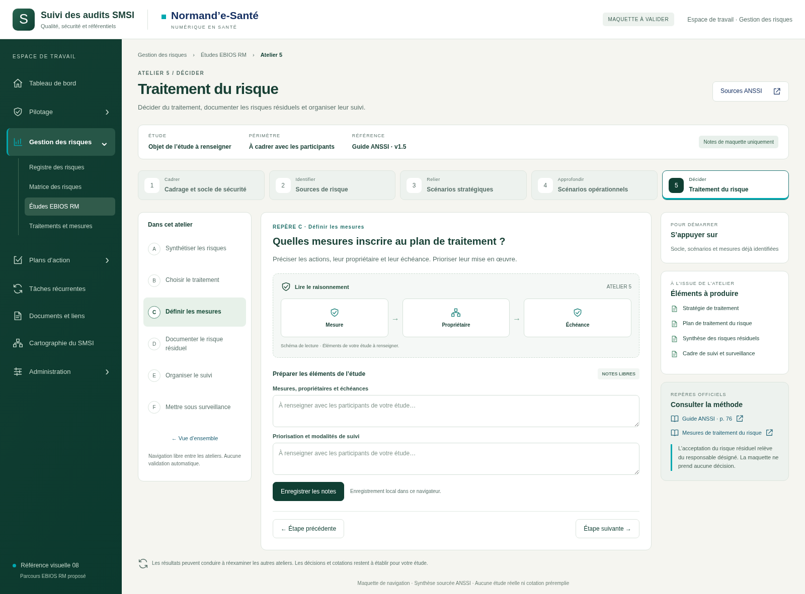
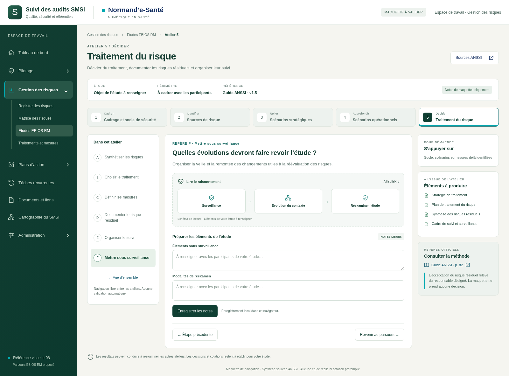

# Parcours EBIOS RM — maquette visuelle à valider

**10 vues · 5 ateliers · 18 étapes · style de référence 08.**

Emplacement proposé : **Gestion des risques → Études EBIOS RM**. Maquette isolée de l’application, sans modification du code métier ni de la cartographie dynamique. Base de référence de l’application : `699c39e71eed90f2f437635722c1331732dc9cc3` (`legacy`).

Le parcours reprend les cinq ateliers du guide ANSSI v1.5 (septembre 2024) et s’appuie sur les huit fiches méthodes liées par [la page fournie](https://messervices.cyber.gouv.fr/guides/la-methode-ebios-risk-manager-le-guide). Chaque étape renvoie aux pages du guide et aux fiches pertinentes. Les champs et schémas sont des propositions d’interface, à valider.

## Consulter

- Parcourir les dix images ci-dessous directement sur GitHub.
- Télécharger le ZIP livré, le décompresser puis ouvrir **index.html** dans un navigateur pour tester les ateliers. Si la politique du navigateur interdit les fichiers locaux, lancer `python -m http.server 8765 --bind 127.0.0.1` dans ce dossier puis ouvrir `http://127.0.0.1:8765`.
- Ouvrir **galerie.html** pour consulter toutes les images hors ligne.
- Lire [SOURCES.md](SOURCES.md) pour la correspondance des 18 étapes avec les publications officielles.

Les cinq ateliers et leurs étapes sont navigables librement. Les boutons d’enregistrement conservent seulement les notes de maquette dans le navigateur. Aucun score, scénario ou décision n’est prérempli ; aucune validation métier n’est effectuée. Le menu latéral représente l’emplacement proposé dans l’application et n’ouvre pas les autres modules.

## Points à valider

La lisibilité du parcours, la place des schémas, les repères de navigation et le panneau de sources. Les deux zones de notes par étape ne remplacent pas les futurs objets structurés de l’application.

## Galerie

### Vue d’ensemble

### Atelier 1 · Cadrage

### Atelier 1 · Périmètre

### Atelier 2 · Sources de risque

### Atelier 3 · Écosystème

### Atelier 3 · Scénarios stratégiques

### Atelier 4 · Scénarios opérationnels

### Atelier 4 · Vraisemblance

### Atelier 5 · Plan de traitement

### Atelier 5 · Surveillance

## Vérification

Contrôles réalisés avec Chromium : accès aux 18 étapes, champs initialement vides, liens vers les pages PDF, sauvegarde et restitution locale de texte échappé, dialogue de sources au clavier, absence d’appel réseau automatique et d’erreur JavaScript. Absence de débordement horizontal vérifiée à 390, 768, 1440 et 1600 pixels sur la vue d’ensemble et les ateliers 4 et 5. Détails : [technique/verification.json](technique/verification.json).

Reproduction des captures : Playwright et Chromium requis ; lancer le serveur local ci-dessus, puis `node technique/capturer.cjs`. Les dix images sont des captures du prototype HTML/CSS ; aucun contenu d’étude réel n’est utilisé.
