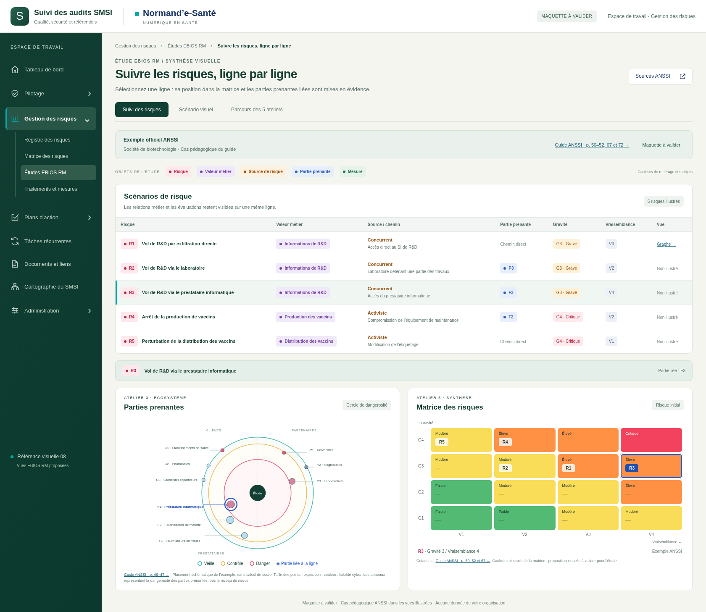
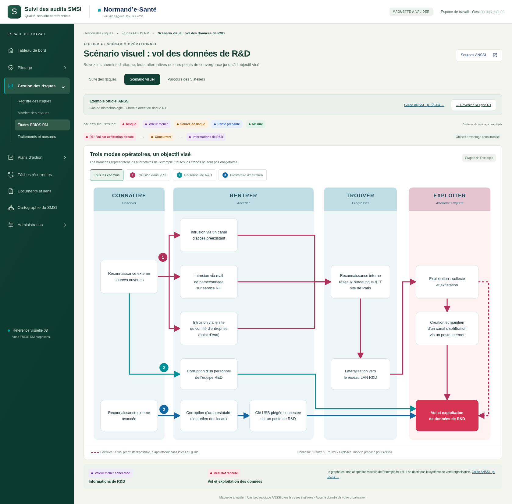
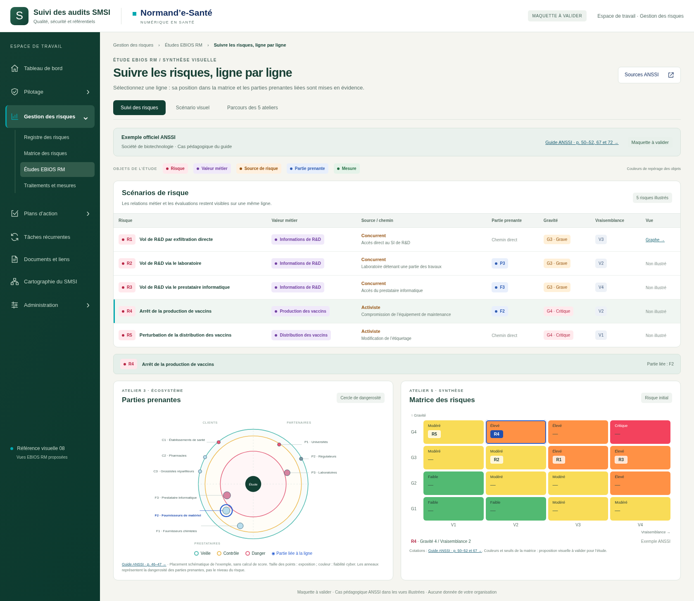
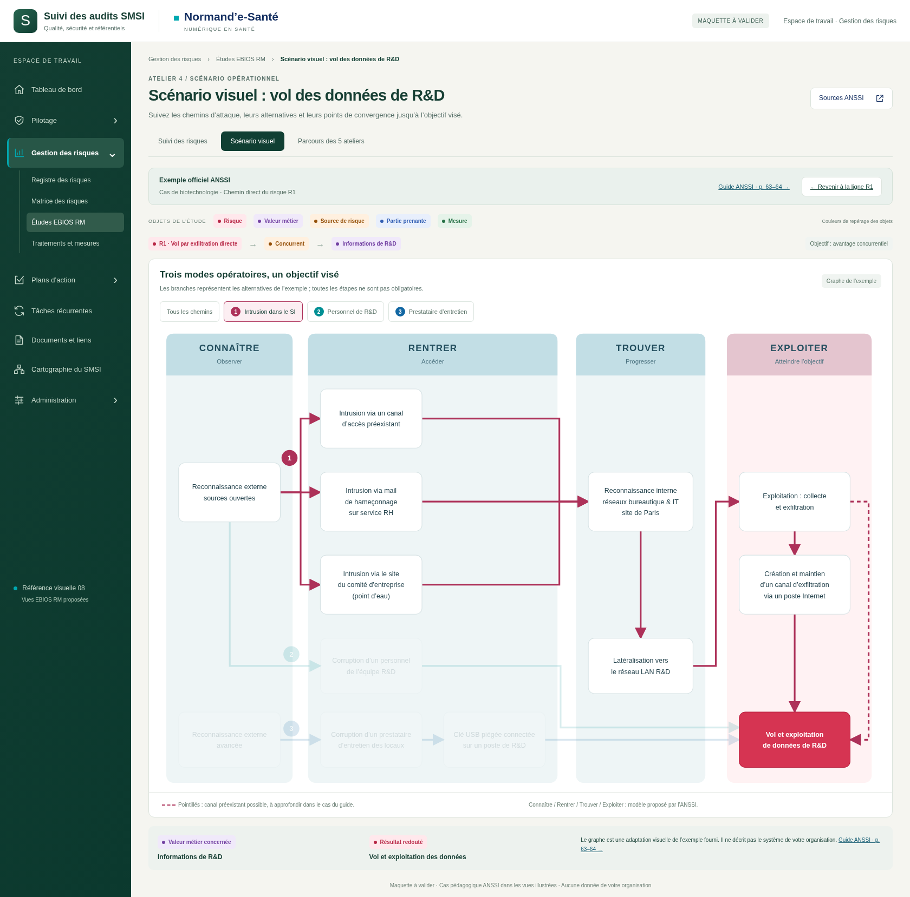
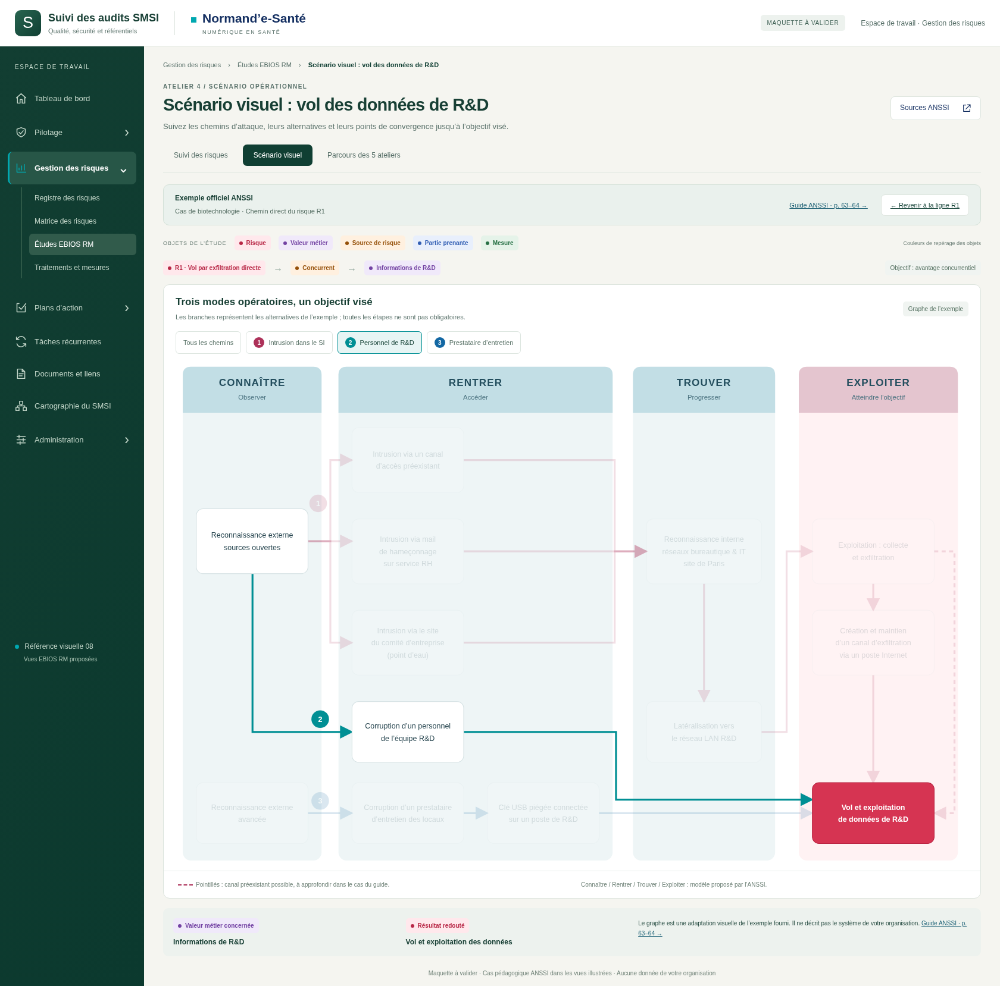

# Vues EBIOS RM — suivi des risques et scénario visuel

**Deux nouvelles représentations · six captures · style 08 enrichi en couleurs.**

Maquette à valider pour **Gestion des risques → Études EBIOS RM**. Référence de dépôt : `6c6a4f24d48596acb33ae0ac4524ce9a2ca6d839` sur `legacy`. Aucun fichier métier ni aucune cartographie dynamique de l’application n’est modifié.

## Ce qui change

- Suivi de cinq risques ligne par ligne, valeurs métier en violet, sources de risque en orange, parties prenantes en bleu et risques en rouge.
- Matrice colorée et cercle de l’écosystème sous le tableau. Cliquer un risque dans le tableau ou dans une cellule synchronise la ligne, la case sélectionnée et le halo de la partie prenante liée.
- Scénario opérationnel représenté par un graphe : quatre colonnes, embranchements, convergences, trois chemins colorés et une alternative en pointillés. Les filtres permettent de suivre chaque chemin séparément.
- Les cinq ateliers et 18 étapes de la série précédente restent accessibles via « Parcours des 5 ateliers ».

## Ouvrir la maquette

Décompresser le ZIP livré puis ouvrir **index.html**. Pour une politique de navigateur interdisant les fichiers locaux : lancer `python -m http.server 8766 --bind 127.0.0.1` dans ce dossier et ouvrir `http://127.0.0.1:8766`.

La vue initiale sélectionne **R3**, pour montrer le lien avec F3. Le graphe est celui de **R1** dans le cas pédagogique du guide ANSSI ; seuls les liens justifiés par cet exemple sont préremplis. Les couleurs de la matrice sont une proposition à valider, pas un barème imposé par l’ANSSI. Voir [SOURCES.md](SOURCES.md).

Le menu latéral représente le contexte de l’application. La sélection et les filtres sont fonctionnels ; le graphe n’est pas encore un éditeur métier. Les notes du parcours sont locales au navigateur. Aucune donnée de votre organisation n’est utilisée.

## Galerie

### Suivi des risques · Matrice et cercle

### Scénario opérationnel · Trois chemins

### Sélection R2 · Laboratoire

### Sélection R4 · Production

### Chemin 1 · Intrusion et embranchements

### Chemin 2 · Personnel R&D

## Vérifications

Cinq sélections synchronisées contrôlées : positions de matrice, halo P3/F3/F2 et absence de halo pour les chemins directs. Contrôle des 13 nœuds, des 16 liaisons et des trois filtres de chemins. Retour au parcours vérifié. Aucun débordement horizontal de page aux largeurs 390, 768 et 1440 pixels ; tableau et graphe défilent dans leur panneau lorsque nécessaire. Aucune erreur JavaScript détectée. Résultats : [technique/verification.json](technique/verification.json).

Reproduction : Playwright, Chromium et serveur local sur le port 8766 ; exécuter `node technique/capturer.cjs`.
