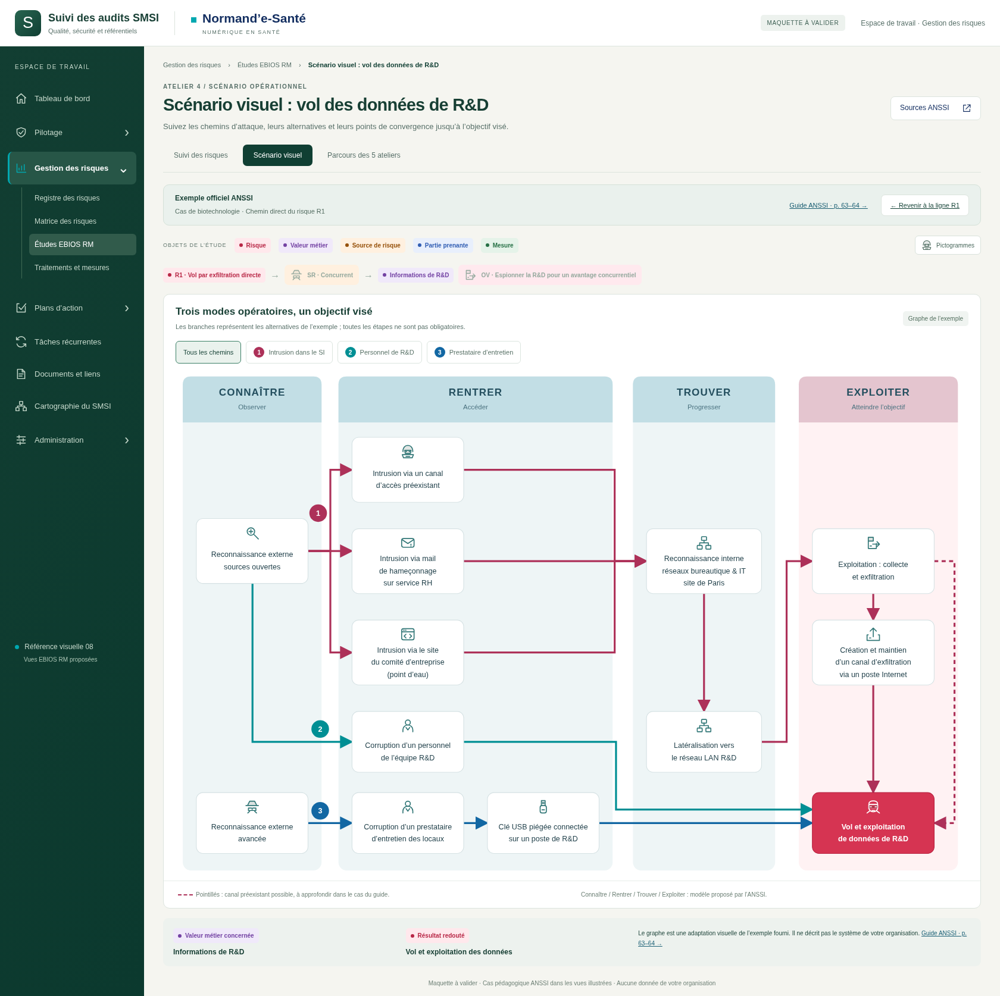
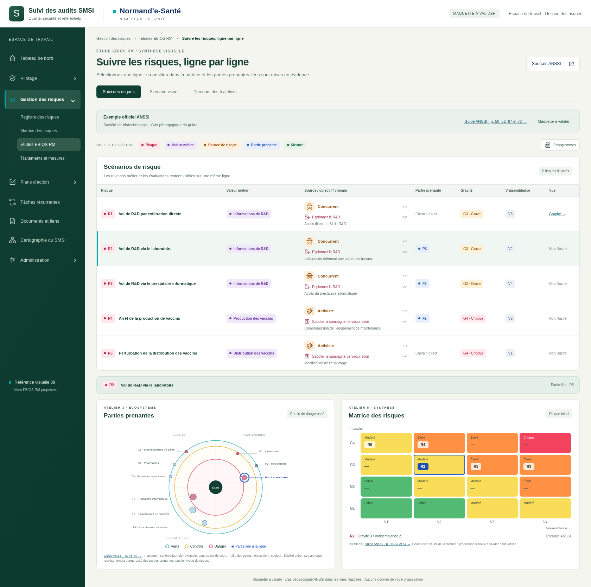
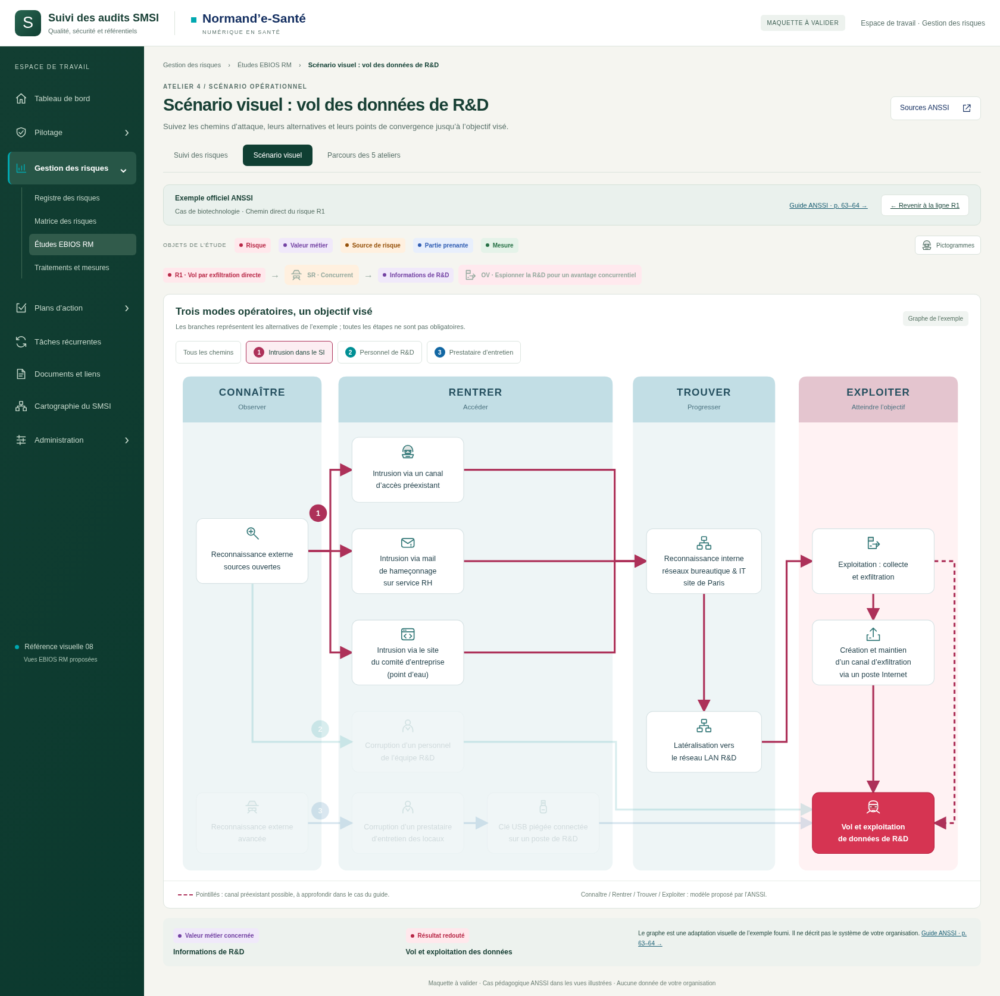
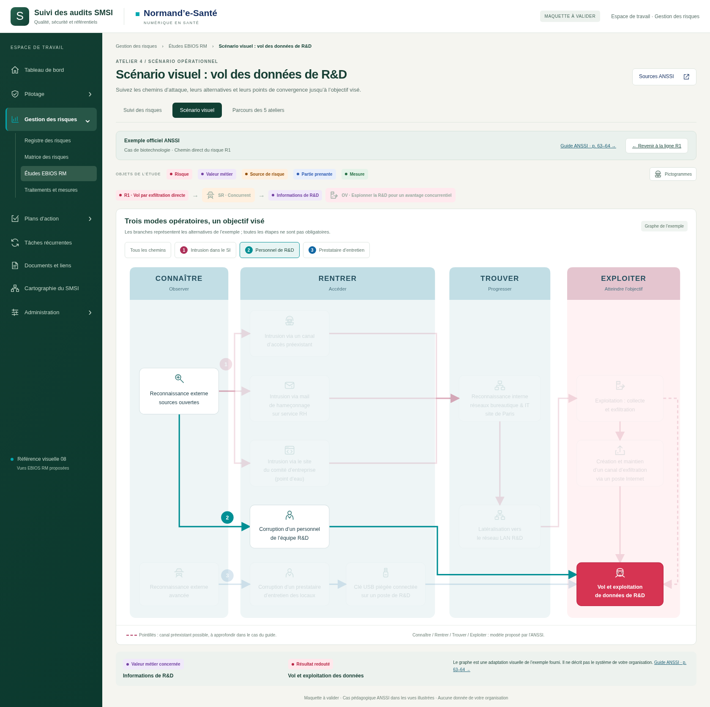

# EBIOS RM — pictogrammes SR / OV

**Style 08 · sept captures · maquette à valider.**

Les vues de la série 18 sont enrichies de petits pictogrammes vectoriels : espion, hacker, activiste, voleur, vol de données, sabotage, incendie et valeur métier. Les étapes du graphe comportent également leurs repères : recherche, messagerie, site web, personnel, USB, réseau et exfiltration.

Les libellés restent visibles. La colonne distingue maintenant **SR** (source de risque), **OV** (objectif visé) et chemin. Le bouton **Pictogrammes** ouvre la palette. Le feu est disponible comme illustration d’un événement à contextualiser ; il n’est pas ajouté au cas de biotechnologie ni présenté comme une SR en soi. Aucune nouvelle cotation ou classification ANSSI n’est introduite.

## Utilisation

Décompresser le ZIP puis ouvrir `index.html`. Alternative si le navigateur bloque les fichiers locaux : lancer `python -m http.server 8767 --bind 127.0.0.1` dans ce dossier et ouvrir `http://127.0.0.1:8767`.

Les sélections de risques synchronisent toujours la matrice et le cercle. Les trois chemins du graphe sont filtrables. Les cinq ateliers et 18 étapes restent accessibles. Il s’agit d’une maquette autonome, pas d’une intégration métier. La cartographie dynamique existante n’est pas modifiée.

Base de dépôt : `8afd48604b13b78a1be320c95f818fa9b59ca33e` (`legacy`). Sources : [SOURCES.md](SOURCES.md). Les SVG de `pictogrammes.js` sont locaux, sans police d’icônes ni chargement externe. Ils sont décoratifs (`aria-hidden`) et accompagnent du texte lisible.

## Galerie

### Suivi des risques · Matrice et cercle

### Scénario opérationnel · Trois chemins

### Sélection R2 · Laboratoire

### Sélection R4 · Production

### Chemin 1 · Intrusion et embranchements

### Chemin 2 · Personnel R&D

### Palette de pictogrammes SR / OV

## Vérification

Captures contrôlées dans Chromium. Les cinq sélections de risques, les trois filtres du graphe, le retour au parcours et l’ouverture / fermeture clavier de la palette ont été vérifiés. Aucune erreur JavaScript ; mise en page vérifiée à 390, 768 et 1440 pixels. Détails dans `technique/verification.json`.

Pour reproduire les captures : Playwright et Chromium requis, serveur local sur 8767 puis `node technique/capturer.cjs`.
